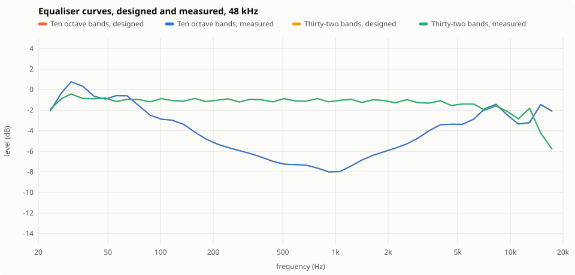
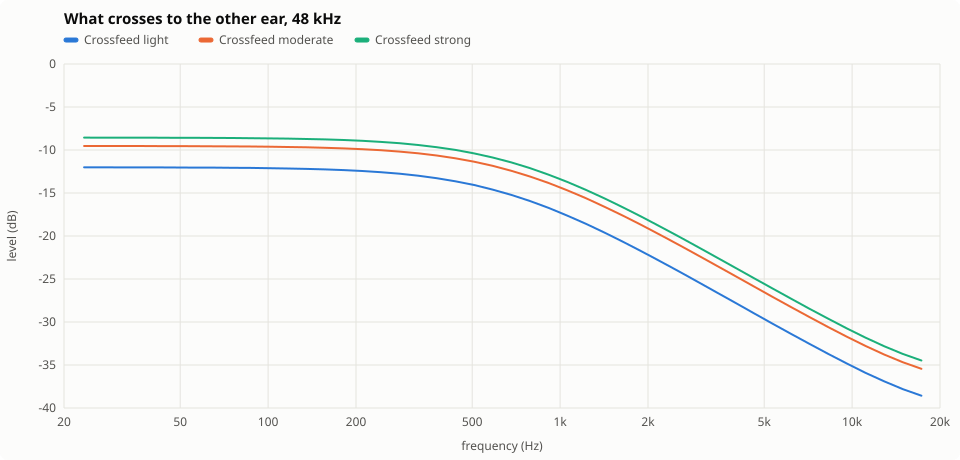

# The DSP pipeline measured

Every stage of `resonate-dsp` and eleven whole chains the engine plans, measured for quality by
`dsp-lab/` (`.claude/rules/build.md`, *The DSP lab*). Measured on 2026-11-22 (the generated
inputs on 2026-11-23) with rustc 1.100.0 and `target-cpu=native` on an AMD Ryzen 7 7700. The
resampler has a report of its own, `docs/RESAMPLING.md`, which is the lab's `resample` suite. The
`measure-dsp` skill reruns this one and holds it to `dsp-lab/baseline.tsv`.

## How it was measured

- **Every subject takes and gives f64 interleaved**, block by block as the engine feeds it (1 024
  frames). A stage is driven alone through its `Processor`. A chain is planned by `plan_output` for
  a source and a sink and built by `build_chain`, as the engine builds it. Its input is rounded to
  the source's words and its output to the sink's, so it is the chain that plays.
- **Tones sit on whole FFT bins**: 2^16 frames at 44.1 and 48 kHz, widened with the rate, taken
  after 0.75 s of settling, so a rectangular window leaks nothing. The tone is 997 Hz, which shares
  no factor with any rate. THD sums harmonics 2 to 10 under 20 kHz. THD+N counts every bin from
  20 Hz to 20 kHz but the fundamental. Noise in dBFS is against a full-scale sine.
- **A response is a multitone** of 48 log-spaced tones from 20 Hz to the lower of 20 kHz and
  0.45 of the rate, at random phases and −20 dBFS together.
- **Dynamic range** is the A-weighted noise beside a −60 dBFS tone against a full-scale sine.
  **SMPTE IMD** is 60 Hz and 7 kHz at 4:1, summing four sidebands either side of 7 kHz against it.
- **Latency is measured** by where an impulse lands and tabled beside what the subject claims.
  Every null is aligned by the measured figure, never the claimed one (*What the figures show*).
- Every figure below is reproducible bit for bit except a chain's, whose dither the engine seeds
  from the clock. A chain's THD and SMPTE IMD read a few bins at the dither floor and moved by up to
  6.8 and 4 dB over six runs; THD+N and dynamic range moved by under 0.2 dB.

## What the figures show

- **A chain that changes nothing is bit-perfect.** A CD on a CD sink nulls to −∞ against its input.
- **A CD resampled to a 24-bit sink keeps its own floor**: THD+N at −1 dBFS is −97.5 dB against the
  source's −97.4, and dynamic range is 100.4 dB against 100.5. **To a 16-bit sink it loses 16.6 dB**
  (−80.8 dB, 88.7 dB of dynamic range). That is the cost of quantising a second time with shaped
  dither, the same as 96/24 to 48/16 pays (−80.9 dB).
- **Low latency at 192 to 44.1 kHz is the one chain whose response droops audibly near 20 kHz**:
  its spread is 0.169 dB, against 0.068 dB for MP3 restoration and 0.008 dB or less for every
  other chain without an equaliser or a correction. Its THD+N (−127.0 dB) is far under its 24-bit sink's floor.
- **The equaliser is its design to the f64 floor**: no band, curve or rate measured passes
  3.1e-9 dB from `Profile::magnitude_db_on`. Its impulse matches the designed filters within
  −224 dB, and its THD+N at −20 dBFS stays under −228 dB. It claims and has no latency. On the plot
  each measured curve covers its designed one, which is why the designed lines cannot be seen.

  

- **The gain stage scales exactly**: every volume and ReplayGain nulls to −∞ against the input
  times the gain asked. A ReplayGain of +6 dB with a declared peak of 0.9 is held to +0.915 dB. With
  no peak, every sample is limited, so a +3 dBFS tone makes no over. With the protection off it
  makes 73 836.
- **The true-peak guard holds a +1 dBFS tone at exactly −0.10 dBTP** (1.10 dB of reduction, THD+N
  −105.9 to −109.9 dB while limiting) and leaves music under its ceiling bit for bit. **An
  inter-sample over comes out at the ceiling too**: a sine at a quarter of the rate, 45 degrees off
  its samples, with its samples at 0 dBFS, reads +3.1 dBTP where it starts and stops (+3.0 between)
  and leaves at −0.10 dBTP, within 6e-5 dB, at every rate measured. Each output is read whole, its
  start and its end included, by the `TruePeakMeter` of its rate.
- **A claimed latency is not where the samples land.** The guard claims 115 to 192 frames,
  restoration 768 and the resampler up to 17 064, but each holds its delay back and hands the
  samples on aligned (measured 0). The convolver hands them on one 1 024-frame partition late, as it
  claims. A chain's claim is the sum of its stages', so a room correction's 1 144 frames land at
  1 024.
- **Remix is its matrix exactly**: every cell within 1.9e-15 dB, nothing where the matrix asks
  nothing, and no output's gains summing past one. Mono to stereo puts −3 dB in each.
- **Crossfeed matches its presets**: the crossed path is 9.60, 6.09 and 4.59 dB under the direct one
  at 100 Hz (Meier's 9.5, Chu Moy's 6 and bs2b's 4.5 dB). It is 300 µs late to the nearest frame
  (291.7 to 302.1 µs), and the direct path is flat. A centred source falls by 4.1, 6.2 and 7.3 dB
  across the band, the treble price of never passing full scale (`eq.md`).

  

- **The convolver is direct convolution to −291 dB** or better, at the response's rate and redrawn
  at another, a two-by-two set included, and its flush carries the whole tail: the response's
  length less one, plus the partition it is late by, and the same again after a reset.
- **Dither does what it is for, and A-weighting hides what shaping buys.** Rounding to 16 bits
  alone puts a one-step tone's harmonics 12.2 dB under it and moves the noise by 1.6 dB with the
  level. Triangular dither takes both away (harmonics at the noise floor, modulation 0.02 dB) for
  4.8 dB more noise. Threshold shaping lowers the noise from 1 to 5 kHz by 20.7 dB but raises it
  overall by 13.4 dB, and the A-weighted figure reads 7.1 dB worse, because A-weighting barely
  falls by 15 to 20 kHz, where the shaping puts the noise. **Lipshitz shaping is not applied at
  96 kHz** (its rows equal flat's there), and threshold is. Every dithered setting falls silent
  within 50 ms of the music stopping.
- **Restoration's extension adds −14.0 dB (44.1 kHz) and −7.6 dB (48 kHz) above a 16 kHz wall**,
  against the band under it, where repair leaves −86 to −94 dB. Both leave what is under the wall
  within −112 to −123 dB of the input.

- **Generated inputs leave nothing behind** (the `stress` suite: every subject of ours above at
  its own rates, fed full-scale noise, a 0 dBFS square, Nyquist, a DC step, impulses, a sweep to
  0.99 of Nyquist, a tone under every word, a NaN and an infinity, and silence). No sample out is
  ever non-finite, none falls under f32's normal range through 12 s of silence after noise, and every
  stage is down to digital silence or under −468 dBFS (an equaliser's ring) 1.5 s after the music
  stops. A NaN and an infinity in a tone leave no trace a second on: the output nulls to −∞ against
  a clean run, but for the guard's gain (−157 dB) and restoration's extension (−92 to −104 dB), which
  learnt its spectrum over them. **Every stage hands on the same samples in blocks of 1, 37, 1 024
  and 4 096 frames and again after a flush and a reset** (−∞), every chain within its dither (−68 dB
  at 16 bits, −105 to −118 at 24). **Two stages failed this when it was first run**: the low-latency
  resampler, fed in blocks shorter than its filter, ended a track short by up to its own latency,
  since its flush padded only what the history had room for; and the convolver, reset after a
  flush, flushed nothing (losing the last partition of music and the response's tail), and one
  frame past its tail otherwise. **The resampler ends a track at the input's last instant**
  (`outputs_of`), so converting up hands one or two frames fewer than the ratio times the input
  (−1 at 44.1 to 48 kHz, −2 at 44.1 to 96), at every level alike.

## Every measurement

The tables the lab prints. Resonate's stages are in bold.

### Dither to 16 bits

#### Dither to 16 bits, 44.1 kHz

| Setting | Noise to Nyquist (dBFS) | Noise, A-weighted (dBFS) | Noise 1–5 kHz (dBFS) | Noise 15–20 kHz (dBFS) | Harmonics of a one-step tone (dB) | Noise modulation (dB) | Every sample on the grid | Frames to silence |
| --- | ---: | ---: | ---: | ---: | ---: | ---: | ---: | ---: |
| **Dither no dither, flat** | -98.1 | -100.6 | -105.4 | -104.4 | -12.2 | 1.61 | yes | 0 |
| **Dither rectangular, flat** | -95.1 | -97.6 | -102.5 | -101.5 | -42.0 | 0.89 | yes | 0 |
| **Dither rectangular, Lipshitz** | -82.9 | -93.3 | -119.9 | -85.8 | -44.5 | 0.09 | yes | 2205 |
| **Dither rectangular, threshold** | -80.6 | -88.9 | -121.8 | -82.7 | -58.1 | 0.01 | yes | 2205 |
| **Dither triangular, flat** | -93.3 | -95.8 | -100.6 | -99.9 | -37.7 | 0.04 | yes | 2201 |
| **Dither triangular, Lipshitz** | -81.1 | -91.6 | -118.1 | -84.1 | -43.4 | 0.05 | yes | 2205 |
| **Dither triangular, threshold** | -78.9 | -87.2 | -119.9 | -80.9 | -53.4 | 0.04 | yes | 2205 |

#### Dither to 16 bits, 48 kHz

| Setting | Noise to Nyquist (dBFS) | Noise, A-weighted (dBFS) | Noise 1–5 kHz (dBFS) | Noise 15–20 kHz (dBFS) | Harmonics of a one-step tone (dB) | Noise modulation (dB) | Every sample on the grid | Frames to silence |
| --- | ---: | ---: | ---: | ---: | ---: | ---: | ---: | ---: |
| **Dither no dither, flat** | -98.1 | -100.9 | -105.7 | -105.0 | -12.2 | 1.55 | yes | 0 |
| **Dither rectangular, flat** | -95.1 | -97.9 | -102.8 | -101.9 | -39.4 | 0.89 | yes | 0 |
| **Dither rectangular, Lipshitz** | -83.0 | -96.4 | -120.4 | -89.0 | -49.3 | 0.15 | yes | 2400 |
| **Dither rectangular, threshold** | -81.6 | -90.8 | -123.2 | -84.5 | -57.2 | 0.03 | yes | 1701 |
| **Dither triangular, flat** | -93.3 | -96.2 | -101.1 | -100.1 | -36.7 | 0.02 | yes | 2386 |
| **Dither triangular, Lipshitz** | -81.2 | -94.6 | -118.7 | -87.2 | -46.3 | 0.04 | yes | 2400 |
| **Dither triangular, threshold** | -79.9 | -89.1 | -121.8 | -82.8 | -52.8 | 0.09 | yes | 2399 |

#### Dither to 16 bits, 96 kHz

| Setting | Noise to Nyquist (dBFS) | Noise, A-weighted (dBFS) | Noise 1–5 kHz (dBFS) | Noise 15–20 kHz (dBFS) | Harmonics of a one-step tone (dB) | Noise modulation (dB) | Every sample on the grid | Frames to silence |
| --- | ---: | ---: | ---: | ---: | ---: | ---: | ---: | ---: |
| **Dither no dither, flat** | -98.1 | -104.0 | -108.8 | -108.0 | -12.2 | 1.53 | yes | 0 |
| **Dither rectangular, flat** | -95.1 | -100.9 | -105.8 | -104.9 | -45.2 | 0.89 | yes | 0 |
| **Dither rectangular, Lipshitz** | -95.1 | -100.9 | -105.8 | -104.9 | -45.2 | 0.89 | yes | 0 |
| **Dither rectangular, threshold** | -87.8 | -103.9 | -134.6 | -96.8 | -65.2 | 0.02 | yes | 4800 |
| **Dither triangular, flat** | -93.3 | -99.1 | -104.0 | -103.0 | -41.0 | 0.03 | yes | 4799 |
| **Dither triangular, Lipshitz** | -93.3 | -99.1 | -104.0 | -103.0 | -41.0 | 0.03 | yes | 4799 |
| **Dither triangular, threshold** | -86.1 | -102.1 | -133.6 | -94.9 | -66.4 | 0.02 | yes | 4800 |

### Dither to 24 bits

#### Dither to 24 bits, 44.1 kHz

| Setting | Noise to Nyquist (dBFS) | Noise, A-weighted (dBFS) | Noise 1–5 kHz (dBFS) | Noise 15–20 kHz (dBFS) | Harmonics of a one-step tone (dB) | Noise modulation (dB) | Every sample on the grid | Frames to silence |
| --- | ---: | ---: | ---: | ---: | ---: | ---: | ---: | ---: |
| **Dither no dither, flat** | -146.2 | -148.6 | -153.5 | -152.8 | -12.2 | 1.60 | yes | 0 |
| **Dither rectangular, flat** | -143.2 | -145.7 | -150.6 | -149.6 | -42.0 | 0.90 | yes | 0 |
| **Dither rectangular, Lipshitz** | -131.0 | -141.5 | -168.2 | -134.0 | -44.5 | 0.12 | yes | 2205 |
| **Dither rectangular, threshold** | -128.8 | -137.1 | -170.0 | -130.8 | -58.1 | 0.02 | yes | 27 |
| **Dither triangular, flat** | -141.4 | -143.9 | -148.9 | -147.9 | -37.7 | 0.04 | yes | 2201 |
| **Dither triangular, Lipshitz** | -129.4 | -139.8 | -166.3 | -132.3 | -43.4 | 0.01 | yes | 2205 |
| **Dither triangular, threshold** | -127.1 | -135.4 | -168.1 | -129.1 | -53.4 | 0.06 | yes | 2204 |

#### Dither to 24 bits, 48 kHz

| Setting | Noise to Nyquist (dBFS) | Noise, A-weighted (dBFS) | Noise 1–5 kHz (dBFS) | Noise 15–20 kHz (dBFS) | Harmonics of a one-step tone (dB) | Noise modulation (dB) | Every sample on the grid | Frames to silence |
| --- | ---: | ---: | ---: | ---: | ---: | ---: | ---: | ---: |
| **Dither no dither, flat** | -146.2 | -149.0 | -154.0 | -152.8 | -12.2 | 1.57 | yes | 0 |
| **Dither rectangular, flat** | -143.2 | -146.0 | -150.9 | -149.9 | -39.4 | 0.91 | yes | 0 |
| **Dither rectangular, Lipshitz** | -131.1 | -144.6 | -168.6 | -137.1 | -49.3 | 0.12 | yes | 2400 |
| **Dither rectangular, threshold** | -129.7 | -138.9 | -171.8 | -132.7 | -57.2 | 0.04 | yes | 2399 |
| **Dither triangular, flat** | -141.5 | -144.3 | -149.2 | -148.3 | -36.7 | 0.04 | yes | 2386 |
| **Dither triangular, Lipshitz** | -129.4 | -142.9 | -166.8 | -135.5 | -46.3 | 0.04 | yes | 2400 |
| **Dither triangular, threshold** | -128.0 | -137.2 | -170.0 | -130.9 | -52.8 | 0.03 | yes | 2400 |

#### Dither to 24 bits, 96 kHz

| Setting | Noise to Nyquist (dBFS) | Noise, A-weighted (dBFS) | Noise 1–5 kHz (dBFS) | Noise 15–20 kHz (dBFS) | Harmonics of a one-step tone (dB) | Noise modulation (dB) | Every sample on the grid | Frames to silence |
| --- | ---: | ---: | ---: | ---: | ---: | ---: | ---: | ---: |
| **Dither no dither, flat** | -146.2 | -152.1 | -157.1 | -155.9 | -12.2 | 1.56 | yes | 0 |
| **Dither rectangular, flat** | -143.2 | -149.0 | -153.9 | -153.1 | -45.2 | 0.88 | yes | 0 |
| **Dither rectangular, Lipshitz** | -143.2 | -149.0 | -153.9 | -153.1 | -45.2 | 0.88 | yes | 0 |
| **Dither rectangular, threshold** | -136.0 | -152.0 | -183.6 | -144.9 | -65.2 | 0.00 | yes | 4800 |
| **Dither triangular, flat** | -141.5 | -147.3 | -152.2 | -151.2 | -41.0 | 0.01 | yes | 4799 |
| **Dither triangular, Lipshitz** | -141.5 | -147.3 | -152.2 | -151.2 | -41.0 | 0.01 | yes | 4799 |
| **Dither triangular, threshold** | -134.2 | -150.2 | -181.6 | -143.0 | -66.4 | 0.03 | yes | 4800 |

### Equaliser

#### Equaliser, 44.1 kHz

| Setting | Worst off the design 20 Hz–20 kHz (dB) | Mean off the design (dB) | THD+N at −20 dBFS (dB) | Impulse against the design (dB) | Claimed latency (frames) |
| --- | ---: | ---: | ---: | ---: | ---: |
| **Peaking, 1 kHz, +6 dB, Q 1** | 8.9e-14 | 1.2e-14 | -298.7 | -297.2 | 0 |
| **Peaking, 60 Hz, −9 dB, Q 8** | 3.5e-11 | 2.0e-12 | -256.4 | -267.4 | 0 |
| **Low shelf, 100 Hz, +6 dB** | 3.2e-12 | 5.6e-13 | -269.2 | -269.4 | 0 |
| **High shelf, 8 kHz, −6 dB** | 4.3e-15 | 1.3e-15 | -308.9 | -341.3 | 0 |
| **Low pass, 10 kHz** | 1.4e-14 | 1.5e-15 | -308.9 | -321.6 | 0 |
| **High pass, 40 Hz** | 1.5e-10 | 1.0e-11 | -260.9 | -255.4 | 0 |
| **Notch, 3 kHz, Q 4** | 8.2e-14 | 4.4e-15 | -304.3 | -312.5 | 0 |
| **Band pass, 1 kHz, Q 1** | 1.1e-13 | 2.3e-14 | -300.7 | -295.6 | 0 |
| **All pass, 2 kHz, Q 0.7** | 1.3e-14 | 4.3e-15 | -305.7 | -302.0 | 0 |
| **Ten octave bands** | 4.6e-11 | 3.8e-12 | -246.6 | -250.7 | 0 |
| **Thirty-two bands** | 3.9e-11 | 3.4e-12 | -252.9 | -251.5 | 0 |

#### Equaliser, 48 kHz

| Setting | Worst off the design 20 Hz–20 kHz (dB) | Mean off the design (dB) | THD+N at −20 dBFS (dB) | Impulse against the design (dB) | Claimed latency (frames) |
| --- | ---: | ---: | ---: | ---: | ---: |
| **Peaking, 1 kHz, +6 dB, Q 1** | 5.5e-14 | 1.2e-14 | -297.4 | -304.5 | 0 |
| **Peaking, 60 Hz, −9 dB, Q 8** | 3.2e-11 | 2.4e-12 | -254.6 | -253.8 | 0 |
| **Low shelf, 100 Hz, +6 dB** | 5.4e-12 | 8.0e-13 | -267.6 | -277.9 | 0 |
| **High shelf, 8 kHz, −6 dB** | 5.3e-15 | 9.5e-16 | -309.1 | -357.5 | 0 |
| **Low pass, 10 kHz** | 1.1e-14 | 1.5e-15 | -309.0 | -340.9 | 0 |
| **High pass, 40 Hz** | 1.2e-10 | 7.1e-12 | -259.1 | -261.8 | 0 |
| **Notch, 3 kHz, Q 4** | 1.1e-13 | 4.8e-15 | -303.5 | -310.3 | 0 |
| **Band pass, 1 kHz, Q 1** | 1.1e-13 | 2.5e-14 | -299.6 | -290.0 | 0 |
| **All pass, 2 kHz, Q 0.7** | 1.2e-14 | 4.1e-15 | -305.0 | -307.3 | 0 |
| **Ten octave bands** | 5.1e-11 | 3.6e-12 | -246.1 | -255.9 | 0 |
| **Thirty-two bands** | 5.5e-11 | 5.2e-12 | -251.3 | -246.3 | 0 |

#### Equaliser, 96 kHz

| Setting | Worst off the design 20 Hz–20 kHz (dB) | Mean off the design (dB) | THD+N at −20 dBFS (dB) | Impulse against the design (dB) | Claimed latency (frames) |
| --- | ---: | ---: | ---: | ---: | ---: |
| **Peaking, 1 kHz, +6 dB, Q 1** | 2.2e-13 | 6.8e-14 | -288.7 | -286.5 | 0 |
| **Peaking, 60 Hz, −9 dB, Q 8** | 1.2e-10 | 8.4e-12 | -245.5 | -258.5 | 0 |
| **Low shelf, 100 Hz, +6 dB** | 3.6e-11 | 3.6e-12 | -258.6 | -263.0 | 0 |
| **High shelf, 8 kHz, −6 dB** | 9.8e-15 | 4.0e-15 | -310.0 | -320.7 | 0 |
| **Low pass, 10 kHz** | 7.7e-15 | 2.0e-15 | -310.7 | -311.5 | 0 |
| **High pass, 40 Hz** | 5.4e-10 | 3.3e-11 | -250.8 | -253.3 | 0 |
| **Notch, 3 kHz, Q 4** | 3.9e-14 | 1.2e-14 | -296.2 | -307.2 | 0 |
| **Band pass, 1 kHz, Q 1** | 3.7e-13 | 7.8e-14 | -291.2 | -287.5 | 0 |
| **All pass, 2 kHz, Q 0.7** | 3.5e-14 | 1.3e-14 | -298.2 | -303.6 | 0 |
| **Ten octave bands** | 1.5e-10 | 1.1e-11 | -239.0 | -235.9 | 0 |
| **Thirty-two bands** | 2.6e-10 | 1.9e-11 | -242.1 | -236.0 | 0 |

#### Equaliser, 192 kHz

| Setting | Worst off the design 20 Hz–20 kHz (dB) | Mean off the design (dB) | THD+N at −20 dBFS (dB) | Impulse against the design (dB) | Claimed latency (frames) |
| --- | ---: | ---: | ---: | ---: | ---: |
| **Peaking, 1 kHz, +6 dB, Q 1** | 1.1e-12 | 2.3e-13 | -279.8 | -284.6 | 0 |
| **Peaking, 60 Hz, −9 dB, Q 8** | 1.2e-9 | 7.1e-11 | -236.6 | -255.5 | 0 |
| **Low shelf, 100 Hz, +6 dB** | 1.0e-10 | 1.6e-11 | -248.9 | -251.1 | 0 |
| **High shelf, 8 kHz, −6 dB** | 3.2e-14 | 1.1e-14 | -306.6 | -307.5 | 0 |
| **Low pass, 10 kHz** | 2.1e-14 | 6.0e-15 | -311.1 | -308.0 | 0 |
| **High pass, 40 Hz** | 3.1e-9 | 1.6e-10 | -241.1 | -237.4 | 0 |
| **Notch, 3 kHz, Q 4** | 6.9e-12 | 1.8e-13 | -287.6 | -294.0 | 0 |
| **Band pass, 1 kHz, Q 1** | 1.4e-12 | 3.1e-13 | -282.2 | -281.2 | 0 |
| **All pass, 2 kHz, Q 0.7** | 1.1e-13 | 3.0e-14 | -289.7 | -297.0 | 0 |
| **Ten octave bands** | 1.4e-9 | 6.7e-11 | -228.8 | -229.9 | 0 |
| **Thirty-two bands** | 5.6e-10 | 5.9e-11 | -233.5 | -224.5 | 0 |

### Gain

#### Gain, 48 kHz

| Setting | Gain asked (dB) | Gain heard at 1 kHz (dB) | Off the gain asked (dB) | Null against the input scaled (dB) | Samples past full scale, +3 dBFS in |
| --- | ---: | ---: | ---: | ---: | ---: |
| **Volume +0 dB** | 0.000 | 0.000 | 0.0e0 | −∞ | 47924 |
| **Volume -0.1 dB** | -0.100 | -0.100 | 1.9e-15 | −∞ | 47212 |
| **Volume -6 dB** | -6.000 | -6.000 | 2.7e-15 | −∞ | 0 |
| **Volume -20 dB** | -20.000 | -20.000 | 0.0e0 | −∞ | 0 |
| **Volume -60 dB** | -60.000 | -60.000 | 0.0e0 | −∞ | 0 |
| **ReplayGain −6 dB** | -6.000 | -6.000 | 2.7e-15 | −∞ | 0 |
| **ReplayGain +6 dB, peak 0.9** | 0.915 | 0.915 | 0.0e0 | −∞ | 53780 |
| **ReplayGain +6 dB, no peak** | 6.000 | 6.000 | 0.0e0 | −∞ | 0 |
| **ReplayGain +6 dB, no peak, unprotected** | 6.000 | 6.000 | 0.0e0 | −∞ | 73836 |

### True-peak guard

#### True-peak guard, 44.1 kHz

| Setting | Inter-sample over out (dBTP) | +1 dBFS tone out (dBTP) | Reduction of the hot tone (dB) | THD+N while limiting (dB) | Null under the ceiling (dB) | Claimed latency (frames) | Measured latency (frames) |
| --- | ---: | ---: | ---: | ---: | ---: | ---: | ---: |
| **True-peak guard** | -0.10 | -0.10 | -1.10 | -105.9 | −∞ | 115 | 0 |
| **No guard** | 3.10 | 1.00 | 0.00 | -308.2 | −∞ | 0 | 0 |

#### True-peak guard, 48 kHz

| Setting | Inter-sample over out (dBTP) | +1 dBFS tone out (dBTP) | Reduction of the hot tone (dB) | THD+N while limiting (dB) | Null under the ceiling (dB) | Claimed latency (frames) | Measured latency (frames) |
| --- | ---: | ---: | ---: | ---: | ---: | ---: | ---: |
| **True-peak guard** | -0.10 | -0.10 | -1.10 | -109.9 | −∞ | 120 | 0 |
| **No guard** | 3.10 | 1.00 | 0.00 | -308.8 | −∞ | 0 | 0 |

#### True-peak guard, 96 kHz

| Setting | Inter-sample over out (dBTP) | +1 dBFS tone out (dBTP) | Reduction of the hot tone (dB) | THD+N while limiting (dB) | Null under the ceiling (dB) | Claimed latency (frames) | Measured latency (frames) |
| --- | ---: | ---: | ---: | ---: | ---: | ---: | ---: |
| **True-peak guard** | -0.10 | -0.10 | -1.10 | -108.6 | −∞ | 192 | 0 |
| **No guard** | 3.10 | 1.00 | 0.00 | -310.4 | −∞ | 0 | 0 |

### Remix

#### Remix, 48 kHz

| Setting | Worst cell off the matrix (dB) | Loudest where the matrix asks nothing (dB) | Loudest output's summed gains | Worst THD+N (dB) |
| --- | ---: | ---: | ---: | ---: |
| **Remix mono to stereo** | 1.9e-15 | −∞ | 0.7071 | -308.8 |
| **Remix stereo to mono** | 0.0e0 | −∞ | 1.0000 | -308.1 |
| **Remix quad to stereo** | 1.9e-15 | −∞ | 1.0000 | -308.2 |
| **Remix 5.0 to stereo** | 0.0e0 | −∞ | 1.0000 | -308.4 |
| **Remix 5.1 to stereo** | 0.0e0 | −∞ | 1.0000 | -308.4 |
| **Remix 6.1 to stereo** | 1.9e-15 | −∞ | 1.0000 | -308.6 |
| **Remix 7.1 to stereo** | 1.9e-15 | −∞ | 1.0000 | -308.6 |
| **Remix 7.1 to 5.1** | 1.9e-15 | −∞ | 1.0000 | -308.1 |

### Crossfeed

#### Crossfeed, 44.1 kHz

| Setting | Direct over crossed at 100 Hz (dB) | Direct over crossed at 10 kHz (dB) | Direct path's spread 20 Hz–20 kHz (dB) | A centred source's spread (dB) | Crossed path's delay (µs) |
| --- | ---: | ---: | ---: | ---: | ---: |
| **Crossfeed light** | 9.60 | 32.16 | 0.00 | 4.12 | 294.8 |
| **Crossfeed moderate** | 6.09 | 28.02 | 0.00 | 6.17 | 294.8 |
| **Crossfeed strong** | 4.59 | 26.52 | 0.00 | 7.29 | 294.8 |

#### Crossfeed, 48 kHz

| Setting | Direct over crossed at 100 Hz (dB) | Direct over crossed at 10 kHz (dB) | Direct path's spread 20 Hz–20 kHz (dB) | A centred source's spread (dB) | Crossed path's delay (µs) |
| --- | ---: | ---: | ---: | ---: | ---: |
| **Crossfeed light** | 9.60 | 32.32 | 0.00 | 4.11 | 291.7 |
| **Crossfeed moderate** | 6.09 | 28.18 | 0.00 | 6.16 | 291.7 |
| **Crossfeed strong** | 4.59 | 26.68 | 0.00 | 7.27 | 291.7 |

#### Crossfeed, 96 kHz

| Setting | Direct over crossed at 100 Hz (dB) | Direct over crossed at 10 kHz (dB) | Direct path's spread 20 Hz–20 kHz (dB) | A centred source's spread (dB) | Crossed path's delay (µs) |
| --- | ---: | ---: | ---: | ---: | ---: |
| **Crossfeed light** | 9.60 | 32.76 | 0.00 | 4.16 | 302.1 |
| **Crossfeed moderate** | 6.09 | 28.62 | 0.00 | 6.26 | 302.1 |
| **Crossfeed strong** | 4.59 | 27.12 | 0.00 | 7.41 | 302.1 |

#### Crossfeed, 192 kHz

| Setting | Direct over crossed at 100 Hz (dB) | Direct over crossed at 10 kHz (dB) | Direct path's spread 20 Hz–20 kHz (dB) | A centred source's spread (dB) | Crossed path's delay (µs) |
| --- | ---: | ---: | ---: | ---: | ---: |
| **Crossfeed light** | 9.60 | 32.86 | 0.00 | 4.16 | 302.1 |
| **Crossfeed moderate** | 6.09 | 28.72 | 0.00 | 6.27 | 302.1 |
| **Crossfeed strong** | 4.59 | 27.22 | 0.00 | 7.43 | 302.1 |

### Convolver

#### Convolver, 48 kHz

| Setting | Null against direct convolution (dB) | Claimed latency (frames) | Measured latency (frames) | Tail frames never flushed |
| --- | ---: | ---: | ---: | ---: |
| **Unit impulse** | -308.8 | 1024 | 1024 | 0 |
| **Decaying noise, 1 s** | -291.4 | 1024 | 1024 | 0 |
| **Stereo pair, 0.1 s** | -293.7 | 1024 | 1024 | 0 |
| **Two-by-two, 0.25 s** | -291.8 | 1024 | 1024 | 0 |

#### Convolver, 44.1 kHz

| Setting | Null against direct convolution (dB) | Claimed latency (frames) | Measured latency (frames) | Tail frames never flushed |
| --- | ---: | ---: | ---: | ---: |
| **Unit impulse** | -308.5 | 1024 | 1024 | 0 |
| **Decaying noise, 1 s** | -291.7 | 1024 | 1024 | 0 |
| **Stereo pair, 0.1 s** | -294.0 | 1024 | 1024 | 0 |
| **Two-by-two, 0.25 s** | -292.3 | 1024 | 1024 | 0 |

### Lossy restoration

#### Lossy restoration, 44.1 kHz

| Setting | Null below the wall (dB) | Above the wall against under it (dB) | Claimed latency (frames) | Measured latency (frames) |
| --- | ---: | ---: | ---: | ---: |
| **repair MP3** | -116.3 | -86.3 | 768 | 0 |
| **repair AAC** | -123.0 | -92.8 | 768 | 0 |
| **repair Vorbis** | -119.2 | -89.0 | 768 | 0 |
| **extend MP3** | -114.1 | -14.0 | 768 | 0 |
| **extend AAC** | -117.7 | -13.8 | 768 | 0 |
| **extend Vorbis** | -115.9 | -13.9 | 768 | 0 |

#### Lossy restoration, 48 kHz

| Setting | Null below the wall (dB) | Above the wall against under it (dB) | Claimed latency (frames) | Measured latency (frames) |
| --- | ---: | ---: | ---: | ---: |
| **repair MP3** | -113.7 | -87.4 | 768 | 0 |
| **repair AAC** | -120.3 | -94.0 | 768 | 0 |
| **repair Vorbis** | -116.4 | -90.1 | 768 | 0 |
| **extend MP3** | -111.9 | -7.7 | 768 | 0 |
| **extend AAC** | -115.9 | -7.5 | 768 | 0 |
| **extend Vorbis** | -113.8 | -7.6 | 768 | 0 |

### Whole chains, as the engine plans them

#### What each chain is

| Chain | From | To | Mode | Stages |
| --- | ---: | ---: | ---: | ---: |
| CD on a CD sink | 44.1 Stereo S16 | 44.1 Stereo S16 | BitPerfect | none |
| CD on 48/24 | 44.1 Stereo S16 | 48 Stereo S24 | Converted | resample High Linear, gain ×1.000, guard, dither Triangular Threshold to 24-bit |
| CD on 48/16 | 44.1 Stereo S16 | 48 Stereo S16 | Converted | resample High Linear, gain ×1.000, guard, dither Triangular Threshold to 16-bit |
| 96/24 on 48/16, very high | 96 Stereo S24 | 48 Stereo S16 | Converted | resample VeryHigh Linear, gain ×1.000, guard, dither Triangular Threshold to 16-bit |
| 192/24 on 44.1/24, low latency | 192 Stereo S24 | 44.1 Stereo S24 | Converted | resample LowLatency Linear, gain ×1.000, guard, dither Triangular Threshold to 24-bit |
| CD on 96 kHz float, minimum phase | 44.1 Stereo S16 | 96 Stereo F32 | Converted | resample High Minimum, gain ×1.000, guard |
| 5.1 at 48/24 on a stereo sink | 48 Surround51 S24 | 48 Stereo S24 | Converted | remix Surround51 to Stereo, gain ×1.000, guard, dither Triangular Threshold to 24-bit |
| Ten bands and moderate crossfeed, 48/24 | 48 Stereo S24 | 48 Stereo S24 | Converted | crossfeed moderate, equalise, gain ×1.000, guard, dither Triangular Threshold to 24-bit |
| Half volume, ReplayGain +6 dB, guarded, 44.1/16 on 44.1/24 | 44.1 Stereo S16 | 44.1 Stereo S24 | Converted | gain ×0.998, guard, dither Triangular Threshold to 24-bit |
| MP3 extended past its wall, 44.1 on 48/24 | 44.1 Stereo F32 | 48 Stereo S24 | Converted | restore extend, resample High Linear, gain ×1.000, guard, dither Triangular Threshold to 24-bit |
| Room correction of 1 s, 48/24 | 48 Stereo S24 | 48 Stereo S24 | Converted | convolve, gain ×1.000, guard, dither Triangular Threshold to 24-bit |

#### What each chain does

| Chain | THD at −1 dBFS (dB) | THD+N at −1 dBFS (dB) | THD+N at −20 dBFS (dB) | Dynamic range, A-weighted (dB) | SMPTE IMD (dB) | Response spread 20 Hz–20 kHz (dB) | Gain the plan asks (dB) | Gain heard at 1 kHz (dB) | Claimed latency (frames) | Measured latency (frames) | Null against the input (dB) |
| --- | ---: | ---: | ---: | ---: | ---: | ---: | ---: | ---: | ---: | ---: | ---: |
| CD on a CD sink | -129.2 | -97.4 | -78.5 | 100.5 | -124.8 | 0.001 | 0.00 | 0.00 | 0.0 | 0.0 | −∞ |
| CD on 48/24 | -133.7 | -97.5 | -78.5 | 100.4 | -119.7 | 0.001 | 0.00 | 0.00 | 1799.5 | 0.0 | — |
| CD on 48/16 | -132.4 | -80.8 | -61.9 | 88.7 | -119.4 | 0.008 | 0.00 | 0.00 | 1799.5 | 0.0 | — |
| 96/24 on 48/16, very high | -139.4 | -80.9 | -62.0 | 89.1 | -130.6 | 0.004 | 0.00 | -0.00 | 17064.0 | 0.0 | — |
| 192/24 on 44.1/24, low latency | -188.5 | -127.0 | -108.3 | 135.3 | -170.9 | 0.169 | 0.00 | 0.00 | 162.1 | 0.0 | — |
| CD on 96 kHz float, minimum phase | -133.7 | -97.5 | -78.5 | 100.4 | -119.7 | 0.001 | 0.00 | 0.00 | 5383.8 | 0.0 | — |
| 5.1 at 48/24 on a stereo sink | -179.3 | -121.5 | -102.4 | 137.1 | -162.1 | 0.000 | -7.66 | -7.66 | 120.0 | 0.0 | — |
| Ten bands and moderate crossfeed, 48/24 | -174.1 | -115.0 | -96.0 | 137.1 | -162.6 | 14.884 | 0.00 | -14.13 | 120.0 | 0.0 | -1.9 |
| Half volume, ReplayGain +6 dB, guarded, 44.1/16 on 44.1/24 | -129.2 | -97.4 | -78.5 | 100.5 | -124.8 | 0.001 | -0.02 | -0.02 | 115.0 | 0.0 | -52.5 |
| MP3 extended past its wall, 44.1 on 48/24 | -186.1 | -125.6 | -110.1 | 137.2 | -173.3 | 0.068 | 0.00 | 0.00 | 2635.4 | 0.0 | — |
| Room correction of 1 s, 48/24 | -115.4 | -52.3 | -52.3 | 125.7 | -89.0 | 21.950 | 0.00 | -13.78 | 1144.0 | 1024.0 | 1.2 |

### Generated inputs, every stage and chain

#### Generated inputs, every stage and chain, 44.1 kHz

| Setting | Non-finite samples out | Non-finite a second after a NaN and an infinity in | Null against a clean run a second on (dB) | Loudest sample out (dBFS) | Silence in, peak out after 0.1 s (dBFS) | Left after 1.5 s of silence (dBFS) | Under f32's normal range in 12 s of silence | Worst null across block sizes (dB) | Null of a run after a flush and reset (dB) | Frames out beyond the input's |
| --- | ---: | ---: | ---: | ---: | ---: | ---: | ---: | ---: | ---: | ---: |
| **dither-16: Dither no dither, flat** | 0 | 0 | −∞ | 0.00 | -600.0 | -600.0 | 0 | −∞ | −∞ | 0 |
| **dither-16: Dither rectangular, flat** | 0 | 0 | −∞ | 0.00 | -600.0 | -600.0 | 0 | −∞ | -90.4 | 0 |
| **dither-16: Dither rectangular, Lipshitz** | 0 | 0 | −∞ | 0.00 | -600.0 | -600.0 | 0 | −∞ | -77.4 | 0 |
| **dither-16: Dither rectangular, threshold** | 0 | 0 | −∞ | 0.00 | -600.0 | -600.0 | 0 | −∞ | -75.5 | 0 |
| **dither-16: Dither triangular, flat** | 0 | 0 | −∞ | 0.00 | -600.0 | -600.0 | 0 | −∞ | -87.7 | 0 |
| **dither-16: Dither triangular, Lipshitz** | 0 | 0 | −∞ | 0.00 | -600.0 | -600.0 | 0 | −∞ | -75.5 | 0 |
| **dither-16: Dither triangular, threshold** | 0 | 0 | −∞ | 0.00 | -600.0 | -600.0 | 0 | −∞ | -73.3 | 0 |
| **dither-24: Dither no dither, flat** | 0 | 0 | −∞ | 0.00 | -600.0 | -600.0 | 0 | −∞ | −∞ | 0 |
| **dither-24: Dither rectangular, flat** | 0 | 0 | −∞ | 0.00 | -600.0 | -600.0 | 0 | −∞ | -138.5 | 0 |
| **dither-24: Dither rectangular, Lipshitz** | 0 | 0 | −∞ | 0.00 | -600.0 | -600.0 | 0 | −∞ | -125.5 | 0 |
| **dither-24: Dither rectangular, threshold** | 0 | 0 | −∞ | 0.00 | -600.0 | -600.0 | 0 | −∞ | -123.9 | 0 |
| **dither-24: Dither triangular, flat** | 0 | 0 | −∞ | 0.00 | -600.0 | -600.0 | 0 | −∞ | -135.9 | 0 |
| **dither-24: Dither triangular, Lipshitz** | 0 | 0 | −∞ | 0.00 | -600.0 | -600.0 | 0 | −∞ | -123.7 | 0 |
| **dither-24: Dither triangular, threshold** | 0 | 0 | −∞ | 0.00 | -600.0 | -600.0 | 0 | −∞ | -121.4 | 0 |
| **eq: Peaking, 1 kHz, +6 dB, Q 1** | 0 | 0 | −∞ | 7.13 | -600.0 | -600.0 | 0 | −∞ | −∞ | 0 |
| **eq: Peaking, 60 Hz, −9 dB, Q 8** | 0 | 0 | −∞ | 1.72 | -600.0 | -468.4 | 0 | −∞ | −∞ | 0 |
| **eq: Low shelf, 100 Hz, +6 dB** | 0 | 0 | −∞ | 5.98 | -600.0 | -600.0 | 0 | −∞ | −∞ | 0 |
| **eq: High shelf, 8 kHz, −6 dB** | 0 | 0 | −∞ | 0.65 | -600.0 | -600.0 | 0 | −∞ | −∞ | 0 |
| **eq: Low pass, 10 kHz** | 0 | 0 | −∞ | 1.55 | -600.0 | -600.0 | 0 | −∞ | −∞ | 0 |
| **eq: High pass, 40 Hz** | 0 | 0 | −∞ | 1.38 | -600.0 | -569.0 | 0 | −∞ | −∞ | 0 |
| **eq: Notch, 3 kHz, Q 4** | 0 | 0 | −∞ | 2.94 | -600.0 | -600.0 | 0 | −∞ | −∞ | 0 |
| **eq: Band pass, 1 kHz, Q 1** | 0 | 0 | −∞ | 2.12 | -600.0 | -600.0 | 0 | −∞ | −∞ | 0 |
| **eq: All pass, 2 kHz, Q 0.7** | 0 | 0 | −∞ | 5.53 | -600.0 | -600.0 | 0 | −∞ | −∞ | 0 |
| **eq: Ten octave bands** | 0 | 0 | −∞ | 0.76 | -600.0 | -555.2 | 0 | −∞ | −∞ | 0 |
| **eq: Thirty-two bands** | 0 | 0 | −∞ | -0.06 | -600.0 | -552.9 | 0 | −∞ | −∞ | 0 |
| **peak: True-peak guard** | 0 | 0 | -156.7 | -0.10 | -600.0 | -600.0 | 0 | −∞ | −∞ | 0 |
| **peak: No guard** | 0 | 0 | −∞ | 0.00 | -600.0 | -600.0 | 0 | −∞ | −∞ | 0 |
| **crossfeed: Crossfeed light** | 0 | 0 | −∞ | -0.00 | -600.0 | -600.0 | 0 | −∞ | −∞ | 0 |
| **crossfeed: Crossfeed moderate** | 0 | 0 | −∞ | -0.00 | -600.0 | -600.0 | 0 | −∞ | −∞ | 0 |
| **crossfeed: Crossfeed strong** | 0 | 0 | −∞ | -0.00 | -600.0 | -600.0 | 0 | −∞ | −∞ | 0 |
| **convolve: Unit impulse** | 0 | 0 | −∞ | -0.08 | -600.0 | -600.0 | 0 | −∞ | −∞ | 1024 |
| **convolve: Decaying noise, 1 s** | 0 | 0 | −∞ | 35.70 | -600.0 | -600.0 | 0 | −∞ | −∞ | 45123 |
| **convolve: Stereo pair, 0.1 s** | 0 | 0 | −∞ | 32.38 | -600.0 | -600.0 | 0 | −∞ | −∞ | 5435 |
| **convolve: Two-by-two, 0.25 s** | 0 | 0 | −∞ | 37.48 | -600.0 | -600.0 | 0 | −∞ | −∞ | 12060 |
| **restore: repair MP3** | 0 | 0 | −∞ | 1.15 | -600.0 | -600.0 | 0 | −∞ | −∞ | 0 |
| **restore: repair AAC** | 0 | 0 | −∞ | 0.39 | -600.0 | -600.0 | 0 | −∞ | −∞ | 0 |
| **restore: repair Vorbis** | 0 | 0 | −∞ | 0.72 | -600.0 | -600.0 | 0 | −∞ | −∞ | 0 |
| **restore: extend MP3** | 0 | 0 | -103.7 | 1.67 | -600.0 | -600.0 | 0 | −∞ | −∞ | 0 |
| **restore: extend AAC** | 0 | 0 | -103.8 | 1.29 | -600.0 | -600.0 | 0 | −∞ | −∞ | 0 |
| **restore: extend Vorbis** | 0 | 0 | -103.8 | 1.29 | -600.0 | -600.0 | 0 | −∞ | −∞ | 0 |
| **chain: CD on a CD sink** | 0 | 0 | −∞ | 0.00 | -600.0 | -600.0 | 0 | −∞ | −∞ | 0 |
| **chain: Half volume, ReplayGain +6 dB, guarded, 44.1/16 on 44.1/24** | 0 | 0 | -118.0 | -0.10 | -600.0 | -600.0 | 0 | -117.4 | -117.4 | 0 |

#### Generated inputs, every stage and chain, 48 kHz

| Setting | Non-finite samples out | Non-finite a second after a NaN and an infinity in | Null against a clean run a second on (dB) | Loudest sample out (dBFS) | Silence in, peak out after 0.1 s (dBFS) | Left after 1.5 s of silence (dBFS) | Under f32's normal range in 12 s of silence | Worst null across block sizes (dB) | Null of a run after a flush and reset (dB) | Frames out beyond the input's |
| --- | ---: | ---: | ---: | ---: | ---: | ---: | ---: | ---: | ---: | ---: |
| **dither-16: Dither no dither, flat** | 0 | 0 | −∞ | 0.00 | -600.0 | -600.0 | 0 | −∞ | −∞ | 0 |
| **dither-16: Dither rectangular, flat** | 0 | 0 | −∞ | 0.00 | -600.0 | -600.0 | 0 | −∞ | -90.3 | 0 |
| **dither-16: Dither rectangular, Lipshitz** | 0 | 0 | −∞ | 0.00 | -600.0 | -600.0 | 0 | −∞ | -77.3 | 0 |
| **dither-16: Dither rectangular, threshold** | 0 | 0 | −∞ | 0.00 | -600.0 | -600.0 | 0 | −∞ | -76.3 | 0 |
| **dither-16: Dither triangular, flat** | 0 | 0 | −∞ | 0.00 | -600.0 | -600.0 | 0 | −∞ | -87.7 | 0 |
| **dither-16: Dither triangular, Lipshitz** | 0 | 0 | −∞ | 0.00 | -600.0 | -600.0 | 0 | −∞ | -75.5 | 0 |
| **dither-16: Dither triangular, threshold** | 0 | 0 | −∞ | 0.00 | -600.0 | -600.0 | 0 | −∞ | -74.2 | 0 |
| **dither-24: Dither no dither, flat** | 0 | 0 | −∞ | 0.00 | -600.0 | -600.0 | 0 | −∞ | −∞ | 0 |
| **dither-24: Dither rectangular, flat** | 0 | 0 | −∞ | 0.00 | -600.0 | -600.0 | 0 | −∞ | -138.4 | 0 |
| **dither-24: Dither rectangular, Lipshitz** | 0 | 0 | −∞ | 0.00 | -600.0 | -600.0 | 0 | −∞ | -125.9 | 0 |
| **dither-24: Dither rectangular, threshold** | 0 | 0 | −∞ | 0.00 | -600.0 | -600.0 | 0 | −∞ | -124.5 | 0 |
| **dither-24: Dither triangular, flat** | 0 | 0 | −∞ | 0.00 | -600.0 | -600.0 | 0 | −∞ | -135.9 | 0 |
| **dither-24: Dither triangular, Lipshitz** | 0 | 0 | −∞ | 0.00 | -600.0 | -600.0 | 0 | −∞ | -123.8 | 0 |
| **dither-24: Dither triangular, threshold** | 0 | 0 | −∞ | 0.00 | -600.0 | -600.0 | 0 | −∞ | -122.3 | 0 |
| **eq: Peaking, 1 kHz, +6 dB, Q 1** | 0 | 0 | −∞ | 7.09 | -600.0 | -600.0 | 0 | −∞ | −∞ | 0 |
| **eq: Peaking, 60 Hz, −9 dB, Q 8** | 0 | 0 | −∞ | 1.65 | -600.0 | -468.4 | 0 | −∞ | −∞ | 0 |
| **eq: Low shelf, 100 Hz, +6 dB** | 0 | 0 | −∞ | 5.98 | -600.0 | -600.0 | 0 | −∞ | −∞ | 0 |
| **eq: High shelf, 8 kHz, −6 dB** | 0 | 0 | −∞ | 0.61 | -600.0 | -600.0 | 0 | −∞ | −∞ | 0 |
| **eq: Low pass, 10 kHz** | 0 | 0 | −∞ | 1.15 | -600.0 | -600.0 | 0 | −∞ | −∞ | 0 |
| **eq: High pass, 40 Hz** | 0 | 0 | −∞ | 1.33 | -600.0 | -600.0 | 0 | −∞ | −∞ | 0 |
| **eq: Notch, 3 kHz, Q 4** | 0 | 0 | −∞ | 2.94 | -600.0 | -600.0 | 0 | −∞ | −∞ | 0 |
| **eq: Band pass, 1 kHz, Q 1** | 0 | 0 | −∞ | 2.04 | -600.0 | -600.0 | 0 | −∞ | −∞ | 0 |
| **eq: All pass, 2 kHz, Q 0.7** | 0 | 0 | −∞ | 5.56 | -600.0 | -600.0 | 0 | −∞ | −∞ | 0 |
| **eq: Ten octave bands** | 0 | 0 | −∞ | 0.78 | -600.0 | -553.3 | 0 | −∞ | −∞ | 0 |
| **eq: Thirty-two bands** | 0 | 0 | −∞ | -0.04 | -600.0 | -552.7 | 0 | −∞ | −∞ | 0 |
| **gain: Volume +0 dB** | 0 | 0 | −∞ | 0.00 | -600.0 | -600.0 | 0 | −∞ | −∞ | 0 |
| **gain: Volume -0.1 dB** | 0 | 0 | −∞ | -0.10 | -600.0 | -600.0 | 0 | −∞ | −∞ | 0 |
| **gain: Volume -6 dB** | 0 | 0 | −∞ | -6.00 | -600.0 | -600.0 | 0 | −∞ | −∞ | 0 |
| **gain: Volume -20 dB** | 0 | 0 | −∞ | -20.00 | -600.0 | -600.0 | 0 | −∞ | −∞ | 0 |
| **gain: Volume -60 dB** | 0 | 0 | −∞ | -60.00 | -600.0 | -600.0 | 0 | −∞ | −∞ | 0 |
| **gain: ReplayGain −6 dB** | 0 | 0 | −∞ | -6.00 | -600.0 | -600.0 | 0 | −∞ | −∞ | 0 |
| **gain: ReplayGain +6 dB, peak 0.9** | 0 | 0 | −∞ | 0.92 | -600.0 | -600.0 | 0 | −∞ | −∞ | 0 |
| **gain: ReplayGain +6 dB, no peak** | 0 | 0 | −∞ | 0.00 | -600.0 | -600.0 | 0 | −∞ | −∞ | 0 |
| **gain: ReplayGain +6 dB, no peak, unprotected** | 0 | 0 | −∞ | 6.00 | -600.0 | -600.0 | 0 | −∞ | −∞ | 0 |
| **peak: True-peak guard** | 0 | 0 | -156.7 | -0.10 | -600.0 | -600.0 | 0 | −∞ | −∞ | 0 |
| **peak: No guard** | 0 | 0 | −∞ | 0.00 | -600.0 | -600.0 | 0 | −∞ | −∞ | 0 |
| **remix: Remix mono to stereo** | 0 | 0 | −∞ | -3.01 | -600.0 | -600.0 | 0 | −∞ | −∞ | 0 |
| **remix: Remix stereo to mono** | 0 | 0 | −∞ | 0.00 | -600.0 | -600.0 | 0 | −∞ | −∞ | 0 |
| **remix: Remix quad to stereo** | 0 | 0 | −∞ | 0.00 | -600.0 | -600.0 | 0 | −∞ | −∞ | 0 |
| **remix: Remix 5.0 to stereo** | 0 | 0 | −∞ | 0.00 | -600.0 | -600.0 | 0 | −∞ | −∞ | 0 |
| **remix: Remix 5.1 to stereo** | 0 | 0 | −∞ | 0.00 | -600.0 | -600.0 | 0 | −∞ | −∞ | 0 |
| **remix: Remix 6.1 to stereo** | 0 | 0 | −∞ | 0.00 | -600.0 | -600.0 | 0 | −∞ | −∞ | 0 |
| **remix: Remix 7.1 to stereo** | 0 | 0 | −∞ | 0.00 | -600.0 | -600.0 | 0 | −∞ | −∞ | 0 |
| **remix: Remix 7.1 to 5.1** | 0 | 0 | −∞ | 0.00 | -600.0 | -600.0 | 0 | −∞ | −∞ | 0 |
| **crossfeed: Crossfeed light** | 0 | 0 | −∞ | -0.00 | -600.0 | -600.0 | 0 | −∞ | −∞ | 0 |
| **crossfeed: Crossfeed moderate** | 0 | 0 | −∞ | -0.00 | -600.0 | -600.0 | 0 | −∞ | −∞ | 0 |
| **crossfeed: Crossfeed strong** | 0 | 0 | −∞ | -0.00 | -600.0 | -600.0 | 0 | −∞ | −∞ | 0 |
| **convolve: Unit impulse** | 0 | 0 | −∞ | 0.00 | -600.0 | -600.0 | 0 | −∞ | −∞ | 1024 |
| **convolve: Decaying noise, 1 s** | 0 | 0 | −∞ | 35.30 | -600.0 | -600.0 | 0 | −∞ | −∞ | 49023 |
| **convolve: Stereo pair, 0.1 s** | 0 | 0 | −∞ | 32.57 | -600.0 | -600.0 | 0 | −∞ | −∞ | 5826 |
| **convolve: Two-by-two, 0.25 s** | 0 | 0 | −∞ | 37.15 | -600.0 | -600.0 | 0 | −∞ | −∞ | 13036 |
| **restore: repair MP3** | 0 | 0 | −∞ | 1.12 | -600.0 | -600.0 | 0 | −∞ | −∞ | 0 |
| **restore: repair AAC** | 0 | 0 | −∞ | 0.39 | -600.0 | -600.0 | 0 | −∞ | −∞ | 0 |
| **restore: repair Vorbis** | 0 | 0 | −∞ | 0.70 | -600.0 | -600.0 | 0 | −∞ | −∞ | 0 |
| **restore: extend MP3** | 0 | 0 | -92.5 | 3.14 | -600.0 | -600.0 | 0 | −∞ | −∞ | 0 |
| **restore: extend AAC** | 0 | 0 | -92.5 | 2.44 | -600.0 | -600.0 | 0 | −∞ | −∞ | 0 |
| **restore: extend Vorbis** | 0 | 0 | -92.5 | 2.70 | -600.0 | -600.0 | 0 | −∞ | −∞ | 0 |
| **chain: 5.1 at 48/24 on a stereo sink** | 0 | 0 | -119.0 | -0.10 | -600.0 | -600.0 | 0 | -116.5 | -116.6 | 0 |
| **chain: Ten bands and moderate crossfeed, 48/24** | 0 | 0 | -104.8 | -0.10 | -600.0 | -600.0 | 0 | -113.3 | -113.4 | 0 |
| **chain: Room correction of 1 s, 48/24** | 0 | 0 | -105.5 | -2.70 | -600.0 | -600.0 | 0 | -105.9 | -105.9 | 49023 |

#### Generated inputs, every stage and chain, 96 kHz

| Setting | Non-finite samples out | Non-finite a second after a NaN and an infinity in | Null against a clean run a second on (dB) | Loudest sample out (dBFS) | Silence in, peak out after 0.1 s (dBFS) | Left after 1.5 s of silence (dBFS) | Under f32's normal range in 12 s of silence | Worst null across block sizes (dB) | Null of a run after a flush and reset (dB) | Frames out beyond the input's |
| --- | ---: | ---: | ---: | ---: | ---: | ---: | ---: | ---: | ---: | ---: |
| **dither-16: Dither no dither, flat** | 0 | 0 | −∞ | 0.00 | -600.0 | -600.0 | 0 | −∞ | −∞ | 0 |
| **dither-16: Dither rectangular, flat** | 0 | 0 | −∞ | 0.00 | -600.0 | -600.0 | 0 | −∞ | -90.3 | 0 |
| **dither-16: Dither rectangular, Lipshitz** | 0 | 0 | −∞ | 0.00 | -600.0 | -600.0 | 0 | −∞ | -90.3 | 0 |
| **dither-16: Dither rectangular, threshold** | 0 | 0 | −∞ | 0.00 | -600.0 | -600.0 | 0 | −∞ | -82.6 | 0 |
| **dither-16: Dither triangular, flat** | 0 | 0 | −∞ | 0.00 | -600.0 | -600.0 | 0 | −∞ | -87.8 | 0 |
| **dither-16: Dither triangular, Lipshitz** | 0 | 0 | −∞ | 0.00 | -600.0 | -600.0 | 0 | −∞ | -87.8 | 0 |
| **dither-16: Dither triangular, threshold** | 0 | 0 | −∞ | 0.00 | -600.0 | -600.0 | 0 | −∞ | -80.5 | 0 |
| **dither-24: Dither no dither, flat** | 0 | 0 | −∞ | 0.00 | -600.0 | -600.0 | 0 | −∞ | −∞ | 0 |
| **dither-24: Dither rectangular, flat** | 0 | 0 | −∞ | 0.00 | -600.0 | -600.0 | 0 | −∞ | -138.4 | 0 |
| **dither-24: Dither rectangular, Lipshitz** | 0 | 0 | −∞ | 0.00 | -600.0 | -600.0 | 0 | −∞ | -138.4 | 0 |
| **dither-24: Dither rectangular, threshold** | 0 | 0 | −∞ | 0.00 | -600.0 | -600.0 | 0 | −∞ | -130.8 | 0 |
| **dither-24: Dither triangular, flat** | 0 | 0 | −∞ | 0.00 | -600.0 | -600.0 | 0 | −∞ | -135.9 | 0 |
| **dither-24: Dither triangular, Lipshitz** | 0 | 0 | −∞ | 0.00 | -600.0 | -600.0 | 0 | −∞ | -135.9 | 0 |
| **dither-24: Dither triangular, threshold** | 0 | 0 | −∞ | 0.00 | -600.0 | -600.0 | 0 | −∞ | -128.6 | 0 |
| **eq: Peaking, 1 kHz, +6 dB, Q 1** | 0 | 0 | −∞ | 7.09 | -600.0 | -600.0 | 0 | −∞ | −∞ | 0 |
| **eq: Peaking, 60 Hz, −9 dB, Q 8** | 0 | 0 | −∞ | 1.75 | -600.0 | -468.4 | 0 | −∞ | −∞ | 0 |
| **eq: Low shelf, 100 Hz, +6 dB** | 0 | 0 | −∞ | 5.98 | -600.0 | -600.0 | 0 | −∞ | −∞ | 0 |
| **eq: High shelf, 8 kHz, −6 dB** | 0 | 0 | −∞ | 0.50 | -600.0 | -600.0 | 0 | −∞ | −∞ | 0 |
| **eq: Low pass, 10 kHz** | 0 | 0 | −∞ | 0.85 | -600.0 | -600.0 | 0 | −∞ | −∞ | 0 |
| **eq: High pass, 40 Hz** | 0 | 0 | −∞ | 1.35 | -600.0 | -600.0 | 0 | −∞ | −∞ | 0 |
| **eq: Notch, 3 kHz, Q 4** | 0 | 0 | −∞ | 2.94 | -600.0 | -600.0 | 0 | −∞ | −∞ | 0 |
| **eq: Band pass, 1 kHz, Q 1** | 0 | 0 | −∞ | 2.04 | -600.0 | -600.0 | 0 | −∞ | −∞ | 0 |
| **eq: All pass, 2 kHz, Q 0.7** | 0 | 0 | −∞ | 5.90 | -600.0 | -600.0 | 0 | −∞ | −∞ | 0 |
| **eq: Ten octave bands** | 0 | 0 | −∞ | 0.89 | -600.0 | -548.4 | 0 | −∞ | −∞ | 0 |
| **eq: Thirty-two bands** | 0 | 0 | −∞ | 0.02 | -600.0 | -546.3 | 0 | −∞ | −∞ | 0 |
| **peak: True-peak guard** | 0 | 0 | -156.8 | -0.10 | -600.0 | -600.0 | 0 | −∞ | −∞ | 0 |
| **peak: No guard** | 0 | 0 | −∞ | 0.00 | -600.0 | -600.0 | 0 | −∞ | −∞ | 0 |
| **crossfeed: Crossfeed light** | 0 | 0 | −∞ | -0.00 | -600.0 | -600.0 | 0 | −∞ | −∞ | 0 |
| **crossfeed: Crossfeed moderate** | 0 | 0 | −∞ | -0.00 | -600.0 | -600.0 | 0 | −∞ | −∞ | 0 |
| **crossfeed: Crossfeed strong** | 0 | 0 | −∞ | -0.00 | -600.0 | -600.0 | 0 | −∞ | −∞ | 0 |

#### Generated inputs, every stage and chain, 44.1 kHz to 48 kHz

| Setting | Non-finite samples out | Non-finite a second after a NaN and an infinity in | Null against a clean run a second on (dB) | Loudest sample out (dBFS) | Silence in, peak out after 0.1 s (dBFS) | Left after 1.5 s of silence (dBFS) | Under f32's normal range in 12 s of silence | Worst null across block sizes (dB) | Null of a run after a flush and reset (dB) | Frames out beyond the input's |
| --- | ---: | ---: | ---: | ---: | ---: | ---: | ---: | ---: | ---: | ---: |
| **resample: Resonate Low latency** | 0 | 0 | −∞ | 4.03 | -600.0 | -600.0 | 0 | −∞ | −∞ | -1 |
| **resample: Resonate Balanced** | 0 | 0 | −∞ | 4.54 | -600.0 | -600.0 | 0 | −∞ | −∞ | -1 |
| **resample: Resonate High** | 0 | 0 | −∞ | 4.56 | -600.0 | -600.0 | 0 | −∞ | −∞ | -1 |
| **resample: Resonate Very high** | 0 | 0 | −∞ | 5.24 | -600.0 | -600.0 | 0 | −∞ | −∞ | -1 |
| **resample: Resonate High, intermediate** | 0 | 0 | −∞ | 6.00 | -600.0 | -600.0 | 0 | −∞ | −∞ | -1 |
| **resample: Resonate High, minimum** | 0 | 0 | −∞ | 6.81 | -600.0 | -600.0 | 0 | −∞ | −∞ | -1 |
| **resample: Resonate Very high, intermediate** | 0 | 0 | −∞ | 6.12 | -600.0 | -600.0 | 0 | −∞ | −∞ | -1 |
| **resample: Resonate Very high, minimum** | 0 | 0 | −∞ | 6.59 | -600.0 | -600.0 | 0 | −∞ | −∞ | -1 |
| **chain: CD on 48/24** | 0 | 0 | -118.9 | -0.10 | -600.0 | -600.0 | 0 | -118.0 | -118.1 | -1 |
| **chain: CD on 48/16** | 0 | 0 | -70.8 | -0.10 | -600.0 | -600.0 | 0 | -69.9 | -70.0 | -1 |
| **chain: MP3 extended past its wall, 44.1 on 48/24** | 0 | 0 | -104.9 | -0.10 | -600.0 | -600.0 | 0 | -117.5 | -117.4 | -1 |

#### Generated inputs, every stage and chain, 48 kHz to 44.1 kHz

| Setting | Non-finite samples out | Non-finite a second after a NaN and an infinity in | Null against a clean run a second on (dB) | Loudest sample out (dBFS) | Silence in, peak out after 0.1 s (dBFS) | Left after 1.5 s of silence (dBFS) | Under f32's normal range in 12 s of silence | Worst null across block sizes (dB) | Null of a run after a flush and reset (dB) | Frames out beyond the input's |
| --- | ---: | ---: | ---: | ---: | ---: | ---: | ---: | ---: | ---: | ---: |
| **resample: Resonate Low latency** | 0 | 0 | −∞ | 3.71 | -600.0 | -600.0 | 0 | −∞ | −∞ | 0 |
| **resample: Resonate Balanced** | 0 | 0 | −∞ | 3.92 | -600.0 | -600.0 | 0 | −∞ | −∞ | 0 |
| **resample: Resonate High** | 0 | 0 | −∞ | 3.92 | -600.0 | -600.0 | 0 | −∞ | −∞ | 0 |
| **resample: Resonate Very high** | 0 | 0 | −∞ | 4.27 | -600.0 | -600.0 | 0 | −∞ | −∞ | 0 |
| **resample: Resonate High, intermediate** | 0 | 0 | −∞ | 5.44 | -600.0 | -600.0 | 0 | −∞ | −∞ | 0 |
| **resample: Resonate High, minimum** | 0 | 0 | −∞ | 6.43 | -600.0 | -600.0 | 0 | −∞ | −∞ | 0 |
| **resample: Resonate Very high, intermediate** | 0 | 0 | −∞ | 5.98 | -600.0 | -600.0 | 0 | −∞ | −∞ | 0 |
| **resample: Resonate Very high, minimum** | 0 | 0 | −∞ | 6.10 | -600.0 | -600.0 | 0 | −∞ | −∞ | 0 |

#### Generated inputs, every stage and chain, 96 kHz to 48 kHz

| Setting | Non-finite samples out | Non-finite a second after a NaN and an infinity in | Null against a clean run a second on (dB) | Loudest sample out (dBFS) | Silence in, peak out after 0.1 s (dBFS) | Left after 1.5 s of silence (dBFS) | Under f32's normal range in 12 s of silence | Worst null across block sizes (dB) | Null of a run after a flush and reset (dB) | Frames out beyond the input's |
| --- | ---: | ---: | ---: | ---: | ---: | ---: | ---: | ---: | ---: | ---: |
| **resample: Resonate Low latency** | 0 | 0 | −∞ | 1.94 | -600.0 | -600.0 | 0 | −∞ | −∞ | 0 |
| **resample: Resonate Balanced** | 0 | 0 | −∞ | 2.51 | -600.0 | -600.0 | 0 | −∞ | −∞ | 0 |
| **resample: Resonate High** | 0 | 0 | −∞ | 2.53 | -600.0 | -600.0 | 0 | −∞ | −∞ | 0 |
| **resample: Resonate Very high** | 0 | 0 | −∞ | 2.85 | -600.0 | -600.0 | 0 | −∞ | −∞ | 0 |
| **resample: Resonate High, intermediate** | 0 | 0 | −∞ | 4.16 | -600.0 | -600.0 | 0 | −∞ | −∞ | 0 |
| **resample: Resonate High, minimum** | 0 | 0 | −∞ | 3.84 | -600.0 | -600.0 | 0 | −∞ | −∞ | 0 |
| **resample: Resonate Very high, intermediate** | 0 | 0 | −∞ | 4.42 | -600.0 | -600.0 | 0 | −∞ | −∞ | 0 |
| **resample: Resonate Very high, minimum** | 0 | 0 | −∞ | 3.89 | -600.0 | -600.0 | 0 | −∞ | −∞ | 0 |
| **chain: 96/24 on 48/16, very high** | 0 | 0 | -70.8 | -0.10 | -600.0 | -600.0 | 0 | -68.1 | -68.1 | 0 |

#### Generated inputs, every stage and chain, 192 kHz to 44.1 kHz

| Setting | Non-finite samples out | Non-finite a second after a NaN and an infinity in | Null against a clean run a second on (dB) | Loudest sample out (dBFS) | Silence in, peak out after 0.1 s (dBFS) | Left after 1.5 s of silence (dBFS) | Under f32's normal range in 12 s of silence | Worst null across block sizes (dB) | Null of a run after a flush and reset (dB) | Frames out beyond the input's |
| --- | ---: | ---: | ---: | ---: | ---: | ---: | ---: | ---: | ---: | ---: |
| **chain: 192/24 on 44.1/24, low latency** | 0 | 0 | -118.0 | -0.10 | -600.0 | -600.0 | 0 | -114.4 | -114.4 | 0 |

#### Generated inputs, every stage and chain, 44.1 kHz to 96 kHz

| Setting | Non-finite samples out | Non-finite a second after a NaN and an infinity in | Null against a clean run a second on (dB) | Loudest sample out (dBFS) | Silence in, peak out after 0.1 s (dBFS) | Left after 1.5 s of silence (dBFS) | Under f32's normal range in 12 s of silence | Worst null across block sizes (dB) | Null of a run after a flush and reset (dB) | Frames out beyond the input's |
| --- | ---: | ---: | ---: | ---: | ---: | ---: | ---: | ---: | ---: | ---: |
| **resample: Resonate Low latency** | 0 | 0 | −∞ | 4.23 | -600.0 | -600.0 | 0 | −∞ | −∞ | -2 |
| **resample: Resonate Balanced** | 0 | 0 | −∞ | 4.54 | -600.0 | -600.0 | 0 | −∞ | −∞ | -2 |
| **resample: Resonate High** | 0 | 0 | −∞ | 4.56 | -600.0 | -600.0 | 0 | −∞ | −∞ | -2 |
| **resample: Resonate Very high** | 0 | 0 | −∞ | 5.24 | -600.0 | -600.0 | 0 | −∞ | −∞ | -2 |
| **resample: Resonate High, intermediate** | 0 | 0 | −∞ | 6.00 | -600.0 | -600.0 | 0 | −∞ | −∞ | -2 |
| **resample: Resonate High, minimum** | 0 | 0 | −∞ | 6.81 | -600.0 | -600.0 | 0 | −∞ | −∞ | -2 |
| **resample: Resonate Very high, intermediate** | 0 | 0 | −∞ | 6.12 | -600.0 | -600.0 | 0 | −∞ | −∞ | -2 |
| **resample: Resonate Very high, minimum** | 0 | 0 | −∞ | 6.59 | -600.0 | -600.0 | 0 | −∞ | −∞ | -2 |
| **chain: CD on 96 kHz float, minimum phase** | 0 | 0 | −∞ | -0.10 | -600.0 | -600.0 | 0 | −∞ | −∞ | -2 |
