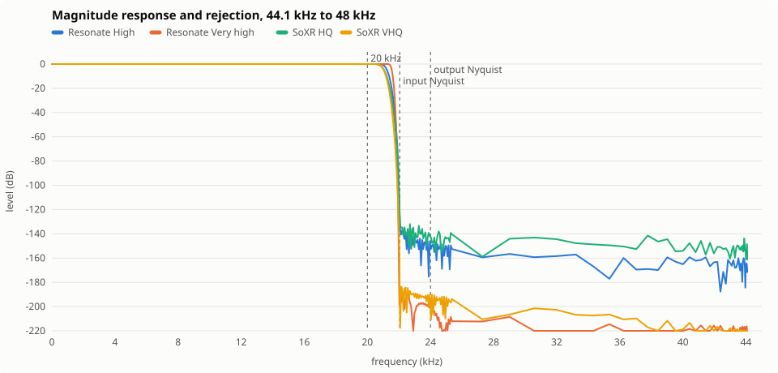
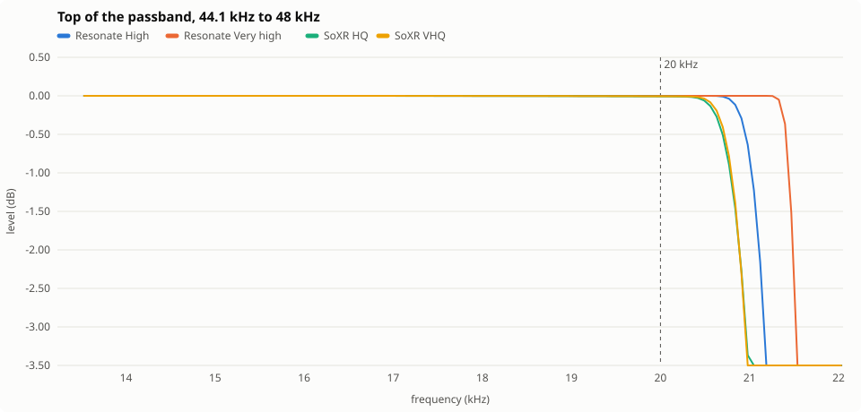
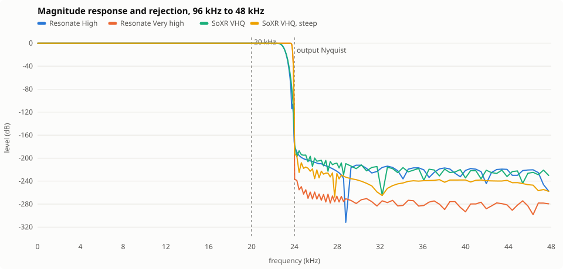
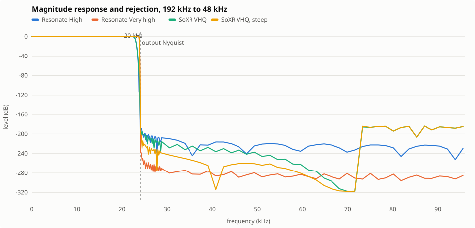

# Resonate's resampler against SoXR

How `resonate-dsp`'s resampler compares with libsoxr, the resampler most audio software treats as
the reference, measured with both in one process on the same buffers. Measured on 2026-11-04 with
libsoxr 0.1.3 as Arch ships it, rustc 1.99.1 and `target-cpu=native` on an AMD Ryzen 7 7700, after
the changes this comparison led to (*What changed in Resonate*). `soxr-comparison/` is the harness
(`.claude/rules/build.md`); the `compare-resamplers` skill reruns it.

## In short

- **Very high now beats every SoXR recipe on every frequency-domain figure at every rate pair, and
  High every recipe up to VHQ, each for less CPU than its peer at the ratios most listeners hear;
  what SoXR keeps is shorter ringing and lower latency.**
- **Very high rejects further than SoXR's 32-bit recipe and keeps more of the top octave than VHQ
  steep, at once and at every rate pair measured.** At 44.1 to 48 kHz it stays flat to 21.76 kHz
  (steep 21.75 kHz) and rejects to −218.7 dB (32-bit −207.0 dB, steep −181.6 dB); its worst SNR is
  255.0 dB against 207.1 dB and its null to 20 kHz −270.5 dB against −77.7 dB.
- **High, the default, beats VHQ on rejection and passband, and HQ on CPU at every pair.** It stays
  flat to 20.84 kHz against VHQ's 20.57 kHz, rejects to −195.4 dB against −183.6 dB, and costs 0.027
  % of a core against HQ's 0.053 % and VHQ's 0.054 %.
- **Very high is the fastest top recipe at the ratios most listeners hear.** 0.039 % of a core at
  44.1 to 48 kHz, against VHQ's 0.054 %, the 32-bit recipe's 0.062 % and steep's 0.073 %. At the
  integer ratios (96 to 48, 192 to 48, 48 to 96 kHz) it costs more than VHQ, whose filter is far
  shorter (0.053 % against 0.040 % at 96 to 48 kHz), and at 96 to 48 and 48 to 96 kHz more than the
  32-bit recipe too.
- **The passband has no ripple left to measure.** 2.0e-13 dB to 10 kHz against SoXR's 1.4e-8 dB,
  because the response is exactly one below its transition, not a sidelobe's depth from it. Its
  stopband is exactly nothing past the band edge, so what is measured there is the kernel's tail,
  not a filter's sidelobe.
- **SoXR's linear recipes ring for less and answer sooner.** A narrower transition needs a longer
  kernel: Very high rings 14.27 ms either side of an impulse against steep's 11.77 ms and VHQ's 2.52
  ms, High 3.02 ms against HQ's 2.15 ms. Very high's peak leaves 80.00 ms after its impulse at 44.1
  to 48 kHz where steep's leaves after 24.83 ms and VHQ's after 8.41 ms, though at 48 to 44.1 kHz
  steep takes 134.27 ms. A player's ring hides latency; it is the price of the speed, and a longer
  hop is what buys it.
- **Fast and Balanced are now the dearest levels.** They stay the low-latency polyphase levels (0.43
  and 1.07 ms), and cost 0.068 % and 0.097 % where High costs 0.027 %.

## What was compared

Eighteen settings at seven rate pairs: 44.1 to 48 kHz (a CD on a 48 kHz device), 48 to 44.1,
96 to 48, 96 to 44.1, 192 to 48, 44.1 to 96 and 48 to 96.

| Setting | Design |
|---|---|
| **Resonate Fast** | Kaiser-windowed sinc, 19 taps a side, cutoff 0.900 of the band edge, β 6.0 (about 63 dB), polyphase |
| **Resonate Balanced** | 47 taps a side, cutoff 0.940, β 9.0 (about 90 dB), polyphase |
| **Resonate High** (default) | flat top reaching 160 taps a side, cutoff 0.9635, β 18.33 (about 175 dB), a block at a time in the frequency domain |
| **Resonate Very high** | flat top reaching 900 taps a side, cutoff 0.9921, β 22.4 (about 212 dB), the same way |
| **Resonate High, minimum** and **Very high, minimum** | those kernels windowed in time, folded to minimum phase through the real cepstrum |
| **Resonate Very high, intermediate** | half minimum, half linear phase |
| SoXR QQ | cubic interpolation, no filter |
| SoXR LQ | 16-bit precision, passband to 0.676 of Nyquist, medium rolloff |
| SoXR MQ | 16-bit, passband to 0.916, medium rolloff |
| SoXR 16-bit | 16-bit, passband to 0.916, small rolloff |
| SoXR HQ (its default) | 20-bit, passband to 0.914 |
| SoXR 24-bit | 24-bit, passband to 0.912 |
| SoXR VHQ | 28-bit, passband to 0.911 |
| SoXR 32-bit | 32-bit, passband to 0.911 |
| SoXR VHQ, steep | VHQ with `SOXR_STEEP_FILTER`'s passband, 0.982 |
| SoXR VHQ, intermediate and minimum | VHQ at phase response 25 and 0 |

Resonate's taps are counted at the lower of the two rates. Fast and Balanced tabulate their kernel
for every phase the exact rational ratio needs (160 for 44.1 to 48 kHz) and sum each output frame
over it. High and Very high take one forward FFT at the input's rate over a pair of channels,
multiply it by the response and take one inverse FFT at the output's rate (*What changed in
Resonate*). SoXR runs on one thread, with its own defaults otherwise: its stopband begins at Nyquist
at every recipe, and recipes of 20 bits and fewer compute in single precision. Both take and give
interleaved f64, so neither pays for a conversion the other does not.

## How it was measured

Every figure is read from what each resampler made of a signal, never from its design.

- **Tones on an exact grid.** Each tone is 1.2 s at −6 dBFS on a 1/64 Hz grid, so its phase at
  any sample reduces exactly and stays accurate to the f64 floor however far into the signal.
  The first and last 0.3 s, where a filter starts and stops, are thrown away.
- **A least-squares fit at known frequencies.** Over the settled 0.6 s, the output is fitted with
  a sine and cosine at the tone's frequency and, where it lands apart from it, at its first image
  `input rate − f`, folded into the output band. What is left after taking the tone away is
  everything the resampler added: images, aliases, noise and rounding.
- **The sweep.** 64 tones spaced logarithmically from 20 Hz to 0.85 of the band edge, 48 spaced
  evenly from there to 0.999 of it, plus 1 kHz and 20 kHz; going down, a further 24 tones from
  the output's Nyquist to 1.2 of it and 40 from there to the input's Nyquist.
- **Ripple** is the spread of gain over the tones from 20 Hz to 10 kHz; **deviation** is the same
  over 20 Hz to 20 kHz, so it shows a filter rolling off under 20 kHz. **−0.1 dB** and **−3 dB**
  are where gain crosses those levels, interpolated between tones.
- **Worst alias or image** is the loudest of every tone above the output's Nyquist (its whole
  output, since none of it belongs there) and every fitted image, against the tone; **worst
  landing ≤ 20 kHz** is the same over what lands in the audible band.
- **SNR** is the tone against everything else in the output, at 1 kHz and at the worst tone from
  20 Hz to 20 kHz. Above about 250 dB it is f64's own rounding.
- **Null** is 48 tones with random phases, spread logarithmically from 20 Hz to 20 kHz (or to
  10 kHz), against the ideal output computed from the same tones, the output's delay at 1 kHz
  taken out. A minimum or intermediate phase filter cannot null: its phase is not the input's.
- **Delay** is the phase delay at 1 kHz, and its **spread** from 20 Hz to 20 kHz, unwrapped from
  the impulse's peak. A linear-phase filter's is zero, since both libraries align their output.
- **Ringing** is how long the impulse response stays above −120 dB of its peak before and after
  it; **energy over 1 ms before the peak** is the share of the response's energy that arrives
  more than a millisecond early: pre-echo.
- **Streaming latency** feeds one frame at a time and times the impulse's peak leaving after the
  impulse arrives: the least delay each setting can be run at.
- **Throughput** is stereo white noise at −6 dBFS, 4 s of it in blocks of 1 024 frames, the best
  of five runs on an idle machine: the share of one core a second of audio costs. **Construction**
  is the first build of a setting in the process, then the best of nine builds after it.
- The plots draw the response as the sweep read it: the tone's gain under the output's Nyquist,
  and above it the alias or image level at the frequency it came from. Their floor is −340 dB;
  anything lower is drawn on it.

## Results

### Best against best

Resonate's best setting, Very high in linear phase, against SoXR's three strongest: VHQ, the
32-bit recipe and VHQ steep. The best figure in each row is in bold.

| 44.1 kHz to 48 kHz unless named | **Resonate Very high** | SoXR VHQ | SoXR 32-bit | SoXR VHQ, steep |
|---|---:|---:|---:|---:|
| Ripple 20 Hz–10 kHz (dB) | **2.0e-13** | 1.4e-8 | 7.2e-9 | 1.3e-8 |
| Deviation 20 Hz–20 kHz (dB) | **< 0.0001** | 0.0062 | 0.0078 | 0.0017 |
| −0.1 dB (kHz) | **21.76** | 20.57 | 20.58 | 21.75 |
| −3 dB (kHz) | **21.84** | 20.95 | 20.94 | 21.82 |
| Worst alias or image (dB) | **−218.7** | −183.6 | −207.0 | −181.6 |
| Worst landing ≤ 20 kHz (dB) | **−334.0** | −201.4 | −222.0 | −214.6 |
| 48 → 44.1 kHz: worst alias (dB) | **−217.7** | −182.0 | −208.5 | −181.4 |
| 96 → 48 kHz: worst alias (dB) | **−219.1** | −177.3 | −216.7 | −192.3 |
| 192 → 48 kHz: worst alias (dB) | **−219.1** | −183.9 | −215.7 | −183.9 |
| SNR at 1 kHz (dB) | **270.1** | 187.0 | 212.3 | 189.9 |
| Worst SNR 20 Hz–20 kHz (dB) | **255.0** | 184.1 | 207.1 | 183.9 |
| Null 20 Hz–20 kHz (dB) | **−270.5** | −79.7 | −77.7 | −91.1 |
| Null 20 Hz–10 kHz (dB) | **−275.0** | −182.4 | −190.7 | −183.0 |
| Ringing either side (ms) | 14.27 | **2.52** | 2.69 | 11.77 |
| Energy over 1 ms before the peak (dB) | −31.1 | **−46.5** | −45.1 | −31.6 |
| Streaming latency (ms) | 80.00 | **8.41** | 18.44 | 24.83 |
| 48 → 44.1 kHz: streaming latency (ms) | 80.02 | 30.85 | **23.77** | 134.27 |
| CPU, % of a core | **0.039** | 0.054 | 0.062 | 0.073 |
| 48 → 44.1 kHz: CPU | **0.039** | 0.059 | 0.064 | 0.073 |
| 96 → 48 kHz: CPU | 0.053 | **0.040** | 0.046 | 0.051 |
| 192 → 48 kHz: CPU | 0.095 | **0.084** | 0.097 | 0.098 |

Very high takes every row of the frequency domain, and CPU at the fractional ratios. VHQ's shorter
filter rings for less, answers sooner and costs less at the integer ratios; the 32-bit recipe costs
less at 96 to 48 kHz.

### 44.1 kHz to 48 kHz

The case nearly every listener with a 48 kHz device hears.

| Setting | −0.1 dB (kHz) | Worst alias or image (dB) | Worst landing ≤ 20 kHz (dB) | Worst SNR (dB) | Null to 10 kHz (dB) | Streaming latency (ms) | CPU (%) |
|---|---:|---:|---:|---:|---:|---:|---:|
| **Resonate High** | 20.84 | −195.4 | −275.6 | 213.6 | −242.4 | 43.33 | 0.027 |
| SoXR HQ | 20.53 | −132.0 | −141.5 | 131.1 | −131.3 | 18.39 | 0.053 |
| SoXR 24-bit | 20.56 | −158.9 | −177.6 | 160.4 | −158.8 | 4.92 | 0.053 |
| **Resonate Very high** | 21.76 | −218.7 | −334.0 | 255.0 | −275.0 | 80.00 | 0.039 |
| SoXR VHQ | 20.57 | −183.6 | −201.4 | 184.1 | −182.4 | 8.41 | 0.054 |
| SoXR 32-bit | 20.58 | −207.0 | −222.0 | 207.1 | −190.7 | 18.44 | 0.062 |
| SoXR VHQ, steep | 21.75 | −181.6 | −214.6 | 183.9 | −183.0 | 24.83 | 0.073 |





High and Very high hold their passbands exactly flat almost to their −3 dB points
(21.14 and 21.84 kHz), then fall to nothing by the input's Nyquist. SoXR's linear
recipes keep their −3 dB point at about 20.95 kHz whatever the precision, and spend the extra
precision on stopband depth alone.

### Going down: 96 and 192 kHz to 48 kHz

A high-resolution file on a 48 kHz device. Every tone above 24 kHz in the source must vanish.

| Setting | 96 → 48: worst alias (dB) | 96 → 48: landing ≤ 20 kHz (dB) | 192 → 48: worst alias (dB) | 192 → 48: landing ≤ 20 kHz (dB) | −0.1 dB (kHz) | 96 → 48: CPU (%) | 192 → 48: CPU (%) |
|---|---:|---:|---:|---:|---:|---:|---:|
| **Resonate High** | −197.7 | −231.5 | −197.7 | −232.0 | 22.68 | 0.039 | 0.069 |
| SoXR HQ | −127.9 | −139.0 | −133.7 | −135.3 | 22.34 | 0.045 | 0.072 |
| **Resonate Very high** | −219.1 | −265.0 | −219.1 | −265.2 | 23.69 | 0.053 | 0.095 |
| SoXR VHQ | −177.3 | −208.3 | −183.9 | −183.9 | 22.39 | 0.040 | 0.084 |
| SoXR 32-bit | −216.7 | −238.0 | −215.7 | −215.7 | 22.40 | 0.046 | 0.097 |
| SoXR VHQ, steep | −192.3 | −229.5 | −183.9 | −183.9 | 23.67 | 0.051 | 0.098 |





SoXR divides a large ratio into stages, so at 192 to 48 kHz its VHQ rejection rises again past
about 72 kHz, where its last stage's images sit; Resonate drops every bin past the band edge in one
transform, so nothing comes back at any frequency. At an integer ratio, SoXR QQ (cubic
interpolation) passes everything above Nyquist at 0 dB: it applies no anti-alias filter.

### Phase, ringing and latency

| Setting | 44.1 → 48: delay spread (µs) | Ringing before / after (ms) | Energy over 1 ms early (dB) | Latency 44.1 → 48 (ms) | Latency 48 → 44.1 (ms) | Latency 96 → 48 (ms) |
|---|---:|---:|---:|---:|---:|---:|
| **Resonate High** | 0.0 | 3.02 / 3.02 | −42.5 | 43.33 | 43.35 | 71.43 |
| **Resonate High, minimum** | 73.4 | 0.10 / 5.60 | −195.8 | 40.00 | 40.02 | 68.20 |
| **Resonate Very high** | 0.0 | 14.27 / 14.27 | −31.1 | 80.00 | 80.02 | 117.89 |
| **Resonate Very high, intermediate** | 42.7 | 9.31 / 21.27 | −59.6 | 93.33 | 93.35 | 145.99 |
| **Resonate Very high, minimum** | 85.4 | 0.12 / 28.38 | < −200 | 60.00 | 60.02 | 99.26 |
| SoXR HQ | 0.0 | 2.15 / 2.15 | −50.8 | 18.39 | 3.04 | 13.26 |
| SoXR VHQ | 0.0 | 2.52 / 2.52 | −46.5 | 8.41 | 30.85 | 2.80 |
| SoXR VHQ, steep | 0.0 | 11.77 / 11.77 | −31.6 | 24.83 | 134.27 | 143.14 |
| SoXR VHQ, intermediate | 38.0 | 1.98 / 3.62 | −75.6 | 34.35 | 33.31 | 9.70 |
| SoXR VHQ, minimum | 76.1 | 0.08 / 4.75 | < −200 | 5.40 | 27.85 | 0.12 |

- Both libraries' minimum phase removes pre-echo entirely and spreads 20 Hz–20 kHz over about 80 µs;
  Resonate's minimum-phase Very high rings for far longer afterwards
  (28.38 ms against 4.75 ms), the price of
  its narrower transition.
- Resonate's latency is its block's hop, its kernel's lead and the margin kept clear of the tail, and
  it hardly moves with the ratio: 43.33 ms for High and 80.00 ms for
  Very high under 2:1, about 71.43 and 117.89 ms where the hop has doubled at 2:1 or
  steeper. SoXR's moves with the ratio, since it fills a block before it filters: VHQ's from 2.8 ms to
  31 ms, steep's from 24.83 ms to 143.14 ms.
- A latency is what a track's first frame waits for, on a chain feeding a ring of 100 ms or more: a
  seek or a track start decodes that many more frames ahead of the first it hears, a few milliseconds'
  work, while a pause or a volume change is answered at the ring and never waits for it. So it is what
  was traded.
- Resonate's intermediate phase waits longer than its linear phase (93.33 ms
  against 80.00 ms), since its window keeps 1.25 half-widths of lead; the lead is genuinely
  part of the response.

### Throughput and construction

Stereo white noise at −6 dBFS, 4 s of it in blocks of 1 024 frames, the best of five runs, on an
idle machine: the share of one core a second of audio costs.

#### Throughput, percent of one core per second of stereo audio

| Setting | 44.1 kHz to 48 kHz | 48 kHz to 44.1 kHz | 96 kHz to 48 kHz | 96 kHz to 44.1 kHz | 192 kHz to 48 kHz | 44.1 kHz to 96 kHz | 48 kHz to 96 kHz |
| --- | ---: | ---: | ---: | ---: | ---: | ---: | ---: |
| **Resonate Fast** | 0.068 | 0.065 | 0.081 | 0.087 | 0.116 | 0.136 | 0.124 |
| **Resonate Balanced** | 0.097 | 0.094 | 0.127 | 0.140 | 0.202 | 0.195 | 0.175 |
| **Resonate High** | 0.027 | 0.028 | 0.039 | 0.041 | 0.069 | 0.043 | 0.040 |
| **Resonate Very high** | 0.039 | 0.039 | 0.053 | 0.053 | 0.095 | 0.055 | 0.054 |
| **Resonate High, minimum** | 0.029 | 0.029 | 0.039 | 0.042 | 0.067 | 0.043 | 0.041 |
| **Resonate Very high, intermediate** | 0.047 | 0.045 | 0.060 | 0.059 | 0.105 | 0.059 | 0.061 |
| **Resonate Very high, minimum** | 0.038 | 0.038 | 0.055 | 0.055 | 0.099 | 0.057 | 0.058 |
| SoXR QQ | 0.023 | 0.022 | 0.026 | 0.025 | 0.032 | 0.043 | 0.044 |
| SoXR LQ | 0.046 | 0.050 | 0.040 | 0.062 | 0.069 | 0.095 | 0.044 |
| SoXR MQ | 0.050 | 0.053 | 0.043 | 0.065 | 0.071 | 0.065 | 0.046 |
| SoXR 16-bit | 0.052 | 0.053 | 0.043 | 0.065 | 0.071 | 0.069 | 0.046 |
| SoXR HQ | 0.053 | 0.056 | 0.045 | 0.069 | 0.072 | 0.070 | 0.047 |
| SoXR 24-bit | 0.053 | 0.055 | 0.038 | 0.064 | 0.079 | 0.077 | 0.041 |
| SoXR VHQ | 0.054 | 0.059 | 0.040 | 0.068 | 0.084 | 0.079 | 0.042 |
| SoXR 32-bit | 0.062 | 0.064 | 0.046 | 0.073 | 0.097 | 0.091 | 0.046 |
| SoXR VHQ, steep | 0.073 | 0.073 | 0.051 | 0.084 | 0.098 | 0.101 | 0.059 |
| SoXR VHQ, intermediate | 0.060 | 0.063 | 0.048 | 0.072 | 0.092 | 0.085 | 0.049 |
| SoXR VHQ, minimum | 0.054 | 0.059 | 0.040 | 0.068 | 0.084 | 0.079 | 0.042 |

#### Construction, milliseconds

| Setting | First, 44.1 kHz to 48 kHz | Again, 44.1 kHz to 48 kHz | First, 192 kHz to 48 kHz | Again, 192 kHz to 48 kHz |
| --- | ---: | ---: | ---: | ---: |
| **Resonate Fast** | 0.15 | 0.00 | 0.01 | 0.00 |
| **Resonate Balanced** | 0.30 | 0.00 | 0.01 | 0.00 |
| **Resonate High** | 0.66 | 0.00 | 0.98 | 0.14 |
| **Resonate Very high** | 0.73 | 0.01 | 1.08 | 0.14 |
| **Resonate High, minimum** | 66.23 | 0.00 | 1.51 | 0.13 |
| **Resonate Very high, intermediate** | 64.26 | 0.01 | 3.15 | 0.13 |
| **Resonate Very high, minimum** | 60.35 | 0.00 | 2.35 | 0.13 |
| SoXR QQ | 0.02 | 0.00 | 0.01 | 0.00 |
| SoXR LQ | 0.05 | 0.05 | 0.01 | 0.00 |
| SoXR MQ | 0.03 | 0.01 | 0.01 | 0.01 |
| SoXR 16-bit | 0.01 | 0.01 | 0.01 | 0.01 |
| SoXR HQ | 0.02 | 0.02 | 0.01 | 0.01 |
| SoXR 24-bit | 0.04 | 0.04 | 0.03 | 0.02 |
| SoXR VHQ | 0.04 | 0.04 | 0.03 | 0.02 |
| SoXR 32-bit | 0.06 | 0.06 | 0.05 | 0.05 |
| SoXR VHQ, steep | 0.20 | 0.19 | 0.18 | 0.18 |
| SoXR VHQ, intermediate | 0.45 | 0.41 | 0.42 | 0.40 |
| SoXR VHQ, minimum | 0.40 | 0.39 | 0.39 | 0.38 |

- **High beats HQ at every pair**, and VHQ too. A stereo pair shares one complex FFT, so where SoXR
  transforms each channel, Resonate transforms the pair once.
- **Very high beats steep, its nearest peer in passband, at all but 96 to 48 kHz, where they are level.**
  It beats the 32-bit recipe at the fractional ratios and at 192 to 48 kHz; at 96 to 48 and 48 to
  96 kHz it costs a sixth more.
- **Going down by a large ratio is still where it is dearest** (0.095 % at 192 to 48 kHz,
  against VHQ's 0.084 %): the forward FFT runs at the input's rate and three quarters
  of its bins are dropped, where SoXR halves the rate twice first.
- **The speed does not depend on the build.** `rustfft` picks its vector width at run time, so on a
  baseline SSE2 build (the Flatpak's) `cargo bench -p resonate-dsp --bench stages` reads High at
  0.029 % and Very high at 0.037 % at 44.1 to 48 kHz, where Fast and Balanced, compiled for the build's
  target, rise from 0.068 % and 0.097 % to 0.079 % and 0.120 %.
- **Intermediate phase costs a fifth more than linear**, its complex response and wider reach;
  minimum phase costs what linear does.
- **The timings vary by about a tenth between runs on the same code**; the tables are the latest run.
- **Construction**: a plan's transforms and response are kept, so a build after the first is free
  (0.01 ms at 44.1 to 48 kHz, 0.14 ms at 192 to 48 kHz for its larger buffers). The first
  costs 0.66 ms for High and 0.73 ms for Very high, and a shaped phase is designed once a run
  (66.23 ms for High minimum, 60.35 ms for Very high's). SoXR
  designs afresh each time but in under half a millisecond.

## What changed in Resonate

### The minimum and intermediate phase kernels keep the linear kernel's passband

`phase.rs` folds the linear kernel to minimum phase through the real cepstrum. It took the
logarithm of the spectrum floored at 1e-30, so every null of the stopband became a spike of the
log spectrum, the cepstrum aliased, and the truncated response strayed in the passband. The log is
now floored a hundredth under the Kaiser stopband the kernel's β promises, over an FFT padded
32-fold rather than 16-fold. A higher floor flattens the passband further, but the flat floor sums
over every polyphase image: at a tenth under the stopband, High's total stopband energy rose
15 dB and its SNR fell by as much. Two tests hold both sides
(`a_shaped_filter_keeps_the_stopband_and_passband_the_linear_one_promises`,
`a_shaped_filter_leaks_hardly_more_into_the_stopband_than_the_linear_one`).

| 44.1 kHz to 48 kHz | Ripple to 10 kHz, before (dB) | After (dB) | Deviation to 20 kHz, before (dB) | After (dB) |
|---|---:|---:|---:|---:|
| Resonate High, minimum | 8.6e-5 | 5.5e-8 | 0.0007 | < 0.0001 |
| Resonate Very high, intermediate | 1.0e-7 | 3.4e-9 | < 0.0001 | < 0.0001 |
| Resonate Very high, minimum | 4.1e-7 | 1.3e-8 | < 0.0001 | < 0.0001 |

### High and Very high convert in the frequency domain

Two earlier designs were measured on the way here: one polyphase stage (up to 2 560 taps a channel
for each output frame) and a partitioned convolution at twice the input rate followed by a short
interpolator (29 to 37 taps a frame). Both spent most of their time on work the output does not need.
High and Very high now take a single conversion:

1. **A block a whole number of ratio cycles long.** At 44.1 to 48 kHz the reduced ratio is 147 : 160,
   so a block is `147k` input and `160k` output samples. Every rate a device offers has no prime
   factor past 7, which is what a fast FFT wants.
2. **One forward FFT, a multiply, one inverse FFT.** The forward transform runs at the input's length
   and the inverse at the output's; bins past the lower rate's Nyquist are dropped, or filled with
   zeros going up. There is no second stage and no table of phases: every output sample is an inverse
   FFT sample, so the read position is exact by construction. Overlap-save keeps the kernel's reach out
   of what is released.
3. **A pair of channels shares one complex FFT.** A real kernel filters `L + iR` into the two filtered
   channels, so stereo costs one transform of each kind where a resampler treating channels apart
   takes two.

The kernel changed as well. **The Kaiser window moved to the frequency side**: the response is exactly
one below the transition, exactly zero from the band edge, and between them the integral of a Kaiser.
A window in time gives a filter with sidelobes and a tail of nothing; a window in frequency gives a
filter of nothing past its edge and a tail in time, and that tail is scaled down further by the sinc
it multiplies. What is left to measure is that tail wrapping round the block: measured rejection is
5 to 30 dB deeper than the Kaiser's own design level, depending on the pair and the block, and a margin
of 192 taps kept clear of it buys 10 to 15 dB of that. The response must close exactly at the band edge: a cut anywhere above zero is
a jump whose tail wraps at about 30 dB under its own level, which one bin lost to rounding (a block's
bin count computed as `1567.9999999999998`) showed as 45 dB of rejection gone.

Since the FFT's cost grows slowly with the kernel, the kernels could lengthen for almost nothing: High
from 128 to 160 taps a side, Very high from 320 to 900. A block's size is searched at construction:
the least `N log N` per sample among the 7-smooth lengths whose hop fits. A longer hop costs less and
waits longer, and the hop chosen (1 400 taps plus half the kernel, scaled by the ratio of the rates up
to twice) is where the cost stops falling much.

| | High 44.1 → 48, before | After | Very high 44.1 → 48, before | After | Very high 192 → 48, before | After |
|---|---:|---:|---:|---:|---:|---:|
| CPU, % of a core | 0.145 | **0.027** | 0.165 | **0.039** | 0.332 | **0.095** |
| −0.1 dB (kHz) | 20.83 | **20.84** | 21.34 | **21.76** | 23.23 | **23.69** |
| Worst alias or image (dB) | −136.6 | **−195.4** | −185.8 | **−218.7** | −185.8 | **−219.1** |
| Worst landing ≤ 20 kHz (dB) | −158.3 | **−275.6** | −210.7 | **−334.0** | −205.9 | **−265.2** |
| SNR at 1 kHz (dB) | 196.6 | **239.3** | 246.4 | **270.1** | 253.2 | **274.3** |
| Worst SNR 20 Hz–20 kHz (dB) | 147.1 | **213.6** | 202.7 | **255.0** | 253.2 | **264.7** |
| Null 20 Hz–20 kHz (dB) | −155.1 | **−229.1** | −208.0 | **−270.5** | −210.2 | **−275.3** |
| Ripple 20 Hz–10 kHz (dB) | 5.7e-8 | **1.5e-13** | 4.2e-10 | **2.0e-13** | 4.6e-10 | **1.1e-13** |
| Ringing either side (ms) | **2.65** | 3.02 | **5.67** | 14.27 | **5.23** | 12.69 |
| Energy over 1 ms before the peak (dB) | **−44.2** | −42.5 | **−35.3** | −31.1 | **−36.0** | −30.2 |
| Streaming latency (ms) | **6.26** | 43.33 | **10.75** | 80.00 | **9.55** | 117.89 |

The output stays aligned to the input and a track keeps its length to the frame. A test holds every
frame against a direct convolution over the kernel written in closed form (a Kaiser's Fourier transform
is `sinh(r)/r`), which shares no code with the block path, within 5e-10 for High and 1e-11 for Very
high. A ratio with a larger prime in it (44.1 kHz onto 47.993 kHz, a rate no device offers) cannot be cut
into blocks, so it runs the same spectral stage at twice the input rate and interpolates on as before.

### Fast and Balanced start their stopband at Nyquist

At 16 and 32 taps a side, Fast's and Balanced's transition bands were wider than the room their
cutoffs leave under Nyquist, so their stopbands began past it and −39 and −36 dB got through just
above the band edge (landing between 20 and 24 kHz). Two cures were measured against leaving them,
each found empirically by `soxr-comparison --fast-and-balanced` rather than from the Kaiser
formula: the highest cutoff, and the fewest taps, for which nothing past Nyquist at any rate pair
is louder than 1 dB above the kernel's own stopband (−63.1 dB for Fast, −90.4 dB for Balanced).
All six settings and SoXR's nearest recipes were then measured and timed in one run (44.1 to
48 kHz where a column names no pair):

| Setting | Worst alias or image, any pair (dB) | Worst landing ≤ 20 kHz, any pair (dB) | −0.1 dB (kHz) | −3 dB (kHz) | At 20 kHz (dB) | Worst SNR, any pair (dB) | Null 20 Hz–10 kHz (dB) | Latency (ms) | CPU 44.1 → 48 (%) | CPU 192 → 48 (%) |
| --- | ---: | ---: | ---: | ---: | ---: | ---: | ---: | ---: | ---: | ---: |
| Fast as it was, 16 taps a side | -39.4 | -66.3 | 16.96 | 19.25 | -7.05 | 65.8 | -74.8 | 0.36 | 0.066 | 0.105 |
| Fast narrowed, 16 taps a side, cutoff 0.8750 | -62.2 | -67.6 | 16.86 | 18.63 | -11.75 | 67.2 | -74.4 | 0.36 | 0.065 | 0.105 |
| **Fast lengthened, 19 taps a side, cutoff 0.9000 (now Fast)** | -62.6 | -68.4 | 17.00 | 19.34 | -7.26 | 67.8 | -74.7 | 0.43 | 0.069 | 0.114 |
| Balanced as it was, 32 taps a side | -36.2 | -94.3 | 19.32 | 20.36 | -1.25 | 94.4 | -103.3 | 0.73 | 0.084 | 0.153 |
| Balanced narrowed, 32 taps a side, cutoff 0.9100 | -90.1 | -97.2 | 18.11 | 19.70 | -5.37 | 95.8 | -102.9 | 0.73 | 0.085 | 0.153 |
| **Balanced lengthened, 47 taps a side, cutoff 0.9400 (now Balanced)** | -89.7 | -98.7 | 19.77 | 20.48 | -0.43 | 97.4 | -106.4 | 1.07 | 0.098 | 0.204 |
| SoXR LQ | -103.9 | -110.4 | 15.41 | 17.47 | -22.04 | 109.3 | -115.1 | 0.48 | 0.046 | 0.069 |
| SoXR MQ | -103.5 | -111.4 | 18.08 | 20.95 | -0.19 | 108.8 | -96.2 | 12.45 | 0.049 | 0.070 |
| SoXR 16-bit | -103.5 | -110.2 | 20.51 | 20.97 | -0.00 | 108.9 | -109.2 | 12.45 | 0.051 | 0.070 |
| SoXR HQ | -126.6 | -134.3 | 20.53 | 20.96 | -0.01 | 130.7 | -131.3 | 18.39 | 0.053 | 0.072 |

Narrowing closes the leak for no CPU but takes the top octave: Fast's −3 dB point falls from
19.25 to 18.63 kHz and its level at 20 kHz from −7.05 to −11.75 dB, Balanced's from −1.25 to
−5.37 dB. Lengthening closes it as well and widens the passband, Balanced's above all (at 20 kHz
−0.43 dB against −1.25 dB), raises the worst SNR by 2 and 3 dB and deepens Balanced's null by
3 dB, for 5 % and 17 % more CPU at 44.1 to 48 kHz (9 % and 33 % at 192 to 48 kHz) and 0.07 and
0.34 ms more latency. Fast and Balanced are now 19 and 47 taps a side.

## Findings left open

- **Very high at the integer ratios still costs more than VHQ and the 32-bit recipe**, now in
  `docs/PERFORMANCE.md`: the forward transform runs at the input's length and most of its bins are
  dropped.
- **Fast and Balanced cost more than High and Very high.** They keep the lowest latency, and could
  run on the same blocks for the listener who does not need it (`docs/PERFORMANCE.md`).
- **SoXR's linear recipes ring for less**, the one thing about a filter the frequency domain cannot
  change: a transition as narrow as Very high's takes a kernel as long. Minimum phase is the way to
  no pre-echo at all, at either library.

## Every measurement

The tables the harness prints, every setting at every rate pair. Resonate's settings are in bold.

### Frequency domain, 44.1 kHz to 48 kHz

| Setting | Ripple 20 Hz–10 kHz (dB) | Deviation 20 Hz–20 kHz (dB) | At 20 kHz (dB) | −0.1 dB (kHz) | −3 dB (kHz) | Worst alias or image (dB) | Worst landing ≤ 20 kHz (dB) | SNR at 1 kHz (dB) | Worst SNR 20 Hz–20 kHz (dB) | Null 20 Hz–20 kHz (dB) | Null 20 Hz–10 kHz (dB) |
| --- | ---: | ---: | ---: | ---: | ---: | ---: | ---: | ---: | ---: | ---: | ---: |
| **Resonate Fast** | 3.2e-3 | 7.2636 | -7.3 | 17.00 | 19.34 | -62.8 | -76.9 | 80.3 | 67.8 | -21.8 | -74.7 |
| **Resonate Balanced** | 7.8e-5 | 0.4267 | -0.4 | 19.77 | 20.48 | -90.0 | -109.1 | 119.6 | 97.4 | -43.2 | -106.4 |
| **Resonate High** | 1.5e-13 | < 0.0001 | 0.0 | 20.84 | 21.14 | -195.4 | -275.6 | 239.3 | 213.6 | -229.1 | -242.4 |
| **Resonate Very high** | 2.0e-13 | < 0.0001 | 0.0 | 21.76 | 21.84 | -218.7 | -334.0 | 270.1 | 255.0 | -270.5 | -275.0 |
| **Resonate High, minimum** | 2.7e-8 | < 0.0001 | -0.0 | 20.83 | 21.14 | -189.3 | -281.2 | 234.0 | 216.8 | -5.8 | -20.0 |
| **Resonate Very high, intermediate** | 1.3e-9 | < 0.0001 | -0.0 | 21.76 | 21.84 | -242.3 | -318.1 | 257.2 | 256.7 | -8.6 | -24.4 |
| **Resonate Very high, minimum** | 5.2e-9 | < 0.0001 | -0.0 | 21.76 | 21.84 | -215.7 | -324.4 | 260.5 | 254.9 | -6.4 | -18.4 |
| SoXR QQ | 4.2e-1 | 5.2375 | -5.2 | 6.65 | 16.94 | -7.3 | -18.0 | 110.7 | 9.6 | -19.5 | -39.4 |
| SoXR LQ | 3.2e-5 | 22.0392 | -22.0 | 15.41 | 17.47 | -105.1 | -115.8 | 119.2 | 109.6 | -17.5 | -115.1 |
| SoXR MQ | 7.3e-4 | 0.1872 | -0.2 | 18.08 | 20.95 | -109.6 | -128.0 | 114.8 | 108.9 | -49.6 | -96.2 |
| SoXR 16-bit | 5.5e-5 | 0.0043 | -0.0 | 20.51 | 20.97 | -109.3 | -126.6 | 112.8 | 111.4 | -83.0 | -109.2 |
| SoXR HQ | 4.9e-6 | 0.0078 | -0.0 | 20.53 | 20.96 | -132.0 | -141.5 | 133.1 | 131.1 | -77.7 | -131.3 |
| SoXR 24-bit | 2.4e-7 | 0.0048 | -0.0 | 20.56 | 20.95 | -158.9 | -177.6 | 163.3 | 160.4 | -81.9 | -158.8 |
| SoXR VHQ | 1.4e-8 | 0.0062 | -0.0 | 20.57 | 20.95 | -183.6 | -201.4 | 187.0 | 184.1 | -79.7 | -182.4 |
| SoXR 32-bit | 7.2e-9 | 0.0078 | -0.0 | 20.58 | 20.94 | -207.0 | -222.0 | 212.3 | 207.1 | -77.7 | -190.7 |
| SoXR VHQ, steep | 1.3e-8 | 0.0017 | -0.0 | 21.75 | 21.82 | -181.6 | -214.6 | 189.9 | 183.9 | -91.1 | -183.0 |
| SoXR VHQ, intermediate | 1.4e-8 | 0.0062 | -0.0 | 20.57 | 20.95 | -183.7 | -201.5 | 187.0 | 183.9 | -8.7 | -26.0 |
| SoXR VHQ, minimum | 1.7e-8 | 0.0062 | -0.0 | 20.57 | 20.95 | -183.6 | -201.5 | 187.0 | 184.1 | -5.9 | -20.0 |

### Time domain, 44.1 kHz to 48 kHz

| Setting | Delay at 1 kHz (µs) | Delay spread 20 Hz–20 kHz (µs) | Impulse peak offset (µs) | Ringing before peak (ms) | Ringing after peak (ms) | Energy over 1 ms before peak (dB) | Streaming latency (ms) |
| --- | ---: | ---: | ---: | ---: | ---: | ---: | ---: |
| **Resonate Fast** | -0.0 | 0.0 | 0.0 | 0.42 | 0.42 | < -200 | 0.43 |
| **Resonate Balanced** | 0.0 | 0.0 | 0.0 | 1.06 | 1.06 | -93.8 | 1.07 |
| **Resonate High** | -0.0 | 0.0 | 0.0 | 3.02 | 3.02 | -42.5 | 43.33 |
| **Resonate Very high** | 0.0 | 0.0 | 0.0 | 14.27 | 14.27 | -31.1 | 80.00 |
| **Resonate High, minimum** | -16.3 | 73.4 | 0.0 | 0.10 | 5.60 | -195.8 | 40.00 |
| **Resonate Very high, intermediate** | -13.7 | 42.7 | 0.0 | 9.31 | 21.27 | -59.6 | 93.33 |
| **Resonate Very high, minimum** | -17.5 | 85.4 | 0.0 | 0.12 | 28.38 | < -200 | 60.00 |
| SoXR QQ | 0.0 | 0.0 | 0.0 | 0.04 | 0.04 | < -200 | 0.02 |
| SoXR LQ | -0.0 | 0.0 | 0.0 | 0.46 | 0.46 | < -200 | 0.48 |
| SoXR MQ | -0.0 | 0.0 | 0.0 | 1.85 | 1.85 | -54.4 | 12.45 |
| SoXR 16-bit | -0.0 | 0.0 | 0.0 | 1.85 | 1.85 | -54.2 | 12.45 |
| SoXR HQ | 0.0 | 0.0 | 0.0 | 2.15 | 2.15 | -50.8 | 18.39 |
| SoXR 24-bit | 0.0 | 0.0 | 0.0 | 2.33 | 2.33 | -48.3 | 4.92 |
| SoXR VHQ | 0.0 | 0.0 | 0.0 | 2.52 | 2.52 | -46.5 | 8.41 |
| SoXR 32-bit | 0.0 | 0.0 | 0.0 | 2.69 | 2.69 | -45.1 | 18.44 |
| SoXR VHQ, steep | 0.0 | 0.0 | 0.0 | 11.77 | 11.77 | -31.6 | 24.83 |
| SoXR VHQ, intermediate | -13.4 | 38.0 | 0.0 | 1.98 | 3.62 | -75.6 | 34.35 |
| SoXR VHQ, minimum | -26.8 | 76.1 | -20.8 | 0.08 | 4.75 | < -200 | 5.40 |

### Frequency domain, 48 kHz to 44.1 kHz

| Setting | Ripple 20 Hz–10 kHz (dB) | Deviation 20 Hz–20 kHz (dB) | At 20 kHz (dB) | −0.1 dB (kHz) | −3 dB (kHz) | Worst alias or image (dB) | Worst landing ≤ 20 kHz (dB) | SNR at 1 kHz (dB) | Worst SNR 20 Hz–20 kHz (dB) | Null 20 Hz–20 kHz (dB) | Null 20 Hz–10 kHz (dB) |
| --- | ---: | ---: | ---: | ---: | ---: | ---: | ---: | ---: | ---: | ---: | ---: |
| **Resonate Fast** | 3.2e-3 | 7.2636 | -7.3 | 17.00 | 19.34 | -62.9 | -71.0 | 77.8 | 72.6 | -21.8 | -74.8 |
| **Resonate Balanced** | 7.8e-5 | 0.4267 | -0.4 | 19.77 | 20.48 | -89.8 | -101.4 | 127.9 | 102.4 | -43.2 | -106.1 |
| **Resonate High** | 1.8e-13 | < 0.0001 | 0.0 | 20.84 | 21.14 | -192.9 | -250.7 | 239.2 | 213.7 | -229.4 | -242.3 |
| **Resonate Very high** | 4.4e-14 | < 0.0001 | 0.0 | 21.76 | 21.84 | -217.7 | -273.2 | 272.8 | 256.6 | -271.8 | -275.1 |
| **Resonate High, minimum** | 2.7e-8 | < 0.0001 | -0.0 | 20.83 | 21.14 | -182.8 | -253.9 | 233.9 | 218.7 | -5.8 | -20.0 |
| **Resonate Very high, intermediate** | 1.3e-9 | < 0.0001 | -0.0 | 21.76 | 21.84 | -232.0 | -286.3 | 273.5 | 253.1 | -8.6 | -24.4 |
| **Resonate Very high, minimum** | 5.2e-9 | < 0.0001 | -0.0 | 21.76 | 21.84 | -213.5 | -286.0 | 273.6 | 258.0 | -6.4 | -18.4 |
| SoXR QQ | 3.1e-1 | 3.9418 | -3.9 | 7.25 | 18.42 | -3.9 | -9.4 | 113.6 | 11.9 | -21.7 | -42.1 |
| SoXR LQ | 9.5e-3 | 23.2641 | -23.3 | 15.15 | 17.43 | -109.5 | -119.4 | 113.6 | 110.1 | -17.4 | -73.6 |
| SoXR MQ | 4.3e-3 | 0.2153 | -0.2 | 17.24 | 20.95 | -109.8 | -122.0 | 113.9 | 109.3 | -48.0 | -80.8 |
| SoXR 16-bit | 5.6e-5 | 0.0051 | -0.0 | 20.51 | 20.97 | -109.4 | -121.2 | 115.7 | 108.9 | -81.4 | -110.1 |
| SoXR HQ | 3.3e-6 | 0.0078 | -0.0 | 20.53 | 20.96 | -130.6 | -139.8 | 133.5 | 130.7 | -77.6 | -131.3 |
| SoXR 24-bit | 2.0e-7 | 0.0016 | -0.0 | 20.56 | 20.95 | -158.8 | -170.4 | 164.1 | 160.3 | -91.5 | -159.0 |
| SoXR VHQ | 1.5e-8 | 0.0023 | -0.0 | 20.57 | 20.95 | -182.0 | -195.1 | 187.5 | 185.7 | -88.3 | -182.3 |
| SoXR 32-bit | 8.4e-10 | 0.0031 | -0.0 | 20.59 | 20.94 | -208.5 | -220.5 | 213.1 | 209.7 | -85.7 | -205.4 |
| SoXR VHQ, steep | 1.2e-8 | 0.0013 | -0.0 | 21.75 | 21.82 | -181.4 | -206.5 | 187.0 | 184.2 | -93.3 | -183.6 |
| SoXR VHQ, intermediate | 1.8e-8 | 0.0023 | -0.0 | 20.57 | 20.95 | -182.1 | -195.2 | 187.5 | 185.7 | -8.7 | -25.7 |
| SoXR VHQ, minimum | 4.8e-8 | 0.0023 | -0.0 | 20.57 | 20.95 | -182.0 | -195.2 | 187.5 | 185.6 | -5.9 | -19.8 |

### Time domain, 48 kHz to 44.1 kHz

| Setting | Delay at 1 kHz (µs) | Delay spread 20 Hz–20 kHz (µs) | Impulse peak offset (µs) | Ringing before peak (ms) | Ringing after peak (ms) | Energy over 1 ms before peak (dB) | Streaming latency (ms) |
| --- | ---: | ---: | ---: | ---: | ---: | ---: | ---: |
| **Resonate Fast** | -0.0 | 0.0 | 0.0 | 0.41 | 0.41 | < -200 | 0.44 |
| **Resonate Balanced** | -0.0 | 0.0 | 0.0 | 1.04 | 1.04 | -93.4 | 1.08 |
| **Resonate High** | -0.0 | 0.0 | 0.0 | 2.97 | 2.97 | -42.9 | 43.35 |
| **Resonate Very high** | 0.0 | 0.0 | 0.0 | 13.81 | 13.81 | -29.6 | 80.02 |
| **Resonate High, minimum** | -16.3 | 73.4 | 0.0 | 0.11 | 5.58 | -196.1 | 40.02 |
| **Resonate Very high, intermediate** | -13.7 | 42.7 | 0.0 | 8.55 | 21.25 | -62.0 | 93.35 |
| **Resonate Very high, minimum** | -17.5 | 85.4 | 0.0 | 0.11 | 27.80 | < -200 | 60.02 |
| SoXR QQ | -0.0 | 0.0 | 0.0 | 0.02 | 0.02 | < -200 | 0.04 |
| SoXR LQ | 0.0 | 0.0 | 0.0 | 0.50 | 0.50 | -139.0 | 9.81 |
| SoXR MQ | -0.0 | 0.0 | 0.0 | 1.86 | 1.86 | -58.0 | 17.62 |
| SoXR 16-bit | -0.0 | 0.0 | 0.0 | 1.86 | 1.86 | -57.8 | 17.62 |
| SoXR HQ | 0.0 | 0.0 | 0.0 | 2.04 | 2.04 | -52.9 | 3.04 |
| SoXR 24-bit | -0.0 | 0.0 | 0.0 | 2.36 | 2.36 | -49.8 | 5.10 |
| SoXR VHQ | 0.0 | 0.0 | 0.0 | 2.47 | 2.47 | -47.4 | 30.85 |
| SoXR 32-bit | 0.0 | 0.0 | 0.0 | 2.74 | 2.74 | -45.6 | 23.77 |
| SoXR VHQ, steep | 0.0 | 0.0 | 0.0 | 11.75 | 11.75 | -30.1 | 134.27 |
| SoXR VHQ, intermediate | -15.8 | 38.6 | 0.0 | 1.90 | 3.67 | -74.5 | 33.31 |
| SoXR VHQ, minimum | -31.5 | 77.2 | -22.7 | 0.09 | 4.60 | < -200 | 27.85 |

### Frequency domain, 96 kHz to 48 kHz

| Setting | Ripple 20 Hz–10 kHz (dB) | Deviation 20 Hz–20 kHz (dB) | At 20 kHz (dB) | −0.1 dB (kHz) | −3 dB (kHz) | Worst alias or image (dB) | Worst landing ≤ 20 kHz (dB) | SNR at 1 kHz (dB) | Worst SNR 20 Hz–20 kHz (dB) | Null 20 Hz–20 kHz (dB) | Null 20 Hz–10 kHz (dB) |
| --- | ---: | ---: | ---: | ---: | ---: | ---: | ---: | ---: | ---: | ---: | ---: |
| **Resonate Fast** | 3.5e-3 | 0.4024 | -0.4 | 18.69 | 21.05 | -63.7 | -71.6 | 271.7 | 258.4 | -43.7 | -74.9 |
| **Resonate Balanced** | 9.1e-5 | 0.0002 | -0.0 | 21.52 | 22.29 | -89.7 | -101.7 | 275.5 | 258.8 | -104.9 | -104.8 |
| **Resonate High** | 3.4e-13 | < 0.0001 | -0.0 | 22.68 | 23.01 | -197.7 | -231.5 | 242.5 | 233.9 | -242.0 | -243.3 |
| **Resonate Very high** | 1.1e-13 | < 0.0001 | 0.0 | 23.69 | 23.77 | -219.1 | -265.0 | 273.9 | 264.3 | -275.1 | -278.1 |
| **Resonate High, minimum** | 1.9e-8 | < 0.0001 | -0.0 | 22.67 | 23.01 | -189.3 | -228.3 | 239.6 | 231.7 | -7.9 | -22.4 |
| **Resonate Very high, intermediate** | 9.4e-10 | < 0.0001 | -0.0 | 23.69 | 23.77 | -223.7 | -270.2 | 265.8 | 265.8 | -8.1 | -26.7 |
| **Resonate Very high, minimum** | 3.8e-9 | < 0.0001 | -0.0 | 23.69 | 23.77 | -216.6 | -265.3 | 261.0 | 261.0 | -7.6 | -20.8 |
| SoXR QQ | 8.6e-8 | < 0.0001 | -0.0 | — | — | 0.0 | 0.0 | 154.9 | 153.3 | -151.9 | -152.0 |
| SoXR LQ | 1.7e-5 | 5.3675 | -5.4 | 16.78 | 19.17 | -109.3 | -128.4 | 135.4 | 135.1 | -23.6 | -126.6 |
| SoXR MQ | 1.3e-5 | < 0.0001 | 0.0 | 22.32 | 22.82 | -105.9 | -136.4 | 135.6 | 134.9 | -123.6 | -124.5 |
| SoXR 16-bit | 1.3e-5 | < 0.0001 | 0.0 | 22.32 | 22.82 | -105.9 | -136.4 | 135.6 | 134.9 | -123.6 | -124.5 |
| SoXR HQ | 2.2e-6 | < 0.0001 | -0.0 | 22.34 | 22.81 | -127.9 | -139.0 | 135.8 | 134.6 | -133.1 | -133.1 |
| SoXR 24-bit | 4.8e-8 | < 0.0001 | 0.0 | 22.37 | 22.80 | -152.3 | -184.8 | 201.1 | 191.4 | -172.3 | -173.9 |
| SoXR VHQ | 2.8e-9 | < 0.0001 | 0.0 | 22.39 | 22.80 | -177.3 | -208.3 | 224.8 | 215.1 | -197.2 | -200.3 |
| SoXR 32-bit | 8.8e-11 | < 0.0001 | 0.0 | 22.40 | 22.80 | -216.7 | -238.0 | 252.5 | 243.4 | -222.1 | -228.3 |
| SoXR VHQ, steep | 3.6e-10 | < 0.0001 | -0.0 | 23.67 | 23.75 | -192.3 | -229.5 | 241.0 | 230.4 | -215.0 | -219.0 |
| SoXR VHQ, intermediate | 2.7e-8 | < 0.0001 | -0.0 | 22.39 | 22.80 | -201.1 | -223.6 | 235.0 | 223.2 | -8.8 | -28.6 |
| SoXR VHQ, minimum | 1.0e-7 | < 0.0001 | -0.0 | 22.39 | 22.80 | -177.1 | -205.7 | 225.8 | 215.6 | -8.0 | -22.6 |

### Time domain, 96 kHz to 48 kHz

| Setting | Delay at 1 kHz (µs) | Delay spread 20 Hz–20 kHz (µs) | Impulse peak offset (µs) | Ringing before peak (ms) | Ringing after peak (ms) | Energy over 1 ms before peak (dB) | Streaming latency (ms) |
| --- | ---: | ---: | ---: | ---: | ---: | ---: | ---: |
| **Resonate Fast** | -0.0 | 0.0 | 0.0 | 0.38 | 0.38 | < -200 | 0.40 |
| **Resonate Balanced** | -0.0 | 0.0 | 0.0 | 0.96 | 0.96 | < -200 | 0.98 |
| **Resonate High** | -0.0 | 0.0 | 0.0 | 2.73 | 2.73 | -46.8 | 71.43 |
| **Resonate Very high** | -0.0 | 0.0 | 0.0 | 12.69 | 12.69 | -30.2 | 117.89 |
| **Resonate High, minimum** | -15.0 | 43.7 | 0.0 | 0.10 | 5.12 | -196.8 | 68.20 |
| **Resonate Very high, intermediate** | -12.6 | 25.9 | 0.0 | 7.85 | 19.52 | -62.4 | 145.99 |
| **Resonate Very high, minimum** | -16.1 | 51.9 | 0.0 | 0.10 | 25.54 | < -200 | 99.26 |
| SoXR QQ | -0.0 | 0.0 | 0.0 | 0.00 | 0.00 | < -200 | 0.02 |
| SoXR LQ | -0.0 | 0.0 | 0.0 | 0.44 | 0.44 | < -200 | 3.97 |
| SoXR MQ | -0.0 | 0.0 | 0.0 | 1.65 | 1.65 | -60.2 | 8.34 |
| SoXR 16-bit | -0.0 | 0.0 | 0.0 | 1.65 | 1.65 | -60.2 | 8.34 |
| SoXR HQ | 0.0 | 0.0 | 0.0 | 1.85 | 1.85 | -54.2 | 13.26 |
| SoXR 24-bit | -0.0 | 0.0 | 0.0 | 2.12 | 2.12 | -50.6 | 16.68 |
| SoXR VHQ | -0.0 | 0.0 | 0.0 | 2.25 | 2.25 | -48.2 | 2.80 |
| SoXR 32-bit | -0.0 | 0.0 | 0.0 | 2.46 | 2.46 | -46.4 | 30.51 |
| SoXR VHQ, steep | -0.0 | 0.0 | 0.0 | 10.60 | 10.60 | -30.9 | 143.14 |
| SoXR VHQ, intermediate | -8.6 | 21.6 | 0.0 | 1.77 | 3.29 | -78.7 | 9.70 |
| SoXR VHQ, minimum | -17.2 | 43.3 | 0.0 | 0.08 | 4.04 | -197.0 | 0.12 |

### Frequency domain, 96 kHz to 44.1 kHz

| Setting | Ripple 20 Hz–10 kHz (dB) | Deviation 20 Hz–20 kHz (dB) | At 20 kHz (dB) | −0.1 dB (kHz) | −3 dB (kHz) | Worst alias or image (dB) | Worst landing ≤ 20 kHz (dB) | SNR at 1 kHz (dB) | Worst SNR 20 Hz–20 kHz (dB) | Null 20 Hz–20 kHz (dB) | Null 20 Hz–10 kHz (dB) |
| --- | ---: | ---: | ---: | ---: | ---: | ---: | ---: | ---: | ---: | ---: | ---: |
| **Resonate Fast** | 3.2e-3 | 7.2636 | -7.3 | 17.00 | 19.34 | -63.8 | -68.4 | 91.4 | 91.0 | -21.8 | -75.3 |
| **Resonate Balanced** | 7.8e-5 | 0.4267 | -0.4 | 19.77 | 20.48 | -89.9 | -98.7 | 132.0 | 116.3 | -43.2 | -107.2 |
| **Resonate High** | 1.5e-13 | < 0.0001 | 0.0 | 20.84 | 21.14 | -193.6 | -229.6 | 307.3 | 216.4 | -243.7 | -245.9 |
| **Resonate Very high** | 3.8e-14 | < 0.0001 | 0.0 | 21.76 | 21.84 | -229.5 | -261.2 | 307.0 | 259.0 | -277.9 | -280.7 |
| **Resonate High, minimum** | 2.7e-8 | < 0.0001 | -0.0 | 20.83 | 21.14 | -183.8 | -223.0 | 281.1 | 221.9 | -5.8 | -20.0 |
| **Resonate Very high, intermediate** | 1.3e-9 | < 0.0001 | -0.0 | 21.76 | 21.84 | -223.9 | -264.4 | 273.6 | 254.2 | -8.6 | -24.4 |
| **Resonate Very high, minimum** | 5.2e-9 | < 0.0001 | -0.0 | 21.76 | 21.84 | -226.3 | -261.0 | 287.8 | 258.0 | -6.4 | -18.4 |
| SoXR QQ | 2.1e-2 | 0.3349 | -0.3 | 14.49 | — | -0.4 | -0.7 | 136.9 | 33.9 | -42.5 | -65.4 |
| SoXR LQ | 9.5e-3 | 23.2641 | -23.3 | 15.15 | 17.43 | -110.4 | -110.4 | 113.6 | 110.1 | -17.4 | -73.6 |
| SoXR MQ | 4.3e-3 | 0.2153 | -0.2 | 17.24 | 20.95 | -110.1 | -111.4 | 113.9 | 109.3 | -48.0 | -80.8 |
| SoXR 16-bit | 5.6e-5 | 0.0051 | -0.0 | 20.51 | 20.97 | -109.7 | -110.2 | 115.7 | 108.9 | -81.4 | -110.1 |
| SoXR HQ | 3.4e-6 | 0.0078 | -0.0 | 20.53 | 20.96 | -131.0 | -134.3 | 134.1 | 131.3 | -77.6 | -131.5 |
| SoXR 24-bit | 2.0e-7 | 0.0016 | -0.0 | 20.56 | 20.95 | -159.0 | -162.5 | 164.1 | 160.3 | -91.5 | -159.0 |
| SoXR VHQ | 1.5e-8 | 0.0023 | -0.0 | 20.57 | 20.95 | -184.8 | -186.8 | 187.5 | 185.7 | -88.3 | -182.2 |
| SoXR 32-bit | 8.4e-10 | 0.0031 | -0.0 | 20.59 | 20.94 | -207.4 | -210.9 | 213.1 | 209.7 | -85.7 | -205.4 |
| SoXR VHQ, steep | 1.2e-8 | 0.0013 | -0.0 | 21.75 | 21.82 | -181.4 | -184.3 | 187.0 | 184.2 | -93.3 | -183.6 |
| SoXR VHQ, intermediate | 1.8e-8 | 0.0023 | -0.0 | 20.57 | 20.95 | -184.0 | -186.8 | 187.5 | 185.7 | -8.7 | -25.7 |
| SoXR VHQ, minimum | 4.8e-8 | 0.0023 | -0.0 | 20.57 | 20.95 | -184.8 | -186.8 | 187.5 | 185.7 | -5.9 | -19.8 |

### Time domain, 96 kHz to 44.1 kHz

| Setting | Delay at 1 kHz (µs) | Delay spread 20 Hz–20 kHz (µs) | Impulse peak offset (µs) | Ringing before peak (ms) | Ringing after peak (ms) | Energy over 1 ms before peak (dB) | Streaming latency (ms) |
| --- | ---: | ---: | ---: | ---: | ---: | ---: | ---: |
| **Resonate Fast** | -0.0 | 0.0 | 0.0 | 0.41 | 0.41 | < -200 | 0.44 |
| **Resonate Balanced** | -0.0 | 0.0 | 0.0 | 1.04 | 1.04 | -93.4 | 1.07 |
| **Resonate High** | 0.0 | 0.0 | 0.0 | 2.97 | 2.97 | -42.9 | 70.02 |
| **Resonate Very high** | 0.0 | 0.0 | 0.0 | 13.81 | 13.81 | -29.6 | 113.35 |
| **Resonate High, minimum** | -16.3 | 73.4 | 0.0 | 0.11 | 5.58 | -197.0 | 66.69 |
| **Resonate Very high, intermediate** | -13.7 | 42.7 | 0.0 | 8.55 | 21.25 | -62.0 | 153.35 |
| **Resonate Very high, minimum** | -17.5 | 85.4 | 0.0 | 0.11 | 27.80 | < -200 | 93.35 |
| SoXR QQ | -0.0 | 0.0 | 0.0 | 0.00 | 0.00 | < -200 | 0.02 |
| SoXR LQ | 0.0 | 0.0 | 0.0 | 0.50 | 0.50 | -140.0 | 9.82 |
| SoXR MQ | -0.0 | 0.0 | 0.0 | 1.86 | 1.86 | -58.0 | 17.64 |
| SoXR 16-bit | -0.0 | 0.0 | 0.0 | 1.86 | 1.86 | -57.8 | 17.64 |
| SoXR HQ | -0.0 | 0.0 | 0.0 | 2.04 | 2.04 | -52.9 | 3.05 |
| SoXR 24-bit | -0.0 | 0.0 | 0.0 | 2.36 | 2.36 | -49.8 | 5.11 |
| SoXR VHQ | 0.0 | 0.0 | 0.0 | 2.47 | 2.47 | -47.4 | 30.86 |
| SoXR 32-bit | 0.0 | 0.0 | 0.0 | 2.74 | 2.74 | -45.6 | 23.78 |
| SoXR VHQ, steep | 0.0 | 0.0 | 0.0 | 11.75 | 11.75 | -30.1 | 134.28 |
| SoXR VHQ, intermediate | -15.8 | 38.6 | 0.0 | 1.90 | 3.67 | -74.5 | 33.32 |
| SoXR VHQ, minimum | -21.1 | 77.2 | 0.0 | 0.11 | 4.78 | < -200 | 27.85 |

### Frequency domain, 192 kHz to 48 kHz

| Setting | Ripple 20 Hz–10 kHz (dB) | Deviation 20 Hz–20 kHz (dB) | At 20 kHz (dB) | −0.1 dB (kHz) | −3 dB (kHz) | Worst alias or image (dB) | Worst landing ≤ 20 kHz (dB) | SNR at 1 kHz (dB) | Worst SNR 20 Hz–20 kHz (dB) | Null 20 Hz–20 kHz (dB) | Null 20 Hz–10 kHz (dB) |
| --- | ---: | ---: | ---: | ---: | ---: | ---: | ---: | ---: | ---: | ---: | ---: |
| **Resonate Fast** | 3.5e-3 | 0.4024 | -0.4 | 18.69 | 21.05 | -63.8 | -71.1 | 263.4 | 263.4 | -43.7 | -74.9 |
| **Resonate Balanced** | 8.5e-5 | 0.0002 | -0.0 | 21.52 | 22.29 | -89.8 | -101.2 | 260.7 | 259.2 | -105.5 | -105.6 |
| **Resonate High** | 2.4e-13 | < 0.0001 | 0.0 | 22.68 | 23.01 | -197.7 | -232.0 | 243.2 | 234.0 | -242.7 | -243.8 |
| **Resonate Very high** | 1.1e-13 | < 0.0001 | 0.0 | 23.69 | 23.77 | -219.1 | -265.2 | 274.3 | 264.7 | -275.3 | -278.5 |
| **Resonate High, minimum** | 1.9e-8 | < 0.0001 | -0.0 | 22.67 | 23.01 | -189.3 | -228.3 | 240.3 | 232.0 | -7.9 | -22.4 |
| **Resonate Very high, intermediate** | 9.4e-10 | < 0.0001 | -0.0 | 23.69 | 23.77 | -223.7 | -272.8 | 266.3 | 266.3 | -8.1 | -26.7 |
| **Resonate Very high, minimum** | 3.8e-9 | < 0.0001 | -0.0 | 23.69 | 23.77 | -216.6 | -265.9 | 261.1 | 261.1 | -7.6 | -20.8 |
| SoXR QQ | 8.6e-8 | < 0.0001 | -0.0 | — | — | 0.0 | 0.0 | 154.9 | 153.3 | -151.9 | -152.0 |
| SoXR LQ | 2.0e-5 | 5.3577 | -5.4 | 16.80 | 19.17 | -115.7 | -133.7 | 136.6 | 134.9 | -23.6 | -123.4 |
| SoXR MQ | 5.0e-6 | < 0.0001 | -0.0 | 22.33 | 22.82 | -111.0 | -135.3 | 135.8 | 133.7 | -128.4 | -129.7 |
| SoXR 16-bit | 5.0e-6 | < 0.0001 | -0.0 | 22.33 | 22.82 | -111.0 | -135.3 | 135.8 | 133.7 | -128.4 | -129.7 |
| SoXR HQ | 4.2e-6 | < 0.0001 | -0.0 | 22.36 | 22.81 | -133.7 | -135.3 | 135.2 | 134.0 | -126.2 | -128.8 |
| SoXR 24-bit | 8.8e-8 | < 0.0001 | -0.0 | 22.38 | 22.80 | -158.8 | -168.5 | 207.3 | 197.3 | -169.7 | -169.5 |
| SoXR VHQ | 1.3e-8 | < 0.0001 | -0.0 | 22.40 | 22.80 | -183.9 | -183.9 | 230.7 | 220.9 | -185.4 | -185.3 |
| SoXR 32-bit | 3.6e-10 | < 0.0001 | -0.0 | 22.41 | 22.80 | -215.7 | -215.7 | 255.9 | 247.5 | -216.1 | -216.2 |
| SoXR VHQ, steep | 1.2e-8 | < 0.0001 | -0.0 | 23.67 | 23.75 | -183.9 | -183.9 | 247.4 | 236.2 | -185.2 | -185.3 |
| SoXR VHQ, intermediate | 1.3e-8 | < 0.0001 | -0.0 | 22.40 | 22.80 | -183.9 | -183.9 | 239.9 | 228.8 | -8.7 | -28.3 |
| SoXR VHQ, minimum | 1.6e-8 | < 0.0001 | -0.0 | 22.40 | 22.80 | -183.9 | -183.9 | 232.1 | 221.6 | -8.0 | -22.3 |

### Time domain, 192 kHz to 48 kHz

| Setting | Delay at 1 kHz (µs) | Delay spread 20 Hz–20 kHz (µs) | Impulse peak offset (µs) | Ringing before peak (ms) | Ringing after peak (ms) | Energy over 1 ms before peak (dB) | Streaming latency (ms) |
| --- | ---: | ---: | ---: | ---: | ---: | ---: | ---: |
| **Resonate Fast** | -0.0 | 0.0 | 0.0 | 0.38 | 0.38 | < -200 | 0.40 |
| **Resonate Balanced** | 0.0 | 0.0 | 0.0 | 0.96 | 0.96 | < -200 | 0.98 |
| **Resonate High** | -0.0 | 0.0 | 0.0 | 2.73 | 2.73 | -46.8 | 71.43 |
| **Resonate Very high** | -0.0 | 0.0 | 0.0 | 12.69 | 12.69 | -30.2 | 117.89 |
| **Resonate High, minimum** | -15.0 | 43.7 | 0.0 | 0.10 | 5.12 | -196.8 | 68.20 |
| **Resonate Very high, intermediate** | -12.6 | 25.9 | 0.0 | 7.85 | 19.52 | -62.4 | 145.99 |
| **Resonate Very high, minimum** | -16.1 | 51.9 | 0.0 | 0.10 | 25.54 | < -200 | 99.27 |
| SoXR QQ | -0.0 | 0.0 | 0.0 | 0.00 | 0.00 | < -200 | 0.02 |
| SoXR LQ | 0.0 | 0.0 | 0.0 | 0.46 | 0.46 | -136.4 | 2.78 |
| SoXR MQ | -0.0 | 0.0 | 0.0 | 1.73 | 1.73 | -58.4 | 4.99 |
| SoXR 16-bit | -0.0 | 0.0 | 0.0 | 1.73 | 1.73 | -58.4 | 4.99 |
| SoXR HQ | -0.0 | 0.0 | 0.0 | 1.88 | 1.88 | -53.1 | 9.70 |
| SoXR 24-bit | -0.0 | 0.0 | 0.0 | 2.17 | 2.17 | -49.9 | 12.93 |
| SoXR VHQ | 0.0 | 0.0 | 0.0 | 2.27 | 2.27 | -47.7 | 14.65 |
| SoXR 32-bit | 0.0 | 0.0 | 0.0 | 2.52 | 2.52 | -46.0 | 28.88 |
| SoXR VHQ, steep | -0.0 | 0.0 | 0.0 | 10.79 | 10.79 | -30.9 | 140.65 |
| SoXR VHQ, intermediate | -12.3 | 22.4 | 0.0 | 1.77 | 3.38 | -78.6 | 7.31 |
| SoXR VHQ, minimum | -14.2 | 44.8 | 0.0 | 0.08 | 4.35 | < -200 | 11.86 |

### Frequency domain, 44.1 kHz to 96 kHz

| Setting | Ripple 20 Hz–10 kHz (dB) | Deviation 20 Hz–20 kHz (dB) | At 20 kHz (dB) | −0.1 dB (kHz) | −3 dB (kHz) | Worst alias or image (dB) | Worst landing ≤ 20 kHz (dB) | SNR at 1 kHz (dB) | Worst SNR 20 Hz–20 kHz (dB) | Null 20 Hz–20 kHz (dB) | Null 20 Hz–10 kHz (dB) |
| --- | ---: | ---: | ---: | ---: | ---: | ---: | ---: | ---: | ---: | ---: | ---: |
| **Resonate Fast** | 3.2e-3 | 7.2636 | -7.3 | 17.00 | 19.34 | -62.8 | — | 80.2 | 67.8 | -21.8 | -74.7 |
| **Resonate Balanced** | 7.8e-5 | 0.4267 | -0.4 | 19.77 | 20.48 | -90.0 | — | 119.6 | 97.4 | -43.2 | -106.3 |
| **Resonate High** | 1.9e-13 | < 0.0001 | 0.0 | 20.84 | 21.14 | -206.0 | — | 306.2 | 216.2 | -241.5 | -242.9 |
| **Resonate Very high** | 3.3e-14 | < 0.0001 | 0.0 | 21.76 | 21.84 | -239.0 | — | 307.0 | 256.6 | -273.6 | -278.5 |
| **Resonate High, minimum** | 2.7e-8 | < 0.0001 | -0.0 | 20.83 | 21.14 | -191.9 | — | 251.5 | 219.0 | -5.8 | -20.0 |
| **Resonate Very high, intermediate** | 1.3e-9 | < 0.0001 | -0.0 | 21.76 | 21.84 | -231.2 | — | 256.2 | 256.2 | -8.6 | -24.4 |
| **Resonate Very high, minimum** | 5.2e-9 | < 0.0001 | -0.0 | 21.76 | 21.84 | -230.7 | — | 262.7 | 247.6 | -6.4 | -18.4 |
| SoXR QQ | 4.2e-1 | 5.2376 | -5.2 | 6.65 | 16.94 | -7.3 | — | 110.7 | 9.6 | -19.5 | -39.4 |
| SoXR LQ | 3.2e-5 | 22.0405 | -22.0 | 15.41 | 17.47 | -105.1 | — | 119.4 | 109.6 | -17.5 | -115.2 |
| SoXR MQ | 7.2e-4 | 0.1867 | -0.2 | 18.09 | 20.95 | -109.6 | — | 115.3 | 108.8 | -49.6 | -96.3 |
| SoXR 16-bit | 5.5e-5 | 0.0043 | -0.0 | 20.51 | 20.97 | -109.3 | — | 112.8 | 111.4 | -83.1 | -109.2 |
| SoXR HQ | 4.8e-6 | 0.0078 | -0.0 | 20.53 | 20.96 | -132.0 | — | 133.1 | 131.1 | -77.7 | -131.3 |
| SoXR 24-bit | 2.4e-7 | 0.0048 | -0.0 | 20.56 | 20.95 | -158.9 | — | 163.3 | 160.4 | -81.9 | -158.8 |
| SoXR VHQ | 1.4e-8 | 0.0062 | -0.0 | 20.57 | 20.95 | -183.6 | — | 187.1 | 184.1 | -79.7 | -182.5 |
| SoXR 32-bit | 7.0e-9 | 0.0078 | -0.0 | 20.58 | 20.94 | -207.0 | — | 212.5 | 207.2 | -77.7 | -190.8 |
| SoXR VHQ, steep | 1.3e-8 | 0.0017 | -0.0 | 21.75 | 21.82 | -181.6 | — | 190.0 | 183.9 | -91.1 | -183.0 |
| SoXR VHQ, intermediate | 1.4e-8 | 0.0062 | -0.0 | 20.57 | 20.95 | -183.7 | — | 187.1 | 183.9 | -8.7 | -26.0 |
| SoXR VHQ, minimum | 1.7e-8 | 0.0062 | -0.0 | 20.57 | 20.95 | -183.6 | — | 187.1 | 184.1 | -5.9 | -20.0 |

### Time domain, 44.1 kHz to 96 kHz

| Setting | Delay at 1 kHz (µs) | Delay spread 20 Hz–20 kHz (µs) | Impulse peak offset (µs) | Ringing before peak (ms) | Ringing after peak (ms) | Energy over 1 ms before peak (dB) | Streaming latency (ms) |
| --- | ---: | ---: | ---: | ---: | ---: | ---: | ---: |
| **Resonate Fast** | -0.0 | 0.0 | 0.0 | 0.43 | 0.43 | < -200 | 0.43 |
| **Resonate Balanced** | 0.0 | 0.0 | 0.0 | 1.06 | 1.06 | -94.2 | 1.07 |
| **Resonate High** | -0.0 | 0.0 | 0.0 | 3.02 | 3.02 | -42.3 | 70.00 |
| **Resonate Very high** | -0.0 | 0.0 | 0.0 | 14.36 | 14.36 | -31.3 | 113.33 |
| **Resonate High, minimum** | -16.3 | 73.4 | 0.0 | 0.10 | 5.60 | -196.7 | 66.67 |
| **Resonate Very high, intermediate** | -13.7 | 42.7 | 0.0 | 9.31 | 21.36 | -59.4 | 153.33 |
| **Resonate Very high, minimum** | -17.5 | 85.4 | 0.0 | 0.12 | 28.49 | < -200 | 93.33 |
| SoXR QQ | -0.0 | 0.0 | 0.0 | 0.04 | 0.04 | < -200 | 0.05 |
| SoXR LQ | -0.0 | 0.0 | 0.0 | 0.47 | 0.47 | < -200 | 0.48 |
| SoXR MQ | -0.0 | 0.0 | 0.0 | 1.86 | 1.86 | -52.8 | 12.45 |
| SoXR 16-bit | -0.0 | 0.0 | 0.0 | 1.86 | 1.86 | -52.6 | 12.45 |
| SoXR HQ | 0.0 | 0.0 | 0.0 | 2.15 | 2.15 | -49.5 | 18.39 |
| SoXR 24-bit | 0.0 | 0.0 | 0.0 | 2.33 | 2.33 | -47.4 | 4.92 |
| SoXR VHQ | 0.0 | 0.0 | 0.0 | 2.57 | 2.57 | -45.7 | 8.41 |
| SoXR 32-bit | 0.0 | 0.0 | 0.0 | 2.74 | 2.74 | -44.5 | 18.44 |
| SoXR VHQ, steep | 0.0 | 0.0 | 0.0 | 11.77 | 11.77 | -31.8 | 24.83 |
| SoXR VHQ, intermediate | -13.4 | 38.0 | 0.0 | 1.98 | 3.68 | -76.0 | 34.35 |
| SoXR VHQ, minimum | -26.8 | 76.1 | -10.4 | 0.10 | 4.79 | < -200 | 5.40 |

### Frequency domain, 48 kHz to 96 kHz

| Setting | Ripple 20 Hz–10 kHz (dB) | Deviation 20 Hz–20 kHz (dB) | At 20 kHz (dB) | −0.1 dB (kHz) | −3 dB (kHz) | Worst alias or image (dB) | Worst landing ≤ 20 kHz (dB) | SNR at 1 kHz (dB) | Worst SNR 20 Hz–20 kHz (dB) | Null 20 Hz–20 kHz (dB) | Null 20 Hz–10 kHz (dB) |
| --- | ---: | ---: | ---: | ---: | ---: | ---: | ---: | ---: | ---: | ---: | ---: |
| **Resonate Fast** | 3.5e-3 | 0.4024 | -0.4 | 18.69 | 21.05 | -62.6 | — | 82.4 | 72.2 | -43.7 | -74.7 |
| **Resonate Balanced** | 9.1e-5 | 0.0002 | -0.0 | 21.52 | 22.29 | -89.7 | — | 153.3 | 102.4 | -104.7 | -104.8 |
| **Resonate High** | 2.9e-13 | < 0.0001 | 0.0 | 22.68 | 23.01 | -204.1 | — | 239.7 | 231.8 | -238.9 | -240.9 |
| **Resonate Very high** | 3.6e-14 | < 0.0001 | -0.0 | 23.69 | 23.77 | -223.1 | — | 272.7 | 258.1 | -271.8 | -275.1 |
| **Resonate High, minimum** | 1.9e-8 | < 0.0001 | -0.0 | 22.67 | 23.01 | -195.8 | — | 237.5 | 229.0 | -7.9 | -22.4 |
| **Resonate Very high, intermediate** | 9.4e-10 | < 0.0001 | -0.0 | 23.69 | 23.77 | -230.4 | — | 269.4 | 261.4 | -8.1 | -26.7 |
| **Resonate Very high, minimum** | 3.8e-9 | < 0.0001 | -0.0 | 23.69 | 23.77 | -221.3 | — | 255.0 | 255.0 | -7.6 | -20.8 |
| SoXR QQ | 2.1e-1 | 3.2258 | -3.2 | 7.74 | 19.55 | -6.0 | — | 109.3 | 10.2 | -21.8 | -42.3 |
| SoXR LQ | 1.7e-5 | 5.3675 | -5.4 | 16.78 | 19.17 | -103.9 | — | 130.1 | 109.3 | -23.6 | -125.8 |
| SoXR MQ | 1.3e-5 | < 0.0001 | 0.0 | 22.32 | 22.82 | -103.5 | — | 134.0 | 119.0 | -123.6 | -124.4 |
| SoXR 16-bit | 1.3e-5 | < 0.0001 | 0.0 | 22.32 | 22.82 | -103.5 | — | 134.0 | 119.0 | -123.6 | -124.4 |
| SoXR HQ | 2.2e-6 | < 0.0001 | -0.0 | 22.34 | 22.81 | -126.6 | — | 133.8 | 131.2 | -132.0 | -132.0 |
| SoXR 24-bit | 4.8e-8 | < 0.0001 | 0.0 | 22.37 | 22.80 | -152.4 | — | 175.5 | 166.1 | -170.4 | -171.9 |
| SoXR VHQ | 2.8e-9 | < 0.0001 | 0.0 | 22.39 | 22.80 | -177.1 | — | 210.7 | 191.3 | -194.5 | -196.3 |
| SoXR 32-bit | 8.8e-11 | < 0.0001 | 0.0 | 22.40 | 22.80 | -199.8 | — | 225.1 | 217.8 | -219.1 | -221.9 |
| SoXR VHQ, steep | 3.6e-10 | < 0.0001 | -0.0 | 23.67 | 23.75 | -176.3 | — | 225.1 | 199.7 | -209.0 | -211.5 |
| SoXR VHQ, intermediate | 2.7e-8 | < 0.0001 | -0.0 | 22.39 | 22.80 | -177.8 | — | 216.7 | 190.6 | -8.8 | -28.6 |
| SoXR VHQ, minimum | 1.0e-7 | < 0.0001 | -0.0 | 22.39 | 22.80 | -177.1 | — | 210.6 | 191.3 | -8.0 | -22.6 |

### Time domain, 48 kHz to 96 kHz

| Setting | Delay at 1 kHz (µs) | Delay spread 20 Hz–20 kHz (µs) | Impulse peak offset (µs) | Ringing before peak (ms) | Ringing after peak (ms) | Energy over 1 ms before peak (dB) | Streaming latency (ms) |
| --- | ---: | ---: | ---: | ---: | ---: | ---: | ---: |
| **Resonate Fast** | -0.0 | 0.0 | 0.0 | 0.39 | 0.39 | < -200 | 0.40 |
| **Resonate Balanced** | -0.0 | 0.0 | 0.0 | 0.97 | 0.97 | < -200 | 0.98 |
| **Resonate High** | 0.0 | 0.0 | 0.0 | 2.78 | 2.78 | -44.1 | 71.42 |
| **Resonate Very high** | -0.0 | 0.0 | 0.0 | 13.24 | 13.24 | -31.9 | 117.88 |
| **Resonate High, minimum** | -15.0 | 43.7 | 0.0 | 0.10 | 5.12 | -196.4 | 68.19 |
| **Resonate Very high, intermediate** | -12.6 | 25.9 | 0.0 | 8.47 | 19.52 | -59.8 | 145.98 |
| **Resonate Very high, minimum** | -16.1 | 51.9 | 0.0 | 0.11 | 26.22 | < -200 | 99.25 |
| SoXR QQ | -0.0 | 0.0 | 0.0 | 0.03 | 0.03 | < -200 | 0.04 |
| SoXR LQ | -0.0 | 0.0 | 0.0 | 0.44 | 0.44 | < -200 | 3.96 |
| SoXR MQ | -0.0 | 0.0 | 0.0 | 1.65 | 1.65 | -57.7 | 8.33 |
| SoXR 16-bit | -0.0 | 0.0 | 0.0 | 1.65 | 1.65 | -57.7 | 8.33 |
| SoXR HQ | -0.0 | 0.0 | 0.0 | 1.91 | 1.91 | -53.6 | 13.25 |
| SoXR 24-bit | -0.0 | 0.0 | 0.0 | 2.12 | 2.12 | -50.8 | 16.67 |
| SoXR VHQ | -0.0 | 0.0 | 0.0 | 2.30 | 2.30 | -48.8 | 2.79 |
| SoXR 32-bit | 0.0 | 0.0 | 0.0 | 2.46 | 2.46 | -47.2 | 30.50 |
| SoXR VHQ, steep | 0.0 | 0.0 | 0.0 | 10.60 | 10.60 | -32.4 | 143.12 |
| SoXR VHQ, intermediate | -8.6 | 21.6 | 0.0 | 1.82 | 3.29 | -80.5 | 9.69 |
| SoXR VHQ, minimum | -27.6 | 43.3 | -10.4 | 0.09 | 4.26 | < -200 | 0.12 |

## Reproducing

```sh
cd soxr-comparison
cargo run --release -- --no-timing --plots ../docs/resampling
cargo run --release -- --timing-only
cargo run --release -- --fast-and-balanced
```

The first prints the frequency and time domain tables and writes the plots on every core, under
any load; the second prints the cost tables and wants an idle machine; the third searches Fast's
and Balanced's narrowed and lengthened kernels and measures and times them beside SoXR's nearest
recipes. All need libsoxr and its headers (`pkg-config --modversion soxr`).
