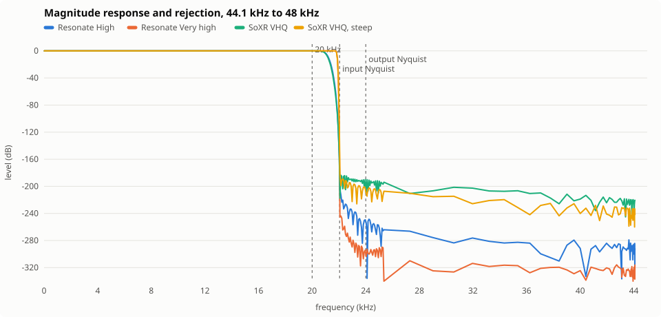
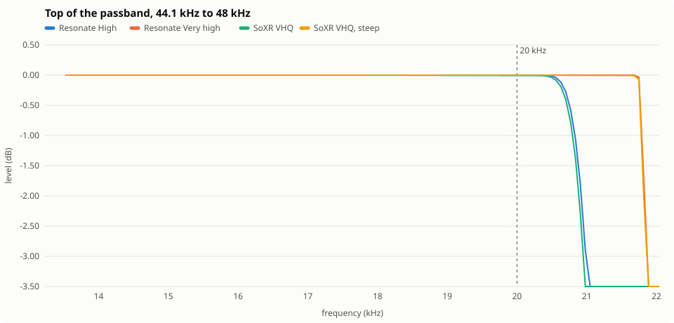
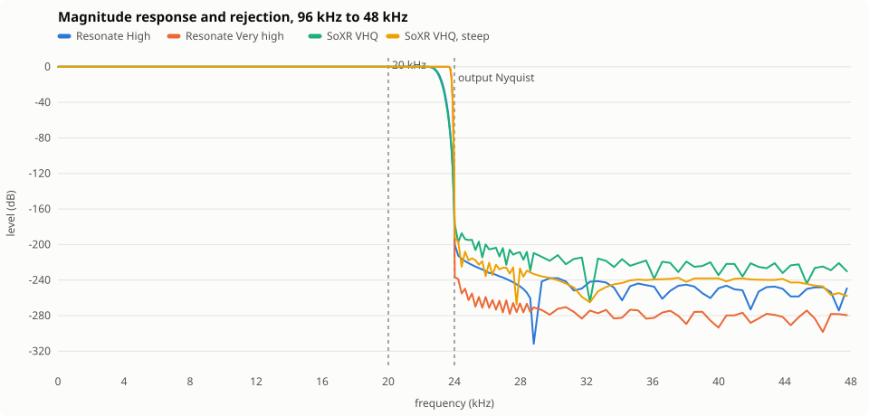
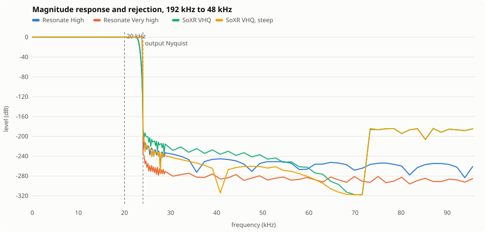

# Resonate's resampler against SoXR

How `resonate-dsp`'s resampler compares with libsoxr, the resampler most audio software treats as
the reference, measured with both in one process on the same buffers. Measured on 2026-11-17 with
libsoxr 0.1.3 as Arch ships it, rustc 1.100.0 and `target-cpu=native` on an AMD Ryzen 7 7700, after
the changes this comparison led to (*What changed in Resonate*). `soxr-comparison/` is the harness
(`.claude/rules/build.md`); the `compare-resamplers` skill reruns it.

## In short

- **Very high loses no frequency-domain row to any SoXR recipe at any rate pair, rings for less than
  the one recipe with its passband, and costs less than VHQ, the 32-bit recipe and steep at five
  ratios of seven, level with VHQ at the other two. What SoXR keeps is latency, and the ringing and
  pre-echo of recipes that give up 1.2 kHz of passband to have them.**
- **Very high rejects further than the 32-bit recipe at every pair, keeps the top octave as far as
  VHQ steep, and rings for less than steep, at once.** At 44.1 to 48 kHz it stays flat to
  21.75 kHz (steep 21.75) and rejects to −243.8 dB (32-bit −207.0,
  steep −181.6); it rings 10.40 ms either side of an impulse against steep's
  11.77 ms; its worst SNR is 255.6 dB against 207.1 dB and its null to 20 kHz
  −237.7 dB against −91.1 dB.
- **Very high is cheaper than every recipe near it at the ratios most listeners hear, and level with
  VHQ where it was behind.** 0.036 % of a core at 44.1 to 48 kHz, against VHQ's 0.055 %, the
  32-bit recipe's 0.062 % and steep's 0.072 %; 0.075 % at 192 to 48 kHz against
  0.084 %, 0.097 % and 0.096 %. At 96 to 48 and 48 to 96 kHz it costs 0.039 %
  and 0.043 % against VHQ's 0.040 % and 0.041 %, within what a run varies by.
- **High, the default, takes every row from VHQ but latency, at every pair.** It stays flat to
  20.61 kHz against 20.57 kHz, rejects to −205.2 dB against −183.6 dB (−199.0 dB at its worst
  pair, VHQ's −177.1 dB), ripples 5.5e-10 dB against 1.4e-8 dB, rings 2.21 ms against 2.52 ms,
  pre-echoes −47.5 dB against −46.5 dB and costs 0.024 % against 0.055 %. The rows VHQ kept are
  High's now: the pre-echo at every pair, and the null at the 2:1 ratios (−210.1 dB against
  −200.3 dB).
- **High's intermediate phase rejects what its linear phase does**: −206.7 dB at 44.1 to 48 kHz where
  it had −166.6 dB, against VHQ intermediate's −183.7 dB, with less pre-echo (−79.0 dB against
  −75.6 dB) and the same ringing before the peak (1.98 ms).
- **Balanced is the cheapest level and beats HQ in every row at 44.1 to 48 kHz.** It rejects further
  at every pair (−133.9 dB against −132.0 dB, −149.9 dB against −127.9 dB at 96 to 48 kHz), rings for
  less (1.88 ms against 2.15 ms) and pre-echoes less (−52.0 dB against −50.8 dB) at every pair,
  at 0.023 % against 0.053 % of a core, and at 44.1 to 48 kHz answers sooner too
  (16.67 ms against 18.39 ms).
- **Low latency answers in about a millisecond, for the most work of the four.** It is the one level
  left summing a polyphase kernel: 1.07 ms, flat to 19.77 kHz, −90.0 dB, 0.060 %.
- **The price is latency, and a longer hop is what buys the speed.** Very high's peak leaves
  103.88 ms after its impulse at 44.1 to 48 kHz and 299.99 ms at 96 to 48 kHz, where VHQ's
  leaves after 8.41 ms and 2.80 ms and steep's after 24.83 ms and 143.14 ms; High's leaves after
  34.99 ms and 62.93 ms. A player's ring hides it, and a listener who wants it gone chooses Low
  latency.

## What was compared

Nineteen settings at seven rate pairs: 44.1 to 48 kHz (a CD on a 48 kHz device), 48 to 44.1,
96 to 48, 96 to 44.1, 192 to 48, 44.1 to 96 and 48 to 96.

| Setting | Design |
|---|---|
| **Resonate Low latency** | Kaiser-windowed sinc, 47 taps a side, cutoff 0.940 of the band edge, β 9.0 (about 90 dB), polyphase |
| **Resonate Balanced** | designed window, 140 taps a side, transition 1 890 Hz wide at a 44.1 kHz band, about 140 dB, a block at a time in the frequency domain |
| **Resonate High** (default) | designed window, 220 taps a side, transition 1 880 Hz wide, about 200 dB, the same way |
| **Resonate Very high** | designed window, 1 200 taps a side, transition 380 Hz wide, about 218 dB, the same way |
| **Resonate High, minimum** and **Very high, minimum** | those kernels folded to minimum phase through the real cepstrum |
| **Resonate High, intermediate** and **Very high, intermediate** | half minimum, half the linear kernel's own phase |
| SoXR QQ | cubic interpolation, no filter |
| SoXR LQ | 16-bit precision, passband to 0.676 of Nyquist, medium rolloff |
| SoXR MQ | 16-bit, passband to 0.916, medium rolloff |
| SoXR 16-bit | 16-bit, passband to 0.916, small rolloff |
| SoXR HQ (its default) | 20-bit, passband to 0.914 |
| SoXR 24-bit | 24-bit, passband to 0.912 |
| SoXR VHQ | 28-bit, passband to 0.911 |
| SoXR 32-bit | 32-bit, passband to 0.911 |
| SoXR VHQ, steep | VHQ with `SOXR_STEEP_FILTER`'s passband, 0.982 |
| SoXR VHQ, intermediate and minimum | VHQ at phase response 25 and 0 |

Resonate's taps are counted at the lower of the two rates. Low latency tabulates its kernel for every
phase the exact rational ratio needs (160 for 44.1 to 48 kHz) and sums each output frame over it. The
other three take one forward FFT at the input's rate over a pair of channels, multiply it by the
response and take one inverse FFT at the output's rate (*What changed in Resonate*). SoXR runs on one
thread, with its own defaults otherwise: its stopband begins at Nyquist at every recipe, and recipes of
20 bits and fewer compute in single precision. Both take and give interleaved f64, so neither pays for
a conversion the other does not.

## How it was measured

Every figure is read from what each resampler made of a signal, never from its design.

- **Tones on an exact grid.** Each tone is 1.2 s at −6 dBFS on a 1/64 Hz grid, so its phase at
  any sample reduces exactly and stays accurate to the f64 floor however far into the signal.
  The first and last 0.3 s, where a filter starts and stops, are thrown away.
- **A least-squares fit at known frequencies.** Over the settled 0.6 s, the output is fitted with
  a sine and cosine at the tone's frequency and, where it lands apart from it, at its first image
  `input rate − f`, folded into the output band. What is left after taking the tone away is
  everything the resampler added: images, aliases, noise and rounding.
- **The sweep.** 64 tones spaced logarithmically from 20 Hz to 0.85 of the band edge, 48 spaced
  evenly from there to 0.999 of it, plus 1 kHz and 20 kHz; going down, a further 24 tones from
  the output's Nyquist to 1.2 of it and 40 from there to the input's Nyquist.
- **Ripple** is the spread of gain over the tones from 20 Hz to 10 kHz; **deviation** is the same
  over 20 Hz to 20 kHz, so it shows a filter rolling off under 20 kHz. **−0.1 dB** and **−3 dB**
  are where gain crosses those levels, interpolated between tones.
- **Worst alias or image** is the loudest of every tone above the output's Nyquist (its whole
  output, since none of it belongs there) and every fitted image, against the tone; **worst
  landing ≤ 20 kHz** is the same over what lands in the audible band.
- **SNR** is the tone against everything else in the output, at 1 kHz and at the worst tone from
  20 Hz to 20 kHz. Above about 250 dB it is f64's own rounding.
- **Null** is 48 tones with random phases, spread logarithmically from 20 Hz to 20 kHz (or to
  10 kHz), against the ideal output computed from the same tones, the output's delay at 1 kHz
  taken out. A minimum or intermediate phase filter cannot null: its phase is not the input's.
- **Delay** is the phase delay at 1 kHz, and its **spread** from 20 Hz to 20 kHz, unwrapped from
  the impulse's peak. A linear-phase filter's is zero, since both libraries align their output.
- **Ringing** is how long the impulse response stays above −120 dB of its peak before and after
  it; **energy over 1 ms before the peak** is the share of the response's energy that arrives
  more than a millisecond early: pre-echo.
- **Streaming latency** feeds one frame at a time and times the impulse's peak leaving after the
  impulse arrives: the least delay each setting can be run at.
- **Throughput** is stereo white noise at −6 dBFS, 4 s of it in blocks of 1 024 frames, the best
  of five runs on an idle machine: the share of one core a second of audio costs. **Construction**
  is the first build of a setting in the process, then the best of nine builds after it.
- The plots draw the response as the sweep read it: the tone's gain under the output's Nyquist,
  and above it the alias or image level at the frequency it came from. Their floor is −340 dB;
  anything lower is drawn on it.

## Results

### Best against best

Resonate's best setting, Very high in linear phase, against SoXR's three strongest: VHQ, the
32-bit recipe and VHQ steep. The best figure in each row is in bold; a tie at these digits bolds
neither where the harness's finer digits decide it (21.751 kHz against steep's 21.750 kHz).

| 44.1 kHz to 48 kHz unless named | **Resonate Very high** | SoXR VHQ | SoXR 32-bit | SoXR VHQ, steep |
|---|---:|---:|---:|---:|
| Ripple 20 Hz–10 kHz (dB) | **2.5e-11** | 1.4e-8 | 7.2e-9 | 1.3e-8 |
| Deviation 20 Hz–20 kHz (dB) | **< 0.0001** | 0.0062 | 0.0078 | 0.0017 |
| −0.1 dB (kHz) | **21.75** | 20.57 | 20.58 | 21.75 |
| −3 dB (kHz) | **21.83** | 20.95 | 20.94 | 21.82 |
| Worst alias or image (dB) | **−243.8** | −183.6 | −207.0 | −181.6 |
| Worst landing ≤ 20 kHz (dB) | **−313.8** | −201.4 | −222.0 | −214.6 |
| 48 → 44.1 kHz: worst alias (dB) | **−228.7** | −182.0 | −208.5 | −181.4 |
| 96 → 48 kHz: worst alias (dB) | **−236.7** | −177.3 | −216.7 | −192.3 |
| 192 → 48 kHz: worst alias (dB) | **−236.7** | −183.9 | −215.7 | −183.9 |
| SNR at 1 kHz (dB) | **269.6** | 187.0 | 212.3 | 189.9 |
| Worst SNR 20 Hz–20 kHz (dB) | **255.6** | 184.1 | 207.1 | 183.9 |
| Null 20 Hz–20 kHz (dB) | **−237.7** | −79.7 | −77.7 | −91.1 |
| Null 20 Hz–10 kHz (dB) | **−238.7** | −182.4 | −190.7 | −183.0 |
| Ringing either side (ms) | 10.40 | **2.52** | 2.69 | 11.77 |
| Energy over 1 ms before the peak (dB) | −31.6 | **−46.5** | −45.1 | −31.6 |
| Streaming latency (ms) | 103.88 | **8.41** | 18.44 | 24.83 |
| 48 → 44.1 kHz: streaming latency (ms) | 103.92 | 30.85 | **23.77** | 134.27 |
| CPU, % of a core | **0.036** | 0.055 | 0.062 | 0.072 |
| 48 → 44.1 kHz: CPU | **0.036** | 0.059 | 0.064 | 0.072 |
| 96 → 48 kHz: CPU | **0.039** | 0.040 | 0.045 | 0.052 |
| 192 → 48 kHz: CPU | **0.075** | 0.084 | 0.097 | 0.096 |

Very high takes every row of the frequency domain and of CPU, the 2:1 ratios by less than a run
varies by. VHQ's and the 32-bit recipe's far wider transitions ring for less and
pre-echo less, the one thing about a filter that cannot be had with its passband: against steep, the
one recipe with that passband, Very high rings for 11.77 − 10.40 = 1.37 ms less at the
same pre-echo (−31.6 dB, to a hair: −31.57 dB against −31.55 dB). Latency is the row SoXR keeps.
Its rejection past the band edge is its window's own ripple, about −218 dB, seen through a block
that is not windowed, so the figure a sweep of a hundred tones reads moves with the block's length:
−243.8 dB at this pair with the block chosen, −220.8 dB with one four cycles shorter, and never
under the ripple.

### 44.1 kHz to 48 kHz

The case nearly every listener with a 48 kHz device hears.

| Setting | −0.1 dB (kHz) | Worst alias or image (dB) | Worst landing ≤ 20 kHz (dB) | Worst SNR (dB) | Null to 10 kHz (dB) | Ringing (ms) | Streaming latency (ms) | CPU (%) |
|---|---:|---:|---:|---:|---:|---:|---:|---:|
| **Resonate Low latency** | 19.77 | −90.0 | −109.1 | 97.4 | −106.4 | 1.06 | 1.07 | 0.060 |
| **Resonate Balanced** | 20.53 | −133.9 | −218.2 | 168.3 | −140.2 | 1.88 | 16.67 | 0.023 |
| SoXR HQ | 20.53 | −132.0 | −141.5 | 131.1 | −131.3 | 2.15 | 18.39 | 0.053 |
| **Resonate High** | 20.61 | −205.2 | −275.7 | 226.3 | −209.2 | 2.21 | 34.99 | 0.024 |
| SoXR 24-bit | 20.56 | −158.9 | −177.6 | 160.4 | −158.8 | 2.33 | 4.92 | 0.054 |
| SoXR VHQ | 20.57 | −183.6 | −201.4 | 184.1 | −182.4 | 2.52 | 8.41 | 0.055 |
| **Resonate Very high** | 21.75 | −243.8 | −313.8 | 255.6 | −238.7 | 10.40 | 103.88 | 0.036 |
| SoXR 32-bit | 20.58 | −207.0 | −222.0 | 207.1 | −190.7 | 2.69 | 18.44 | 0.062 |
| SoXR VHQ, steep | 21.75 | −181.6 | −214.6 | 183.9 | −183.0 | 11.77 | 24.83 | 0.072 |





High sits on VHQ's curve from 20 kHz down and Very high on steep's, each far below it past the band
edge: the plot's vertical distance at the right is what the rest of this report is about.

### Going down: 96 and 192 kHz to 48 kHz

A high-resolution file on a 48 kHz device. Every tone above 24 kHz in the source must vanish.

| Setting | 96 → 48: worst alias (dB) | 96 → 48: landing ≤ 20 kHz (dB) | 192 → 48: worst alias (dB) | 192 → 48: landing ≤ 20 kHz (dB) | −0.1 dB (kHz) | 96 → 48: CPU (%) | 192 → 48: CPU (%) |
|---|---:|---:|---:|---:|---:|---:|---:|
| **Resonate Balanced** | −149.9 | −174.4 | −149.9 | −174.3 | 22.35 | 0.036 | 0.065 |
| SoXR HQ | −127.9 | −139.0 | −133.7 | −135.3 | 22.34 | 0.044 | 0.073 |
| **Resonate High** | −200.1 | −237.8 | −211.7 | −231.6 | 22.44 | 0.036 | 0.067 |
| SoXR VHQ | −177.3 | −208.3 | −183.9 | −183.9 | 22.39 | 0.040 | 0.084 |
| **Resonate Very high** | −236.7 | −266.6 | −236.7 | −266.6 | 23.67 | 0.039 | 0.075 |
| SoXR 32-bit | −216.7 | −238.0 | −215.7 | −215.7 | 22.40 | 0.045 | 0.097 |
| SoXR VHQ, steep | −192.3 | −229.5 | −183.9 | −183.9 | 23.67 | 0.052 | 0.096 |





SoXR divides a large ratio into stages, so at 192 to 48 kHz its VHQ rejection rises again past
about 72 kHz, where its last stage's images sit; Resonate drops every bin past the band edge in one
transform, so nothing comes back at any frequency. At an integer ratio, SoXR QQ (cubic
interpolation) passes everything above Nyquist at 0 dB: it applies no anti-alias filter.

### Phase, ringing and latency

| Setting | 44.1 → 48: delay spread (µs) | Ringing before / after (ms) | Energy over 1 ms early (dB) | Latency 44.1 → 48 (ms) | Latency 48 → 44.1 (ms) | Latency 96 → 48 (ms) |
|---|---:|---:|---:|---:|---:|---:|
| **Resonate Low latency** | 0.0 | 1.06 / 1.06 | −93.8 | 1.07 | 1.08 | 0.98 |
| **Resonate Balanced** | 0.0 | 1.88 / 1.88 | −52.0 | 16.67 | 16.69 | 34.59 |
| **Resonate High** | 0.0 | 2.21 / 2.21 | −47.5 | 34.99 | 35.02 | 62.93 |
| **Resonate High, intermediate** | 39.9 | 1.98 / 3.85 | −79.0 | 43.33 | 43.35 | 64.93 |
| **Resonate High, minimum** | 79.8 | 0.10 / 5.46 | < −200 | 40.75 | 40.77 | 57.89 |
| **Resonate Very high** | 0.0 | 10.40 / 10.40 | −31.6 | 103.88 | 103.92 | 299.99 |
| **Resonate Very high, intermediate** | 40.8 | 8.15 / 19.08 | −60.8 | 106.67 | 106.69 | 299.99 |
| **Resonate Very high, minimum** | 81.6 | 0.10 / 27.25 | < −200 | 73.56 | 73.58 | 299.99 |
| SoXR HQ | 0.0 | 2.15 / 2.15 | −50.8 | 18.39 | 3.04 | 13.26 |
| SoXR VHQ | 0.0 | 2.52 / 2.52 | −46.5 | 8.41 | 30.85 | 2.80 |
| SoXR VHQ, steep | 0.0 | 11.77 / 11.77 | −31.6 | 24.83 | 134.27 | 143.14 |
| SoXR VHQ, intermediate | 38.0 | 1.98 / 3.62 | −75.6 | 34.35 | 33.31 | 9.70 |
| SoXR VHQ, minimum | 76.1 | 0.08 / 4.75 | < −200 | 5.40 | 27.85 | 0.12 |

- Both libraries' minimum phase removes pre-echo entirely and spreads 20 Hz–20 kHz over about 80 µs;
  Resonate's minimum-phase Very high rings for far longer afterwards (27.25 ms against
  4.75 ms), the price of its narrower transition.
- An intermediate phase is half of each: High's spreads 39.9 µs against VHQ intermediate's 38.0 µs,
  rings as long before the peak (1.98 ms) and 0.23 ms longer after it, and puts 3.4 dB less energy
  ahead of it.
- Resonate's latency is its block's hop and its kernel's lead. It moves with what the ratio can buy:
  16.67, 34.99 and 103.88 ms for Balanced, High and Very high under 2:1, 34.59, 62.93 and
  299.99 ms at 2:1 or steeper. SoXR's moves with the ratio too, since it fills a block before it
  filters: VHQ's from 2.80 ms to 30.85 ms, steep's from 24.83 ms to 143.14 ms.
- A latency is what a track's first frame waits for, on a chain feeding a ring of 100 ms or more: a
  seek or a track start decodes that many more frames ahead of the first it hears, a few milliseconds'
  work, while a pause or a volume change is answered at the ring and never waits for it. So it is what
  was traded.

### Throughput and construction

Stereo white noise at −6 dBFS, 4 s of it in blocks of 1 024 frames, the best of five runs, on an
idle machine: the share of one core a second of audio costs.

#### Throughput, percent of one core per second of stereo audio

| Setting | 44.1 kHz to 48 kHz | 48 kHz to 44.1 kHz | 96 kHz to 48 kHz | 96 kHz to 44.1 kHz | 192 kHz to 48 kHz | 44.1 kHz to 96 kHz | 48 kHz to 96 kHz |
| --- | ---: | ---: | ---: | ---: | ---: | ---: | ---: |
| **Resonate Low latency** | 0.060 | 0.059 | 0.098 | 0.108 | 0.149 | 0.117 | 0.109 |
| **Resonate Balanced** | 0.023 | 0.023 | 0.036 | 0.035 | 0.065 | 0.036 | 0.038 |
| **Resonate High** | 0.024 | 0.023 | 0.036 | 0.036 | 0.067 | 0.036 | 0.040 |
| **Resonate Very high** | 0.036 | 0.036 | 0.039 | 0.045 | 0.075 | 0.045 | 0.043 |
| **Resonate High, intermediate** | 0.026 | 0.027 | 0.042 | 0.039 | 0.071 | 0.041 | 0.042 |
| **Resonate High, minimum** | 0.024 | 0.025 | 0.037 | 0.038 | 0.063 | 0.041 | 0.040 |
| **Resonate Very high, intermediate** | 0.047 | 0.046 | 0.046 | 0.044 | 0.082 | 0.044 | 0.050 |
| **Resonate Very high, minimum** | 0.039 | 0.037 | 0.045 | 0.043 | 0.082 | 0.046 | 0.046 |
| SoXR QQ | 0.023 | 0.022 | 0.026 | 0.025 | 0.032 | 0.044 | 0.044 |
| SoXR LQ | 0.046 | 0.049 | 0.042 | 0.062 | 0.068 | 0.095 | 0.044 |
| SoXR MQ | 0.050 | 0.052 | 0.043 | 0.065 | 0.072 | 0.066 | 0.045 |
| SoXR 16-bit | 0.052 | 0.052 | 0.043 | 0.065 | 0.072 | 0.069 | 0.045 |
| SoXR HQ | 0.053 | 0.055 | 0.044 | 0.069 | 0.073 | 0.070 | 0.047 |
| SoXR 24-bit | 0.054 | 0.054 | 0.039 | 0.064 | 0.079 | 0.078 | 0.040 |
| SoXR VHQ | 0.055 | 0.059 | 0.040 | 0.067 | 0.084 | 0.079 | 0.041 |
| SoXR 32-bit | 0.062 | 0.064 | 0.045 | 0.072 | 0.097 | 0.091 | 0.046 |
| SoXR VHQ, steep | 0.072 | 0.072 | 0.052 | 0.084 | 0.096 | 0.101 | 0.058 |
| SoXR VHQ, intermediate | 0.060 | 0.063 | 0.048 | 0.071 | 0.092 | 0.084 | 0.049 |
| SoXR VHQ, minimum | 0.055 | 0.059 | 0.040 | 0.067 | 0.084 | 0.079 | 0.042 |

#### Construction, milliseconds

| Setting | First, 44.1 kHz to 48 kHz | Again, 44.1 kHz to 48 kHz | First, 192 kHz to 48 kHz | Again, 192 kHz to 48 kHz |
| --- | ---: | ---: | ---: | ---: |
| **Resonate Low latency** | 0.35 | 0.00 | 0.01 | 0.00 |
| **Resonate Balanced** | 0.31 | 0.00 | 0.36 | 0.01 |
| **Resonate High** | 0.45 | 0.00 | 0.53 | 0.01 |
| **Resonate Very high** | 2.23 | 0.00 | 4.05 | 0.08 |
| **Resonate High, intermediate** | 75.07 | 0.00 | 1.15 | 0.01 |
| **Resonate High, minimum** | 68.98 | 0.00 | 1.15 | 0.01 |
| **Resonate Very high, intermediate** | 151.21 | 0.00 | 6.85 | 0.07 |
| **Resonate Very high, minimum** | 140.86 | 0.00 | 6.63 | 0.07 |
| SoXR QQ | 0.01 | 0.00 | 0.01 | 0.00 |
| SoXR LQ | 0.05 | 0.05 | 0.01 | 0.00 |
| SoXR MQ | 0.03 | 0.01 | 0.01 | 0.01 |
| SoXR 16-bit | 0.01 | 0.01 | 0.01 | 0.01 |
| SoXR HQ | 0.02 | 0.02 | 0.01 | 0.01 |
| SoXR 24-bit | 0.04 | 0.04 | 0.03 | 0.02 |
| SoXR VHQ | 0.04 | 0.04 | 0.03 | 0.03 |
| SoXR 32-bit | 0.06 | 0.06 | 0.05 | 0.05 |
| SoXR VHQ, steep | 0.20 | 0.19 | 0.18 | 0.18 |
| SoXR VHQ, intermediate | 0.45 | 0.41 | 0.41 | 0.40 |
| SoXR VHQ, minimum | 0.40 | 0.39 | 0.38 | 0.37 |

- **Balanced and High beat every recipe at or above their rejection, at every pair.** 0.023 % and
  0.024 % at 44.1 to 48 kHz against HQ's 0.053 % and VHQ's 0.055 %; 0.036 % and 0.036 % at
  96 to 48 kHz against 0.044 % and 0.040 %. A stereo pair shares one complex FFT, so where SoXR
  transforms each channel, Resonate transforms the pair once.
- **Very high beats the 32-bit recipe and steep at every pair, and VHQ at five of seven.** At 96 to 48
  and 48 to 96 kHz VHQ, whose filter is far shorter, is level.
- **The speed hardly depends on the build.** `rustfft` picks its vector width at run time, so on a
  baseline SSE2 build (the Flatpak's) `cargo bench -p resonate-dsp --bench stages` reads Balanced, High
  and Very high at 0.024 %, 0.023 % and 0.035 % at 44.1 to 48 kHz, where Low latency, compiled for the
  build's target, rises from 0.059 % to 0.112 % (0.057 % on `x86-64-v3`, the release assets' baseline).
- **Intermediate phase costs up to a third more than linear** at 44.1 to 48 kHz, its complex
  response and wider reach; minimum phase costs what linear does, within a tenth.
- **The timings vary by about a tenth between runs on the same code**; the tables are the latest run.
- **Construction**: a plan's transforms and response are kept, so a build after the first is free
  (0.00 ms at 44.1 to 48 kHz). The first costs 0.31 ms for Balanced, 0.45 ms for High and 2.23 ms for Very high, its
  window evaluated at 8 points a tap; a shaped phase is designed once a run (68.98 ms for High minimum,
  140.86 ms for Very high's). SoXR designs afresh each time but in under half a millisecond.

## What changed in Resonate

### Four levels, three of them in blocks

Low was removed. **Low latency** took its place and keeps the polyphase sum, with the kernel Medium
had (47 taps a side, 1.07 ms, −90 dB), because a polyphase level exists for its latency alone and the
old Low's 0.43 ms cost 7 dB at 20 kHz. **Balanced** moved to the block route, which took its cost
at 44.1 to 48 kHz from 0.097 % to 0.023 % at −133.1 dB where it had −90 dB. The analysis crates' resamplers
take Low latency, so what they measure does not move. `quality = "fast"` in an existing settings file,
and the phones' stored choice, read as Low latency.

Low latency's sum was then made a third cheaper (0.097 % to 0.068 % at 44.1 to 48 kHz, 0.204 % to 0.155 %
at 192 to 48 kHz) without touching its kernel. The lanes it summed in had been left to LLVM's SLP
vectoriser, which kept every lane a scalar of its own; each frame's sum was one chain of dependent
multiply-adds, then a horizontal sum, and the weights were read again for each channel. It now sums in
explicit vectors (`wide`'s `f64x8`) and walks the frames a call makes phase by phase: frames a whole ratio
cycle apart share a row of the table, so four of them are summed at once, each weight read once for four
frames and every channel, with eight independent chains. The row is read at a fixed offset and the history
at whatever offset the frame starts, so every frame of a phase shares one slice of the row. Grouping by
phase alone, for the table's sake, bought nothing: the table was never what it waited on. Neither do the
mirrored rows of a linear-phase kernel: halving the table saves memory, not work, and a row folds onto
itself only at phase 0 (a whole-number ratio such as 192 to 48 kHz).

### The kernel stops at its reach, and its window is designed

The flat top this report used to describe (a Kaiser on the frequency side, exactly one below its
transition, exactly zero past it) had a tail in time, and what rejection it measured was that tail
wrapping round the block. A kernel that stops at its reach has nothing to wrap: the block keeps its
exact response, and the only cut left is the band edge, whose jump is a stopband ripple deep.

| 44.1 → 48 kHz, 380 or 349 Hz wide, hop as then chosen | Reach (taps a side) | Worst alias, any pair (dB) | Ringing (ms) | Energy early (dB) |
|---|---:|---:|---:|---:|
| Flat top, β 22.4, as it was | 1 092 | −217.7 | 14.27 | −31.1 |
| Kaiser in time, β 22.4 | 900 | −219.0 | 14.25 | −31.1 |
| Kaiser in time, β 25.5 | 1 024 | −244.4 | 15.21 | −31.0 |
| Kaiser in time, β 16.2 | 650 | −164.0 | 11.90 | −31.5 |
| **Designed window (now Very high)** | 1 200 | **−230.5** | **10.40** | **−31.6** |

A Kaiser only trades: every unit of β gained about 8.4 dB of rejection and cost about 0.4 ms of
ringing, and no β beat steep on both. A Kaiser is near-optimal when the only goal is depth at its
reach; here there are two. So the window is an even Legendre series solved numerically
(`soxr-comparison/design_window.py`): the deepest frequency-domain ripple a kernel of this reach and
transition can meet while its level falls in a straight line, in decibels, from −120 dB at a chosen tap
to the far end. The straight line matters: an envelope allowed to sit just under −120 dB rings for
10 ms by this report's measure and about 15 ms by −125 dB, which is the measure gamed rather than a
filter improved. This one is earlier than the flat top at every level down to −150 dB (459 taps against
636 at −120 dB, 667 against 718 at −140 dB) and later only from −160 dB down (851 against 782), far past
anything a chain plays. The window is positive, so the transition is monotonic. Width and ringing
were then chosen against the recipes: 380 Hz puts Very high's −0.1 dB point at 21.751 kHz
and −3 dB at 21.828 kHz against steep's 21.750 and 21.824 kHz.

| | High 44.1 → 48, before | After | Very high 44.1 → 48, before | After | Very high 192 → 48, before | After |
|---|---:|---:|---:|---:|---:|---:|
| CPU, % of a core | 0.027 | **0.025** | 0.039 | **0.037** | 0.095 | **0.076** |
| −0.1 dB (kHz) | **20.84** | 20.61 | **21.76** | 21.75 | **23.69** | 23.67 |
| Worst alias or image (dB) | **−195.4** | −194.1 | −218.7 | **−245.6** | −219.1 | **−236.7** |
| Worst SNR 20 Hz–20 kHz (dB) | 213.6 | **214.5** | 255.0 | **257.7** | **264.7** | 260.0 |
| Null 20 Hz–20 kHz (dB) | **−229.1** | −184.7 | **−270.5** | −237.7 | **−275.3** | −237.9 |
| Ripple 20 Hz–10 kHz (dB) | **1.5e-13** | 1.6e-8 | **2.0e-13** | 2.5e-11 | **1.1e-13** | 1.8e-11 |
| Ringing either side (ms) | 3.02 | **2.38** | 14.27 | **10.40** | 12.69 | **9.31** |
| Energy over 1 ms before the peak (dB) | −42.5 | **−45.6** | −31.1 | **−31.6** | −30.2 | **−30.8** |
| Streaming latency (ms) | **43.33** | 46.67 | **80.00** | 103.33 | **117.89** | 299.99 |

The flat top's exact flatness is what was given up: its ripple and null were rounding, and now they
are the design's, still far past SoXR's. High's passband came down to VHQ's on purpose, where the
ringing comes from. A test holds every frame against a direct convolution over the same window, computed
apart from the block path, within each level's own ripple, since the direct sum also keeps the images
the block path drops. The table is that change as it was measured; High's figures moved again with
its window (*Deeper windows*, below).

### The block is chosen by what a transform costs

Nearly all of a block's time is its two FFTs, and `rustfft` does not cost `N log N`: a length with
`5³` in it runs about a quarter slower than its neighbours, a length with one factor of two a fifth
slower, and past 8 192 points each transform leaves the near cache. The search weighs those, so 96 to
48 kHz no longer takes 6 750 points where 7 680 costs less a sample. Each level then has two longest
hops, under and at 2:1 (`hop_taps`, `steep_hop_taps`), chosen from a sweep of cost against latency; Very
high's steep hop is long because the 2:1 ratios were its last rows behind SoXR.

Two ways to go further were measured and dropped. A split-complex Stockham FFT in safe Rust over `pulp`,
with radix 4, 3, 5 and 7 passes, reached 0.73 to 1.06 times `rustfft`'s time with `target-cpu=native` and
0.87 to 1.15 times on `x86-64-v3`, what the release assets build for, once its planes sat apart so that no
L1 set took all sixteen streams; radix 8 was 1.1 to 1.5 times, for want of registers. An in-place core shared
by forward and inverse at integer ratios, unsorted so nothing is reordered, gained about 15 % on a transform
and less on a block. Neither pays for a dependency and a transform to maintain.

A halving stage was built and measured too, and dropped. At 4:1 and beyond a half-band FIR took the input
down an octave before the block (192 to 96 kHz, then 96 to 48 kHz in the transform), so the forward transform
ran at half its length; going up, a doubling after it would mirror it. Its band is the conversion's (passing
to 24 kHz and stopping from 72 kHz at 192 kHz), its rejection 60 dB under the level's stopband (278 dB at
Very high, what keeps the worst landing under 20 kHz at −266.6 dB), a Kaiser-windowed half-band of 20 tap
pairs at Very high, 17 at High and 14 at Balanced, summed in `f64x8` over a stereo pair with every add and
multiply shared by a tap's two mirrored inputs. Once it handed the block the lead and tail of its own
response (the half-band's output before the first input frame and after the last, which a stage primed with
silence drops, a hundredth off at the edges), it agreed with the direct route to 5e-11. It cost more than it
saved:

| Second of stereo noise, best of 60, in one process | Without | With | With every load aligned |
|---|---:|---:|---:|
| Very high, 192 to 48 kHz (µs) | 501 | 620 | 556 |
| High, 192 to 48 kHz (µs) | 594 | 665 | 597 |
| Balanced, 192 to 48 kHz (µs) | 592 | 616 | 562 |

The two routes ran in turn in one process, on a machine other builds were loading, so the columns compare and
the levels do not. Very high at 96 to 48 kHz, the transform the halving leaves, took 264 µs: the longer forward
transform absorbs a doubled input rate for about 240 µs a second, some 6 cycles a stereo input frame, where 20
tap pairs over 96 000 frames a second cost about 350 µs, two unaligned loads a tap against one add and one
multiply. Laying every load on a cache line (output thrown away, an upper bound on keeping four shifted copies
of the history) still left Very high 11 % behind and High level; only Balanced, whose short steep hop makes its
transform dear for its kernel, gained 5 to 9 %. Upsampling is the same sum in the other order: 48 to 192 kHz
at Very high took 515 µs against 258 µs at 48 to 96 kHz, less than a doubling of 20 pairs would cost. And a
half-band cannot reach 2:1 at all, where its transition closes to nothing, which is where VHQ is level.

### Minimum and intermediate phase share the level's window

A level is one magnitude response whatever its phase: `phase.rs` folds the same windowed kernel, so
Very high minimum went from 21.75 kHz at −215.7 dB and 28.38 ms to 21.75 kHz at −240.3 dB and
27.25 ms. `phase.rs` takes the logarithm of the spectrum floored under the stopband. A polyphase
kernel floors it a hundredth under, as a higher floor sums over every polyphase image; a block kernel
floors it a tenth under, since it keeps no image, and every null removed from the logarithm stops
aliasing the cepstrum: Very high minimum's ripple fell from 1.1e-9 to 2.9e-11 dB and High minimum's from 1.9e-7
to 1.9e-8 dB with their rejection unchanged.

### Deeper windows, an intermediate phase that keeps its nulls, a block's last cycle

Four changes after the report above was first written, each measured against what it replaced.

**High's and Balanced's windows were under-termed.** A window is an even Legendre series, and High's
thirteen terms could not use a longer reach: more taps bought no ripple. With 22 terms and 220 taps a
side the same transition ripples at −200.3 dB where it had −171.1 dB, while the tap its envelope
crosses −120 dB at moved in from 108 to 100, so it rejects further and rings for less at once.
Balanced went from ten terms at 110 taps to sixteen at 140 (−129.9 to −140.5 dB, the ring tap from 90
to 85). Very high's 25 terms were already enough: 44 give the same −217.6 dB. The designer also holds
the envelope's far end at least 6 dB under where it starts, since a ripple shallower than −150 dB let
the straight line run level or rise, and a level envelope rings longer going up (a Balanced candidate
read 1.97 ms at 48 to 96 kHz against HQ's 1.91 ms before it was held; the window kept reads 1.75 ms).

| | High, before | After | Balanced, before | After |
|---|---:|---:|---:|---:|
| −0.1 dB, 44.1 → 48 (kHz) | 20.606 | **20.613** | 20.533 | **20.534** |
| Worst alias, 44.1 → 48 (dB) | −194.1 | **−205.2** | −133.1 | **−133.9** |
| Worst alias, 96 → 48 (dB) | −180.1 | **−200.1** | −144.8 | **−149.9** |
| Worst alias, any pair (dB) | −180.1 | **−199.0** | −132.0 | **−133.7** |
| Ripple 20 Hz–10 kHz (dB) | 1.6e-8 | **5.5e-10** | 2.7e-6 | **1.5e-6** |
| Null 20 Hz–10 kHz, 96 → 48 (dB) | −191.1 | **−210.1** | −136.0 | **−141.1** |
| Ringing either side (ms) | 2.38 | **2.21** | 2.02 | **1.88** |
| Energy over 1 ms before the peak (dB) | −45.6 | **−47.5** | −51.3 | **−52.0** |
| Streaming latency, 44.1 → 48 (ms) | 46.67 | **34.99** | 16.67 | 16.67 |
| Streaming latency, 96 → 48 (ms) | 63.97 | **62.93** | 35.22 | **34.59** |
| Second of stereo, 44.1 → 48 (µs) | 225 | **219** | 227 | 226 |
| Second of stereo, 96 → 48 (µs) | **334** | 347 | **329** | 343 |
| Second of stereo, 192 → 48 (µs) | **601** | 634 | **595** | 618 |

The cost rows are `cargo bench -p resonate-dsp --bench stages`, both builds run in turn seven times
and the best kept. The longer kernels are paid for at 2:1 and steeper, 4 to 5 % (9 % for High at
176.4 to 48 kHz), where the overlap is a larger share of a block whose hop was not lengthened; under
2:1 they cost nothing. High minimum rings for longer after its peak with the longer kernel (5.46 ms
for 4.98 ms).

**An intermediate phase halved the wrong phase.** It took half of the minimum phase and half of a
linear phase written as a plain delay. A minimum phase turns by half a cycle at every null of the
stopband, and the linear kernel's own phase does too (its zero-phase amplitude changes sign there);
halving the first against a delay with no turns left each null a quarter turn, a cusp whose response
decays slowly and leaks once the kernel is trimmed. `phase.rs` now reads the linear kernel's phase
with every sign flip in it, as SoX's `pi_wraps` does, so each null stays a null. High intermediate
went from −166.6 to −206.7 dB at 44.1 to 48 kHz (−152.0 to −203.2 dB at its worst pair) and its
ripple from 1.2e-7 to 7.4e-10 dB, the linear kernel's. With the leak gone the window could shrink
from 3.25 to 2.85 half-widths (lead 1.1, trail 1.75), which took Very high intermediate from 0.055 %
to 0.047 % of a core at 44.1 to 48 kHz; shorter than that cost Very high 3 dB.

**A block's overlap is rounded up once.** A block is a whole number of ratio cycles, and the kernel's
lead and trail were each rounded up to cycles: at the 147-sample cycle of 44.1 to 48 kHz, High kept
four cycles for 440 taps that fit in three, and Very high eighteen for seventeen. Where rounding the
two together frees a cycle the block now primes just short of whole cycles, and the kernel is delayed
by the fraction of an output sample that leaves (a turn of each bin of the response), so the first
frame released is still the first instant. The freed cycle can be spent either way. High took it as
latency: twelve cycles with a hop of nine answer in 34.99 ms for 46.67 ms at the cost it had
(sixteen with a hop of thirteen were 5.5 % cheaper, 223 to 210 µs a second, and waited 48.32 ms).
Very high took it as work: a hop of 23 cycles of 40 for 22, 345 to 329 µs a second, for 0.55 ms more.
A kernel that frees no cycle keeps its whole-cycle priming and its real response: a turned response
cost Balanced 5 % at 48 to 44.1 kHz (217 to 228 µs) for a sixth of a millisecond.

**Low latency's sum lost its stragglers.** A call of 1 024 frames at 44.1 to 48 kHz makes seven
frames of each phase, four summed at once and the rest two and then one; the one was a single chain
of multiply-adds waiting on its own latency, a fifth of the sum's time for a seventh of its frames.
Three are now summed at once, and the frames a call can make are counted by arithmetic, not by
stepping through them (a tenth of the time). The output is the same to the bit.

| Second of stereo, 44.1 → 48 (µs) | Before | After |
|---|---:|---:|
| `target-cpu=native` (AVX-512) | 663 | **591** |
| `x86-64-v3` | 644 | **569** |
| Baseline (SSE2) | 1 195 | **1 122** |

Summing consecutive frames, each with its own row of the table, would leave no stragglers at all; it
was built and read 877 µs against 689 µs under the profiler. Each frame then loads its own weights,
twice the loads for the same multiply-adds, and the 143 KB table is walked once a frame, not once a
phase. Sharing the weight loads across a phase's frames is still what pays.

## Findings left open

- **Latency is what Very high still pays**: 103.88 ms at 44.1 to 48 kHz and 299.99 ms at 2:1 or steeper. A
  shorter hop gives it back for CPU (90.54 ms for 0.040 %), which is the listener's choice of level.
- **VHQ is level at 96 to 48 and 48 to 96 kHz**, not beaten (`docs/PERFORMANCE.md`): a kernel as narrow as
  Very high's cannot be shorter, and the transform did not find another few percent. A halving stage cannot
  reach 2:1, and at 4:1 it costs more than the shorter transform saves (*The block is chosen by what a
  transform costs*). Splitting the long forward transform into its two polyphase branches, two transforms
  of half the length and a turn to join them, was worked through and not built: the join is the radix-2
  stage it removes, so it saves about half a stage of fifteen.
- **VHQ's and the 32-bit recipe's linear filters ring for less than Very high**, the one thing about a
  filter the frequency domain cannot change: their transitions are four times as wide. High rings for less
  than either and pre-echoes less than VHQ. Minimum phase is the way to no pre-echo at all, at either
  library.
- **High and Balanced cost 4 to 5 % more than they did at 2:1 and steeper** (*Deeper windows*), still under
  VHQ and HQ at every pair. A longer steep hop would buy it back for latency.
- **A shaped phase's block is whatever the search finds cheapest under its level's hop**, so its latency
  moved both ways with the kernels: High minimum waits 57.89 ms at 192 to 48 kHz where it waited
  34.60 ms, and Very high intermediate 106.67 ms at 44.1 to 48 kHz for 100.00 ms, while High intermediate
  fell from 76.49 to 64.93 ms at 96 to 48 kHz. A hop of its own for each phase would hold them.
- **Low latency is the dearest level** (0.060 %), the price of summing a kernel per frame for a millisecond's latency.

## Every measurement

The tables the harness prints, every setting at every rate pair. Resonate's settings are in bold.

### Frequency domain, 44.1 kHz to 48 kHz

| Setting | Ripple 20 Hz–10 kHz (dB) | Deviation 20 Hz–20 kHz (dB) | At 20 kHz (dB) | −0.1 dB (kHz) | −3 dB (kHz) | Worst alias or image (dB) | Worst landing ≤ 20 kHz (dB) | SNR at 1 kHz (dB) | Worst SNR 20 Hz–20 kHz (dB) | Null 20 Hz–20 kHz (dB) | Null 20 Hz–10 kHz (dB) |
| --- | ---: | ---: | ---: | ---: | ---: | ---: | ---: | ---: | ---: | ---: | ---: |
| **Resonate Low latency** | 7.8e-5 | 0.4267 | -0.4 | 19.77 | 20.48 | -90.0 | -109.1 | 119.6 | 97.4 | -43.2 | -106.4 |
| **Resonate Balanced** | 1.5e-6 | < 0.0001 | -0.0 | 20.53 | 20.96 | -133.9 | -218.2 | 273.7 | 168.3 | -141.0 | -140.2 |
| **Resonate High** | 5.5e-10 | < 0.0001 | 0.0 | 20.61 | 20.98 | -205.2 | -275.7 | 258.7 | 226.3 | -208.7 | -209.2 |
| **Resonate Very high** | 2.5e-11 | < 0.0001 | 0.0 | 21.75 | 21.83 | -243.8 | -313.8 | 269.6 | 255.6 | -237.7 | -238.7 |
| **Resonate High, intermediate** | 7.4e-10 | < 0.0001 | -0.0 | 20.61 | 20.98 | -206.7 | -309.7 | 256.7 | 239.7 | -8.7 | -25.4 |
| **Resonate High, minimum** | 9.6e-10 | < 0.0001 | -0.0 | 20.61 | 20.98 | -206.6 | -291.6 | 247.9 | 230.2 | -5.9 | -19.4 |
| **Resonate Very high, intermediate** | 2.8e-11 | < 0.0001 | -0.0 | 21.75 | 21.83 | -231.3 | -332.2 | 260.0 | 257.2 | -8.6 | -24.8 |
| **Resonate Very high, minimum** | 2.9e-11 | < 0.0001 | -0.0 | 21.75 | 21.83 | -239.8 | -328.8 | 263.2 | 250.2 | -6.0 | -18.9 |
| SoXR QQ | 4.2e-1 | 5.2375 | -5.2 | 6.65 | 16.94 | -7.3 | -18.0 | 110.7 | 9.6 | -19.5 | -39.4 |
| SoXR LQ | 3.2e-5 | 22.0392 | -22.0 | 15.41 | 17.47 | -105.1 | -115.8 | 119.2 | 109.6 | -17.5 | -115.1 |
| SoXR MQ | 7.3e-4 | 0.1872 | -0.2 | 18.08 | 20.95 | -109.6 | -128.0 | 114.8 | 108.9 | -49.6 | -96.2 |
| SoXR 16-bit | 5.5e-5 | 0.0043 | -0.0 | 20.51 | 20.97 | -109.3 | -126.6 | 112.8 | 111.4 | -83.0 | -109.2 |
| SoXR HQ | 4.9e-6 | 0.0078 | -0.0 | 20.53 | 20.96 | -132.0 | -141.5 | 133.1 | 131.1 | -77.7 | -131.3 |
| SoXR 24-bit | 2.4e-7 | 0.0048 | -0.0 | 20.56 | 20.95 | -158.9 | -177.6 | 163.3 | 160.4 | -81.9 | -158.8 |
| SoXR VHQ | 1.4e-8 | 0.0062 | -0.0 | 20.57 | 20.95 | -183.6 | -201.4 | 187.0 | 184.1 | -79.7 | -182.4 |
| SoXR 32-bit | 7.2e-9 | 0.0078 | -0.0 | 20.58 | 20.94 | -207.0 | -222.0 | 212.3 | 207.1 | -77.7 | -190.7 |
| SoXR VHQ, steep | 1.3e-8 | 0.0017 | -0.0 | 21.75 | 21.82 | -181.6 | -214.6 | 189.9 | 183.9 | -91.1 | -183.0 |
| SoXR VHQ, intermediate | 1.4e-8 | 0.0062 | -0.0 | 20.57 | 20.95 | -183.7 | -201.5 | 187.0 | 183.9 | -8.7 | -26.0 |
| SoXR VHQ, minimum | 1.7e-8 | 0.0062 | -0.0 | 20.57 | 20.95 | -183.6 | -201.5 | 187.0 | 184.1 | -5.9 | -20.0 |

### Time domain, 44.1 kHz to 48 kHz

| Setting | Delay at 1 kHz (µs) | Delay spread 20 Hz–20 kHz (µs) | Impulse peak offset (µs) | Ringing before peak (ms) | Ringing after peak (ms) | Energy over 1 ms before peak (dB) | Streaming latency (ms) |
| --- | ---: | ---: | ---: | ---: | ---: | ---: | ---: |
| **Resonate Low latency** | 0.0 | 0.0 | 0.0 | 1.06 | 1.06 | -93.8 | 1.07 |
| **Resonate Balanced** | 0.0 | 0.0 | 0.0 | 1.88 | 1.88 | -52.0 | 16.67 |
| **Resonate High** | 0.0 | 0.0 | 0.0 | 2.21 | 2.21 | -47.5 | 34.99 |
| **Resonate Very high** | -0.0 | 0.0 | 0.0 | 10.40 | 10.40 | -31.6 | 103.88 |
| **Resonate High, intermediate** | -12.3 | 39.9 | 0.0 | 1.98 | 3.85 | -79.0 | 43.33 |
| **Resonate High, minimum** | -16.5 | 79.8 | 0.0 | 0.10 | 5.46 | < -200 | 40.75 |
| **Resonate Very high, intermediate** | -13.1 | 40.8 | 0.0 | 8.15 | 19.08 | -60.8 | 106.67 |
| **Resonate Very high, minimum** | -17.6 | 81.6 | 0.0 | 0.10 | 27.25 | < -200 | 73.56 |
| SoXR QQ | 0.0 | 0.0 | 0.0 | 0.04 | 0.04 | < -200 | 0.02 |
| SoXR LQ | -0.0 | 0.0 | 0.0 | 0.46 | 0.46 | < -200 | 0.48 |
| SoXR MQ | -0.0 | 0.0 | 0.0 | 1.85 | 1.85 | -54.4 | 12.45 |
| SoXR 16-bit | -0.0 | 0.0 | 0.0 | 1.85 | 1.85 | -54.2 | 12.45 |
| SoXR HQ | 0.0 | 0.0 | 0.0 | 2.15 | 2.15 | -50.8 | 18.39 |
| SoXR 24-bit | 0.0 | 0.0 | 0.0 | 2.33 | 2.33 | -48.3 | 4.92 |
| SoXR VHQ | 0.0 | 0.0 | 0.0 | 2.52 | 2.52 | -46.5 | 8.41 |
| SoXR 32-bit | 0.0 | 0.0 | 0.0 | 2.69 | 2.69 | -45.1 | 18.44 |
| SoXR VHQ, steep | 0.0 | 0.0 | 0.0 | 11.77 | 11.77 | -31.6 | 24.83 |
| SoXR VHQ, intermediate | -13.4 | 38.0 | 0.0 | 1.98 | 3.62 | -75.6 | 34.35 |
| SoXR VHQ, minimum | -26.8 | 76.1 | -20.8 | 0.08 | 4.75 | < -200 | 5.40 |

### Frequency domain, 48 kHz to 44.1 kHz

| Setting | Ripple 20 Hz–10 kHz (dB) | Deviation 20 Hz–20 kHz (dB) | At 20 kHz (dB) | −0.1 dB (kHz) | −3 dB (kHz) | Worst alias or image (dB) | Worst landing ≤ 20 kHz (dB) | SNR at 1 kHz (dB) | Worst SNR 20 Hz–20 kHz (dB) | Null 20 Hz–20 kHz (dB) | Null 20 Hz–10 kHz (dB) |
| --- | ---: | ---: | ---: | ---: | ---: | ---: | ---: | ---: | ---: | ---: | ---: |
| **Resonate Low latency** | 7.8e-5 | 0.4267 | -0.4 | 19.77 | 20.48 | -89.8 | -101.4 | 127.9 | 102.4 | -43.2 | -106.1 |
| **Resonate Balanced** | 1.5e-6 | < 0.0001 | -0.0 | 20.53 | 20.96 | -133.7 | -185.8 | 275.1 | 171.2 | -141.0 | -140.2 |
| **Resonate High** | 5.5e-10 | < 0.0001 | 0.0 | 20.61 | 20.98 | -204.8 | -256.3 | 290.4 | 231.1 | -208.7 | -209.2 |
| **Resonate Very high** | 2.5e-11 | < 0.0001 | 0.0 | 21.75 | 21.83 | -228.7 | -297.7 | 266.4 | 258.5 | -237.7 | -238.7 |
| **Resonate High, intermediate** | 7.4e-10 | < 0.0001 | -0.0 | 20.61 | 20.98 | -203.2 | -273.2 | 257.6 | 242.7 | -8.7 | -25.4 |
| **Resonate High, minimum** | 9.6e-10 | < 0.0001 | -0.0 | 20.61 | 20.98 | -202.9 | -273.3 | 249.0 | 235.5 | -5.9 | -19.4 |
| **Resonate Very high, intermediate** | 2.9e-11 | < 0.0001 | -0.0 | 21.75 | 21.83 | -226.3 | -288.1 | 268.1 | 249.9 | -8.6 | -24.8 |
| **Resonate Very high, minimum** | 2.9e-11 | < 0.0001 | -0.0 | 21.75 | 21.83 | -228.1 | -299.6 | 275.7 | 262.6 | -6.0 | -18.9 |
| SoXR QQ | 3.1e-1 | 3.9418 | -3.9 | 7.25 | 18.42 | -3.9 | -9.4 | 113.6 | 11.9 | -21.7 | -42.1 |
| SoXR LQ | 9.5e-3 | 23.2641 | -23.3 | 15.15 | 17.43 | -109.5 | -119.4 | 113.6 | 110.1 | -17.4 | -73.6 |
| SoXR MQ | 4.3e-3 | 0.2153 | -0.2 | 17.24 | 20.95 | -109.8 | -122.0 | 113.9 | 109.3 | -48.0 | -80.8 |
| SoXR 16-bit | 5.6e-5 | 0.0051 | -0.0 | 20.51 | 20.97 | -109.4 | -121.2 | 115.7 | 108.9 | -81.4 | -110.1 |
| SoXR HQ | 3.3e-6 | 0.0078 | -0.0 | 20.53 | 20.96 | -130.6 | -139.8 | 133.5 | 130.7 | -77.6 | -131.3 |
| SoXR 24-bit | 2.0e-7 | 0.0016 | -0.0 | 20.56 | 20.95 | -158.8 | -170.4 | 164.1 | 160.3 | -91.5 | -159.0 |
| SoXR VHQ | 1.5e-8 | 0.0023 | -0.0 | 20.57 | 20.95 | -182.0 | -195.1 | 187.5 | 185.7 | -88.3 | -182.3 |
| SoXR 32-bit | 8.4e-10 | 0.0031 | -0.0 | 20.59 | 20.94 | -208.5 | -220.5 | 213.1 | 209.7 | -85.7 | -205.4 |
| SoXR VHQ, steep | 1.2e-8 | 0.0013 | -0.0 | 21.75 | 21.82 | -181.4 | -206.5 | 187.0 | 184.2 | -93.3 | -183.6 |
| SoXR VHQ, intermediate | 1.8e-8 | 0.0023 | -0.0 | 20.57 | 20.95 | -182.1 | -195.2 | 187.5 | 185.7 | -8.7 | -25.7 |
| SoXR VHQ, minimum | 4.8e-8 | 0.0023 | -0.0 | 20.57 | 20.95 | -182.0 | -195.2 | 187.5 | 185.6 | -5.9 | -19.8 |

### Time domain, 48 kHz to 44.1 kHz

| Setting | Delay at 1 kHz (µs) | Delay spread 20 Hz–20 kHz (µs) | Impulse peak offset (µs) | Ringing before peak (ms) | Ringing after peak (ms) | Energy over 1 ms before peak (dB) | Streaming latency (ms) |
| --- | ---: | ---: | ---: | ---: | ---: | ---: | ---: |
| **Resonate Low latency** | -0.0 | 0.0 | 0.0 | 1.04 | 1.04 | -93.4 | 1.08 |
| **Resonate Balanced** | -0.0 | 0.0 | 0.0 | 1.90 | 1.90 | -54.7 | 16.69 |
| **Resonate High** | 0.0 | 0.0 | 0.0 | 2.24 | 2.24 | -49.4 | 35.02 |
| **Resonate Very high** | 0.0 | 0.0 | 0.0 | 10.14 | 10.14 | -30.1 | 103.92 |
| **Resonate High, intermediate** | -12.3 | 39.9 | 0.0 | 1.93 | 3.88 | -79.1 | 43.35 |
| **Resonate High, minimum** | -16.5 | 79.8 | 0.0 | 0.11 | 5.46 | < -200 | 40.77 |
| **Resonate Very high, intermediate** | -13.1 | 40.8 | 0.0 | 7.96 | 17.32 | -60.0 | 106.69 |
| **Resonate Very high, minimum** | -17.6 | 81.6 | 0.0 | 0.11 | 24.49 | < -200 | 73.58 |
| SoXR QQ | -0.0 | 0.0 | 0.0 | 0.02 | 0.02 | < -200 | 0.04 |
| SoXR LQ | 0.0 | 0.0 | 0.0 | 0.50 | 0.50 | -139.0 | 9.81 |
| SoXR MQ | -0.0 | 0.0 | 0.0 | 1.86 | 1.86 | -58.0 | 17.62 |
| SoXR 16-bit | -0.0 | 0.0 | 0.0 | 1.86 | 1.86 | -57.8 | 17.62 |
| SoXR HQ | 0.0 | 0.0 | 0.0 | 2.04 | 2.04 | -52.9 | 3.04 |
| SoXR 24-bit | -0.0 | 0.0 | 0.0 | 2.36 | 2.36 | -49.8 | 5.10 |
| SoXR VHQ | 0.0 | 0.0 | 0.0 | 2.47 | 2.47 | -47.4 | 30.85 |
| SoXR 32-bit | 0.0 | 0.0 | 0.0 | 2.74 | 2.74 | -45.6 | 23.77 |
| SoXR VHQ, steep | 0.0 | 0.0 | 0.0 | 11.75 | 11.75 | -30.1 | 134.27 |
| SoXR VHQ, intermediate | -15.8 | 38.6 | 0.0 | 1.90 | 3.67 | -74.5 | 33.31 |
| SoXR VHQ, minimum | -31.5 | 77.2 | -22.7 | 0.09 | 4.60 | < -200 | 27.85 |

### Frequency domain, 96 kHz to 48 kHz

| Setting | Ripple 20 Hz–10 kHz (dB) | Deviation 20 Hz–20 kHz (dB) | At 20 kHz (dB) | −0.1 dB (kHz) | −3 dB (kHz) | Worst alias or image (dB) | Worst landing ≤ 20 kHz (dB) | SNR at 1 kHz (dB) | Worst SNR 20 Hz–20 kHz (dB) | Null 20 Hz–20 kHz (dB) | Null 20 Hz–10 kHz (dB) |
| --- | ---: | ---: | ---: | ---: | ---: | ---: | ---: | ---: | ---: | ---: | ---: |
| **Resonate Low latency** | 9.1e-5 | 0.0002 | -0.0 | 21.52 | 22.29 | -89.7 | -101.7 | 275.5 | 258.8 | -104.9 | -104.8 |
| **Resonate Balanced** | 1.4e-6 | < 0.0001 | -0.0 | 22.35 | 22.81 | -149.9 | -174.4 | 186.2 | 180.9 | -140.1 | -141.1 |
| **Resonate High** | 5.1e-10 | < 0.0001 | 0.0 | 22.44 | 22.84 | -200.1 | -237.8 | 248.4 | 241.8 | -208.5 | -210.1 |
| **Resonate Very high** | 1.8e-11 | < 0.0001 | 0.0 | 23.67 | 23.76 | -236.7 | -266.6 | 291.5 | 260.0 | -237.9 | -239.5 |
| **Resonate High, intermediate** | 7.3e-10 | < 0.0001 | -0.0 | 22.44 | 22.84 | -204.0 | -248.9 | 259.5 | 252.6 | -8.5 | -27.8 |
| **Resonate High, minimum** | 8.1e-10 | < 0.0001 | -0.0 | 22.44 | 22.84 | -199.9 | -244.7 | 253.7 | 246.3 | -7.9 | -21.8 |
| **Resonate Very high, intermediate** | 2.1e-11 | < 0.0001 | 0.0 | 23.67 | 23.76 | -235.3 | -278.7 | 289.9 | 260.2 | -8.3 | -27.2 |
| **Resonate Very high, minimum** | 2.1e-11 | < 0.0001 | 0.0 | 23.67 | 23.76 | -231.1 | -274.7 | 272.7 | 261.2 | -7.7 | -21.2 |
| SoXR QQ | 8.6e-8 | < 0.0001 | -0.0 | — | — | 0.0 | 0.0 | 154.9 | 153.3 | -151.9 | -152.0 |
| SoXR LQ | 1.7e-5 | 5.3675 | -5.4 | 16.78 | 19.17 | -109.3 | -128.4 | 135.4 | 135.1 | -23.6 | -126.6 |
| SoXR MQ | 1.3e-5 | < 0.0001 | 0.0 | 22.32 | 22.82 | -105.9 | -136.4 | 135.6 | 134.9 | -123.6 | -124.5 |
| SoXR 16-bit | 1.3e-5 | < 0.0001 | 0.0 | 22.32 | 22.82 | -105.9 | -136.4 | 135.6 | 134.9 | -123.6 | -124.5 |
| SoXR HQ | 2.2e-6 | < 0.0001 | -0.0 | 22.34 | 22.81 | -127.9 | -139.0 | 135.8 | 134.6 | -133.1 | -133.1 |
| SoXR 24-bit | 4.8e-8 | < 0.0001 | 0.0 | 22.37 | 22.80 | -152.3 | -184.8 | 201.1 | 191.4 | -172.3 | -173.9 |
| SoXR VHQ | 2.8e-9 | < 0.0001 | 0.0 | 22.39 | 22.80 | -177.3 | -208.3 | 224.8 | 215.1 | -197.2 | -200.3 |
| SoXR 32-bit | 8.8e-11 | < 0.0001 | 0.0 | 22.40 | 22.80 | -216.7 | -238.0 | 252.5 | 243.4 | -222.1 | -228.3 |
| SoXR VHQ, steep | 3.6e-10 | < 0.0001 | -0.0 | 23.67 | 23.75 | -192.3 | -229.5 | 241.0 | 230.4 | -215.0 | -219.0 |
| SoXR VHQ, intermediate | 2.7e-8 | < 0.0001 | -0.0 | 22.39 | 22.80 | -201.1 | -223.6 | 235.0 | 223.2 | -8.8 | -28.6 |
| SoXR VHQ, minimum | 1.0e-7 | < 0.0001 | -0.0 | 22.39 | 22.80 | -177.1 | -205.7 | 225.8 | 215.6 | -8.0 | -22.6 |

### Time domain, 96 kHz to 48 kHz

| Setting | Delay at 1 kHz (µs) | Delay spread 20 Hz–20 kHz (µs) | Impulse peak offset (µs) | Ringing before peak (ms) | Ringing after peak (ms) | Energy over 1 ms before peak (dB) | Streaming latency (ms) |
| --- | ---: | ---: | ---: | ---: | ---: | ---: | ---: |
| **Resonate Low latency** | 0.0 | 0.0 | 0.0 | 0.96 | 0.96 | < -200 | 0.98 |
| **Resonate Balanced** | -0.0 | 0.0 | 0.0 | 1.75 | 1.75 | -55.0 | 34.59 |
| **Resonate High** | -0.0 | 0.0 | 0.0 | 2.06 | 2.06 | -49.6 | 62.93 |
| **Resonate Very high** | 0.0 | 0.0 | 0.0 | 9.31 | 9.31 | -30.8 | 299.99 |
| **Resonate High, intermediate** | -11.3 | 23.6 | 0.0 | 1.77 | 3.56 | -80.8 | 64.93 |
| **Resonate High, minimum** | -15.2 | 47.2 | 0.0 | 0.10 | 5.02 | < -200 | 57.89 |
| **Resonate Very high, intermediate** | -12.0 | 24.7 | 0.0 | 7.31 | 15.92 | -60.2 | 299.99 |
| **Resonate Very high, minimum** | -16.2 | 49.4 | 0.0 | 0.10 | 22.50 | < -200 | 299.99 |
| SoXR QQ | -0.0 | 0.0 | 0.0 | 0.00 | 0.00 | < -200 | 0.02 |
| SoXR LQ | -0.0 | 0.0 | 0.0 | 0.44 | 0.44 | < -200 | 3.97 |
| SoXR MQ | -0.0 | 0.0 | 0.0 | 1.65 | 1.65 | -60.2 | 8.34 |
| SoXR 16-bit | -0.0 | 0.0 | 0.0 | 1.65 | 1.65 | -60.2 | 8.34 |
| SoXR HQ | 0.0 | 0.0 | 0.0 | 1.85 | 1.85 | -54.2 | 13.26 |
| SoXR 24-bit | -0.0 | 0.0 | 0.0 | 2.12 | 2.12 | -50.6 | 16.68 |
| SoXR VHQ | -0.0 | 0.0 | 0.0 | 2.25 | 2.25 | -48.2 | 2.80 |
| SoXR 32-bit | -0.0 | 0.0 | 0.0 | 2.46 | 2.46 | -46.4 | 30.51 |
| SoXR VHQ, steep | -0.0 | 0.0 | 0.0 | 10.60 | 10.60 | -30.9 | 143.14 |
| SoXR VHQ, intermediate | -8.6 | 21.6 | 0.0 | 1.77 | 3.29 | -78.7 | 9.70 |
| SoXR VHQ, minimum | -17.2 | 43.3 | 0.0 | 0.08 | 4.04 | -197.0 | 0.12 |

### Frequency domain, 96 kHz to 44.1 kHz

| Setting | Ripple 20 Hz–10 kHz (dB) | Deviation 20 Hz–20 kHz (dB) | At 20 kHz (dB) | −0.1 dB (kHz) | −3 dB (kHz) | Worst alias or image (dB) | Worst landing ≤ 20 kHz (dB) | SNR at 1 kHz (dB) | Worst SNR 20 Hz–20 kHz (dB) | Null 20 Hz–20 kHz (dB) | Null 20 Hz–10 kHz (dB) |
| --- | ---: | ---: | ---: | ---: | ---: | ---: | ---: | ---: | ---: | ---: | ---: |
| **Resonate Low latency** | 7.8e-5 | 0.4267 | -0.4 | 19.77 | 20.48 | -89.9 | -98.7 | 132.0 | 116.3 | -43.2 | -107.2 |
| **Resonate Balanced** | 1.5e-6 | < 0.0001 | -0.0 | 20.53 | 20.96 | -148.4 | -173.6 | 275.1 | 176.2 | -141.0 | -140.2 |
| **Resonate High** | 5.5e-10 | < 0.0001 | 0.0 | 20.61 | 20.98 | -199.0 | -229.0 | 250.2 | 236.6 | -208.7 | -209.2 |
| **Resonate Very high** | 2.5e-11 | < 0.0001 | 0.0 | 21.75 | 21.83 | -230.8 | -264.7 | 267.6 | 262.1 | -237.7 | -238.7 |
| **Resonate High, intermediate** | 7.4e-10 | < 0.0001 | -0.0 | 20.61 | 20.98 | -203.7 | -244.0 | 269.2 | 243.6 | -8.7 | -25.4 |
| **Resonate High, minimum** | 9.6e-10 | < 0.0001 | -0.0 | 20.61 | 20.98 | -198.9 | -233.7 | 254.7 | 239.7 | -5.9 | -19.4 |
| **Resonate Very high, intermediate** | 2.9e-11 | < 0.0001 | -0.0 | 21.75 | 21.83 | -230.8 | -276.0 | 267.8 | 249.9 | -8.6 | -24.8 |
| **Resonate Very high, minimum** | 2.9e-11 | < 0.0001 | -0.0 | 21.75 | 21.83 | -231.8 | -271.0 | 285.3 | 256.8 | -6.0 | -18.9 |
| SoXR QQ | 2.1e-2 | 0.3349 | -0.3 | 14.49 | — | -0.4 | -0.7 | 136.9 | 33.9 | -42.5 | -65.4 |
| SoXR LQ | 9.5e-3 | 23.2641 | -23.3 | 15.15 | 17.43 | -110.4 | -110.4 | 113.6 | 110.1 | -17.4 | -73.6 |
| SoXR MQ | 4.3e-3 | 0.2153 | -0.2 | 17.24 | 20.95 | -110.1 | -111.4 | 113.9 | 109.3 | -48.0 | -80.8 |
| SoXR 16-bit | 5.6e-5 | 0.0051 | -0.0 | 20.51 | 20.97 | -109.7 | -110.2 | 115.7 | 108.9 | -81.4 | -110.1 |
| SoXR HQ | 3.4e-6 | 0.0078 | -0.0 | 20.53 | 20.96 | -131.0 | -134.3 | 134.1 | 131.3 | -77.6 | -131.5 |
| SoXR 24-bit | 2.0e-7 | 0.0016 | -0.0 | 20.56 | 20.95 | -159.0 | -162.5 | 164.1 | 160.3 | -91.5 | -159.0 |
| SoXR VHQ | 1.5e-8 | 0.0023 | -0.0 | 20.57 | 20.95 | -184.8 | -186.8 | 187.5 | 185.7 | -88.3 | -182.2 |
| SoXR 32-bit | 8.4e-10 | 0.0031 | -0.0 | 20.59 | 20.94 | -207.4 | -210.9 | 213.1 | 209.7 | -85.7 | -205.4 |
| SoXR VHQ, steep | 1.2e-8 | 0.0013 | -0.0 | 21.75 | 21.82 | -181.4 | -184.3 | 187.0 | 184.2 | -93.3 | -183.6 |
| SoXR VHQ, intermediate | 1.8e-8 | 0.0023 | -0.0 | 20.57 | 20.95 | -184.0 | -186.8 | 187.5 | 185.7 | -8.7 | -25.7 |
| SoXR VHQ, minimum | 4.8e-8 | 0.0023 | -0.0 | 20.57 | 20.95 | -184.8 | -186.8 | 187.5 | 185.7 | -5.9 | -19.8 |

### Time domain, 96 kHz to 44.1 kHz

| Setting | Delay at 1 kHz (µs) | Delay spread 20 Hz–20 kHz (µs) | Impulse peak offset (µs) | Ringing before peak (ms) | Ringing after peak (ms) | Energy over 1 ms before peak (dB) | Streaming latency (ms) |
| --- | ---: | ---: | ---: | ---: | ---: | ---: | ---: |
| **Resonate Low latency** | -0.0 | 0.0 | 0.0 | 1.04 | 1.04 | -93.4 | 1.07 |
| **Resonate Balanced** | 0.0 | 0.0 | 0.0 | 1.90 | 1.90 | -54.7 | 36.69 |
| **Resonate High** | 0.0 | 0.0 | 0.0 | 2.24 | 2.24 | -49.4 | 61.68 |
| **Resonate Very high** | 0.0 | 0.0 | 0.0 | 10.14 | 10.14 | -30.1 | 299.99 |
| **Resonate High, intermediate** | -12.3 | 39.9 | 0.0 | 1.93 | 3.88 | -79.1 | 70.02 |
| **Resonate High, minimum** | -16.5 | 79.8 | 0.0 | 0.11 | 5.46 | < -200 | 54.10 |
| **Resonate Very high, intermediate** | -13.1 | 40.8 | 0.0 | 7.96 | 17.32 | -60.0 | 299.99 |
| **Resonate Very high, minimum** | -17.6 | 81.6 | 0.0 | 0.11 | 24.49 | < -200 | 299.99 |
| SoXR QQ | -0.0 | 0.0 | 0.0 | 0.00 | 0.00 | < -200 | 0.02 |
| SoXR LQ | 0.0 | 0.0 | 0.0 | 0.50 | 0.50 | -140.0 | 9.82 |
| SoXR MQ | -0.0 | 0.0 | 0.0 | 1.86 | 1.86 | -58.0 | 17.64 |
| SoXR 16-bit | -0.0 | 0.0 | 0.0 | 1.86 | 1.86 | -57.8 | 17.64 |
| SoXR HQ | -0.0 | 0.0 | 0.0 | 2.04 | 2.04 | -52.9 | 3.05 |
| SoXR 24-bit | -0.0 | 0.0 | 0.0 | 2.36 | 2.36 | -49.8 | 5.11 |
| SoXR VHQ | 0.0 | 0.0 | 0.0 | 2.47 | 2.47 | -47.4 | 30.86 |
| SoXR 32-bit | 0.0 | 0.0 | 0.0 | 2.74 | 2.74 | -45.6 | 23.78 |
| SoXR VHQ, steep | 0.0 | 0.0 | 0.0 | 11.75 | 11.75 | -30.1 | 134.28 |
| SoXR VHQ, intermediate | -15.8 | 38.6 | 0.0 | 1.90 | 3.67 | -74.5 | 33.32 |
| SoXR VHQ, minimum | -21.1 | 77.2 | 0.0 | 0.11 | 4.78 | < -200 | 27.85 |

### Frequency domain, 192 kHz to 48 kHz

| Setting | Ripple 20 Hz–10 kHz (dB) | Deviation 20 Hz–20 kHz (dB) | At 20 kHz (dB) | −0.1 dB (kHz) | −3 dB (kHz) | Worst alias or image (dB) | Worst landing ≤ 20 kHz (dB) | SNR at 1 kHz (dB) | Worst SNR 20 Hz–20 kHz (dB) | Null 20 Hz–20 kHz (dB) | Null 20 Hz–10 kHz (dB) |
| --- | ---: | ---: | ---: | ---: | ---: | ---: | ---: | ---: | ---: | ---: | ---: |
| **Resonate Low latency** | 8.5e-5 | 0.0002 | -0.0 | 21.52 | 22.29 | -89.8 | -101.2 | 260.7 | 259.2 | -105.5 | -105.6 |
| **Resonate Balanced** | 1.4e-6 | < 0.0001 | -0.0 | 22.35 | 22.81 | -149.9 | -174.3 | 188.1 | 181.4 | -140.1 | -141.1 |
| **Resonate High** | 5.1e-10 | < 0.0001 | 0.0 | 22.44 | 22.84 | -211.7 | -231.6 | 261.2 | 239.6 | -208.5 | -210.1 |
| **Resonate Very high** | 1.8e-11 | < 0.0001 | 0.0 | 23.67 | 23.76 | -236.7 | -266.6 | 291.5 | 260.0 | -237.9 | -239.5 |
| **Resonate High, intermediate** | 7.3e-10 | < 0.0001 | -0.0 | 22.44 | 22.84 | -204.0 | -249.0 | 259.9 | 252.7 | -8.5 | -27.8 |
| **Resonate High, minimum** | 8.1e-10 | < 0.0001 | -0.0 | 22.44 | 22.84 | -199.9 | -245.2 | 254.3 | 246.4 | -7.9 | -21.8 |
| **Resonate Very high, intermediate** | 2.1e-11 | < 0.0001 | 0.0 | 23.67 | 23.76 | -235.3 | -279.0 | 290.0 | 260.2 | -8.3 | -27.2 |
| **Resonate Very high, minimum** | 2.1e-11 | < 0.0001 | 0.0 | 23.67 | 23.76 | -231.1 | -276.1 | 272.7 | 259.1 | -7.7 | -21.2 |
| SoXR QQ | 8.6e-8 | < 0.0001 | -0.0 | — | — | 0.0 | 0.0 | 154.9 | 153.3 | -151.9 | -152.0 |
| SoXR LQ | 2.0e-5 | 5.3577 | -5.4 | 16.80 | 19.17 | -115.7 | -133.7 | 136.6 | 134.9 | -23.6 | -123.4 |
| SoXR MQ | 5.0e-6 | < 0.0001 | -0.0 | 22.33 | 22.82 | -111.0 | -135.3 | 135.8 | 133.7 | -128.4 | -129.7 |
| SoXR 16-bit | 5.0e-6 | < 0.0001 | -0.0 | 22.33 | 22.82 | -111.0 | -135.3 | 135.8 | 133.7 | -128.4 | -129.7 |
| SoXR HQ | 4.2e-6 | < 0.0001 | -0.0 | 22.36 | 22.81 | -133.7 | -135.3 | 135.2 | 134.0 | -126.2 | -128.8 |
| SoXR 24-bit | 8.8e-8 | < 0.0001 | -0.0 | 22.38 | 22.80 | -158.8 | -168.5 | 207.3 | 197.3 | -169.7 | -169.5 |
| SoXR VHQ | 1.3e-8 | < 0.0001 | -0.0 | 22.40 | 22.80 | -183.9 | -183.9 | 230.7 | 220.9 | -185.4 | -185.3 |
| SoXR 32-bit | 3.6e-10 | < 0.0001 | -0.0 | 22.41 | 22.80 | -215.7 | -215.7 | 255.9 | 247.5 | -216.1 | -216.2 |
| SoXR VHQ, steep | 1.2e-8 | < 0.0001 | -0.0 | 23.67 | 23.75 | -183.9 | -183.9 | 247.4 | 236.2 | -185.2 | -185.3 |
| SoXR VHQ, intermediate | 1.3e-8 | < 0.0001 | -0.0 | 22.40 | 22.80 | -183.9 | -183.9 | 239.9 | 228.8 | -8.7 | -28.3 |
| SoXR VHQ, minimum | 1.6e-8 | < 0.0001 | -0.0 | 22.40 | 22.80 | -183.9 | -183.9 | 232.1 | 221.6 | -8.0 | -22.3 |

### Time domain, 192 kHz to 48 kHz

| Setting | Delay at 1 kHz (µs) | Delay spread 20 Hz–20 kHz (µs) | Impulse peak offset (µs) | Ringing before peak (ms) | Ringing after peak (ms) | Energy over 1 ms before peak (dB) | Streaming latency (ms) |
| --- | ---: | ---: | ---: | ---: | ---: | ---: | ---: |
| **Resonate Low latency** | 0.0 | 0.0 | 0.0 | 0.96 | 0.96 | < -200 | 0.98 |
| **Resonate Balanced** | 0.0 | 0.0 | 0.0 | 1.75 | 1.75 | -55.0 | 34.60 |
| **Resonate High** | 0.0 | 0.0 | 0.0 | 2.06 | 2.06 | -49.6 | 37.43 |
| **Resonate Very high** | 0.0 | 0.0 | 0.0 | 9.31 | 9.31 | -30.8 | 299.99 |
| **Resonate High, intermediate** | -11.3 | 23.6 | 0.0 | 1.77 | 3.56 | -80.8 | 64.93 |
| **Resonate High, minimum** | -15.2 | 47.2 | 0.0 | 0.10 | 5.02 | < -200 | 57.89 |
| **Resonate Very high, intermediate** | -12.0 | 24.7 | 0.0 | 7.31 | 15.92 | -60.2 | 299.99 |
| **Resonate Very high, minimum** | -16.2 | 49.4 | 0.0 | 0.10 | 22.50 | < -200 | 299.99 |
| SoXR QQ | -0.0 | 0.0 | 0.0 | 0.00 | 0.00 | < -200 | 0.02 |
| SoXR LQ | 0.0 | 0.0 | 0.0 | 0.46 | 0.46 | -136.4 | 2.78 |
| SoXR MQ | -0.0 | 0.0 | 0.0 | 1.73 | 1.73 | -58.4 | 4.99 |
| SoXR 16-bit | -0.0 | 0.0 | 0.0 | 1.73 | 1.73 | -58.4 | 4.99 |
| SoXR HQ | -0.0 | 0.0 | 0.0 | 1.88 | 1.88 | -53.1 | 9.70 |
| SoXR 24-bit | -0.0 | 0.0 | 0.0 | 2.17 | 2.17 | -49.9 | 12.93 |
| SoXR VHQ | 0.0 | 0.0 | 0.0 | 2.27 | 2.27 | -47.7 | 14.65 |
| SoXR 32-bit | 0.0 | 0.0 | 0.0 | 2.52 | 2.52 | -46.0 | 28.88 |
| SoXR VHQ, steep | -0.0 | 0.0 | 0.0 | 10.79 | 10.79 | -30.9 | 140.65 |
| SoXR VHQ, intermediate | -12.3 | 22.4 | 0.0 | 1.77 | 3.38 | -78.6 | 7.31 |
| SoXR VHQ, minimum | -14.2 | 44.8 | 0.0 | 0.08 | 4.35 | < -200 | 11.86 |

### Frequency domain, 44.1 kHz to 96 kHz

| Setting | Ripple 20 Hz–10 kHz (dB) | Deviation 20 Hz–20 kHz (dB) | At 20 kHz (dB) | −0.1 dB (kHz) | −3 dB (kHz) | Worst alias or image (dB) | Worst landing ≤ 20 kHz (dB) | SNR at 1 kHz (dB) | Worst SNR 20 Hz–20 kHz (dB) | Null 20 Hz–20 kHz (dB) | Null 20 Hz–10 kHz (dB) |
| --- | ---: | ---: | ---: | ---: | ---: | ---: | ---: | ---: | ---: | ---: | ---: |
| **Resonate Low latency** | 7.8e-5 | 0.4267 | -0.4 | 19.77 | 20.48 | -90.0 | — | 119.6 | 97.4 | -43.2 | -106.3 |
| **Resonate Balanced** | 1.5e-6 | < 0.0001 | -0.0 | 20.53 | 20.96 | -155.3 | — | 288.1 | 171.1 | -141.0 | -140.2 |
| **Resonate High** | 5.5e-10 | < 0.0001 | 0.0 | 20.61 | 20.98 | -219.4 | — | 246.6 | 228.2 | -208.7 | -209.2 |
| **Resonate Very high** | 2.5e-11 | < 0.0001 | 0.0 | 21.75 | 21.83 | -240.7 | — | 281.6 | 259.0 | -237.7 | -238.7 |
| **Resonate High, intermediate** | 7.4e-10 | < 0.0001 | -0.0 | 20.61 | 20.98 | -211.8 | — | 267.4 | 240.0 | -8.7 | -25.4 |
| **Resonate High, minimum** | 9.6e-10 | < 0.0001 | -0.0 | 20.61 | 20.98 | -212.7 | — | 251.5 | 232.6 | -5.9 | -19.4 |
| **Resonate Very high, intermediate** | 2.8e-11 | < 0.0001 | -0.0 | 21.75 | 21.83 | -243.8 | — | 273.3 | 257.4 | -8.6 | -24.8 |
| **Resonate Very high, minimum** | 2.9e-11 | < 0.0001 | -0.0 | 21.75 | 21.83 | -244.6 | — | 259.1 | 257.5 | -6.0 | -18.9 |
| SoXR QQ | 4.2e-1 | 5.2376 | -5.2 | 6.65 | 16.94 | -7.3 | — | 110.7 | 9.6 | -19.5 | -39.4 |
| SoXR LQ | 3.2e-5 | 22.0405 | -22.0 | 15.41 | 17.47 | -105.1 | — | 119.4 | 109.6 | -17.5 | -115.2 |
| SoXR MQ | 7.2e-4 | 0.1867 | -0.2 | 18.09 | 20.95 | -109.6 | — | 115.3 | 108.8 | -49.6 | -96.3 |
| SoXR 16-bit | 5.5e-5 | 0.0043 | -0.0 | 20.51 | 20.97 | -109.3 | — | 112.8 | 111.4 | -83.1 | -109.2 |
| SoXR HQ | 4.8e-6 | 0.0078 | -0.0 | 20.53 | 20.96 | -132.0 | — | 133.1 | 131.1 | -77.7 | -131.3 |
| SoXR 24-bit | 2.4e-7 | 0.0048 | -0.0 | 20.56 | 20.95 | -158.9 | — | 163.3 | 160.4 | -81.9 | -158.8 |
| SoXR VHQ | 1.4e-8 | 0.0062 | -0.0 | 20.57 | 20.95 | -183.6 | — | 187.1 | 184.1 | -79.7 | -182.5 |
| SoXR 32-bit | 7.0e-9 | 0.0078 | -0.0 | 20.58 | 20.94 | -207.0 | — | 212.5 | 207.2 | -77.7 | -190.8 |
| SoXR VHQ, steep | 1.3e-8 | 0.0017 | -0.0 | 21.75 | 21.82 | -181.6 | — | 190.0 | 183.9 | -91.1 | -183.0 |
| SoXR VHQ, intermediate | 1.4e-8 | 0.0062 | -0.0 | 20.57 | 20.95 | -183.7 | — | 187.1 | 183.9 | -8.7 | -26.0 |
| SoXR VHQ, minimum | 1.7e-8 | 0.0062 | -0.0 | 20.57 | 20.95 | -183.6 | — | 187.1 | 184.1 | -5.9 | -20.0 |

### Time domain, 44.1 kHz to 96 kHz

| Setting | Delay at 1 kHz (µs) | Delay spread 20 Hz–20 kHz (µs) | Impulse peak offset (µs) | Ringing before peak (ms) | Ringing after peak (ms) | Energy over 1 ms before peak (dB) | Streaming latency (ms) |
| --- | ---: | ---: | ---: | ---: | ---: | ---: | ---: |
| **Resonate Low latency** | 0.0 | 0.0 | 0.0 | 1.06 | 1.06 | -94.2 | 1.07 |
| **Resonate Balanced** | -0.0 | 0.0 | 0.0 | 1.91 | 1.91 | -50.7 | 36.67 |
| **Resonate High** | 0.0 | 0.0 | 0.0 | 2.26 | 2.26 | -46.4 | 61.66 |
| **Resonate Very high** | -0.0 | 0.0 | 0.0 | 10.40 | 10.40 | -31.8 | 299.98 |
| **Resonate High, intermediate** | -12.3 | 39.9 | 0.0 | 2.03 | 3.93 | -78.5 | 70.00 |
| **Resonate High, minimum** | -16.5 | 79.8 | 0.0 | 0.11 | 5.46 | < -200 | 54.08 |
| **Resonate Very high, intermediate** | -13.1 | 40.8 | 0.0 | 8.15 | 19.08 | -60.8 | 299.98 |
| **Resonate Very high, minimum** | -17.6 | 81.6 | 0.0 | 0.11 | 27.36 | < -200 | 299.98 |
| SoXR QQ | -0.0 | 0.0 | 0.0 | 0.04 | 0.04 | < -200 | 0.05 |
| SoXR LQ | -0.0 | 0.0 | 0.0 | 0.47 | 0.47 | < -200 | 0.48 |
| SoXR MQ | -0.0 | 0.0 | 0.0 | 1.86 | 1.86 | -52.8 | 12.45 |
| SoXR 16-bit | -0.0 | 0.0 | 0.0 | 1.86 | 1.86 | -52.6 | 12.45 |
| SoXR HQ | 0.0 | 0.0 | 0.0 | 2.15 | 2.15 | -49.5 | 18.39 |
| SoXR 24-bit | 0.0 | 0.0 | 0.0 | 2.33 | 2.33 | -47.4 | 4.92 |
| SoXR VHQ | 0.0 | 0.0 | 0.0 | 2.57 | 2.57 | -45.7 | 8.41 |
| SoXR 32-bit | 0.0 | 0.0 | 0.0 | 2.74 | 2.74 | -44.5 | 18.44 |
| SoXR VHQ, steep | 0.0 | 0.0 | 0.0 | 11.77 | 11.77 | -31.8 | 24.83 |
| SoXR VHQ, intermediate | -13.4 | 38.0 | 0.0 | 1.98 | 3.68 | -76.0 | 34.35 |
| SoXR VHQ, minimum | -26.8 | 76.1 | -10.4 | 0.10 | 4.79 | < -200 | 5.40 |

### Frequency domain, 48 kHz to 96 kHz

| Setting | Ripple 20 Hz–10 kHz (dB) | Deviation 20 Hz–20 kHz (dB) | At 20 kHz (dB) | −0.1 dB (kHz) | −3 dB (kHz) | Worst alias or image (dB) | Worst landing ≤ 20 kHz (dB) | SNR at 1 kHz (dB) | Worst SNR 20 Hz–20 kHz (dB) | Null 20 Hz–20 kHz (dB) | Null 20 Hz–10 kHz (dB) |
| --- | ---: | ---: | ---: | ---: | ---: | ---: | ---: | ---: | ---: | ---: | ---: |
| **Resonate Low latency** | 9.1e-5 | 0.0002 | -0.0 | 21.52 | 22.29 | -89.7 | — | 153.3 | 102.4 | -104.7 | -104.8 |
| **Resonate Balanced** | 1.4e-6 | < 0.0001 | -0.0 | 22.35 | 22.81 | -157.0 | — | 183.1 | 175.9 | -140.1 | -141.1 |
| **Resonate High** | 5.1e-10 | < 0.0001 | 0.0 | 22.44 | 22.84 | -213.5 | — | 244.5 | 235.8 | -208.5 | -210.1 |
| **Resonate Very high** | 1.8e-11 | < 0.0001 | 0.0 | 23.67 | 23.76 | -254.0 | — | 290.8 | 255.8 | -237.9 | -239.5 |
| **Resonate High, intermediate** | 7.3e-10 | < 0.0001 | -0.0 | 22.44 | 22.84 | -212.5 | — | 256.1 | 250.4 | -8.5 | -27.8 |
| **Resonate High, minimum** | 8.1e-10 | < 0.0001 | -0.0 | 22.44 | 22.84 | -213.9 | — | 250.6 | 242.0 | -7.9 | -21.8 |
| **Resonate Very high, intermediate** | 2.2e-11 | < 0.0001 | 0.0 | 23.67 | 23.76 | -247.0 | — | 251.8 | 249.1 | -8.3 | -27.2 |
| **Resonate Very high, minimum** | 2.2e-11 | < 0.0001 | 0.0 | 23.67 | 23.76 | -244.0 | — | 258.8 | 257.2 | -7.7 | -21.2 |
| SoXR QQ | 2.1e-1 | 3.2258 | -3.2 | 7.74 | 19.55 | -6.0 | — | 109.3 | 10.2 | -21.8 | -42.3 |
| SoXR LQ | 1.7e-5 | 5.3675 | -5.4 | 16.78 | 19.17 | -103.9 | — | 130.1 | 109.3 | -23.6 | -125.8 |
| SoXR MQ | 1.3e-5 | < 0.0001 | 0.0 | 22.32 | 22.82 | -103.5 | — | 134.0 | 119.0 | -123.6 | -124.4 |
| SoXR 16-bit | 1.3e-5 | < 0.0001 | 0.0 | 22.32 | 22.82 | -103.5 | — | 134.0 | 119.0 | -123.6 | -124.4 |
| SoXR HQ | 2.2e-6 | < 0.0001 | -0.0 | 22.34 | 22.81 | -126.6 | — | 133.8 | 131.2 | -132.0 | -132.0 |
| SoXR 24-bit | 4.8e-8 | < 0.0001 | 0.0 | 22.37 | 22.80 | -152.4 | — | 175.5 | 166.1 | -170.4 | -171.9 |
| SoXR VHQ | 2.8e-9 | < 0.0001 | 0.0 | 22.39 | 22.80 | -177.1 | — | 210.7 | 191.3 | -194.5 | -196.3 |
| SoXR 32-bit | 8.8e-11 | < 0.0001 | 0.0 | 22.40 | 22.80 | -199.8 | — | 225.1 | 217.8 | -219.1 | -221.9 |
| SoXR VHQ, steep | 3.6e-10 | < 0.0001 | -0.0 | 23.67 | 23.75 | -176.3 | — | 225.1 | 199.7 | -209.0 | -211.5 |
| SoXR VHQ, intermediate | 2.7e-8 | < 0.0001 | -0.0 | 22.39 | 22.80 | -177.8 | — | 216.7 | 190.6 | -8.8 | -28.6 |
| SoXR VHQ, minimum | 1.0e-7 | < 0.0001 | -0.0 | 22.39 | 22.80 | -177.1 | — | 210.6 | 191.3 | -8.0 | -22.6 |

### Time domain, 48 kHz to 96 kHz

| Setting | Delay at 1 kHz (µs) | Delay spread 20 Hz–20 kHz (µs) | Impulse peak offset (µs) | Ringing before peak (ms) | Ringing after peak (ms) | Energy over 1 ms before peak (dB) | Streaming latency (ms) |
| --- | ---: | ---: | ---: | ---: | ---: | ---: | ---: |
| **Resonate Low latency** | -0.0 | 0.0 | 0.0 | 0.97 | 0.97 | < -200 | 0.98 |
| **Resonate Balanced** | 0.0 | 0.0 | 0.0 | 1.75 | 1.75 | -54.0 | 34.58 |
| **Resonate High** | 0.0 | 0.0 | 0.0 | 2.06 | 2.06 | -49.0 | 62.92 |
| **Resonate Very high** | -0.0 | 0.0 | 0.0 | 9.55 | 9.55 | -32.4 | 299.98 |
| **Resonate High, intermediate** | -11.3 | 23.6 | 0.0 | 1.86 | 3.56 | -82.3 | 64.92 |
| **Resonate High, minimum** | -15.2 | 47.2 | 0.0 | 0.10 | 5.02 | < -200 | 57.88 |
| **Resonate Very high, intermediate** | -12.0 | 24.7 | 0.0 | 7.31 | 17.53 | -61.3 | 299.98 |
| **Resonate Very high, minimum** | -16.2 | 49.4 | 0.0 | 0.10 | 24.61 | < -200 | 299.98 |
| SoXR QQ | -0.0 | 0.0 | 0.0 | 0.03 | 0.03 | < -200 | 0.04 |
| SoXR LQ | -0.0 | 0.0 | 0.0 | 0.44 | 0.44 | < -200 | 3.96 |
| SoXR MQ | -0.0 | 0.0 | 0.0 | 1.65 | 1.65 | -57.7 | 8.33 |
| SoXR 16-bit | -0.0 | 0.0 | 0.0 | 1.65 | 1.65 | -57.7 | 8.33 |
| SoXR HQ | -0.0 | 0.0 | 0.0 | 1.91 | 1.91 | -53.6 | 13.25 |
| SoXR 24-bit | -0.0 | 0.0 | 0.0 | 2.12 | 2.12 | -50.8 | 16.67 |
| SoXR VHQ | -0.0 | 0.0 | 0.0 | 2.30 | 2.30 | -48.8 | 2.79 |
| SoXR 32-bit | 0.0 | 0.0 | 0.0 | 2.46 | 2.46 | -47.2 | 30.50 |
| SoXR VHQ, steep | 0.0 | 0.0 | 0.0 | 10.60 | 10.60 | -32.4 | 143.12 |
| SoXR VHQ, intermediate | -8.6 | 21.6 | 0.0 | 1.82 | 3.29 | -80.5 | 9.69 |
| SoXR VHQ, minimum | -27.6 | 43.3 | -10.4 | 0.09 | 4.26 | < -200 | 0.12 |

## Reproducing

```sh
cd soxr-comparison
cargo run --release -- --no-timing --plots ../docs/resampling
cargo run --release -- --timing-only
cargo run --release -- --candidates FILE
python3 design_window.py NAME WIDTH_HZ REACH RING_TAPS TERMS
```

The first prints the frequency and time domain tables and writes the plots on every core, under
any load; the second prints the cost tables and wants an idle machine; the third measures and times
candidate kernels and recipes given a line each (`very-high 1200 32.4845 0 3400 16000 window.txt`, `-` for
a Kaiser, `soxr-steep` for a recipe) in one table. The last prints a window as the constant `resample.rs` holds:
`VERY_HIGH_WINDOW 380 1200 460 25`, `HIGH_WINDOW 1880 220 100 22` and `BALANCED_WINDOW 1890 140 85 16`
reproduce the three to the bit (numpy alone). The harness needs libsoxr and its headers
(`pkg-config --modversion soxr`).
